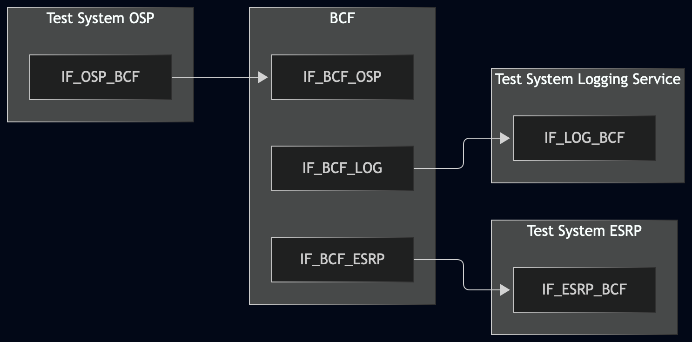
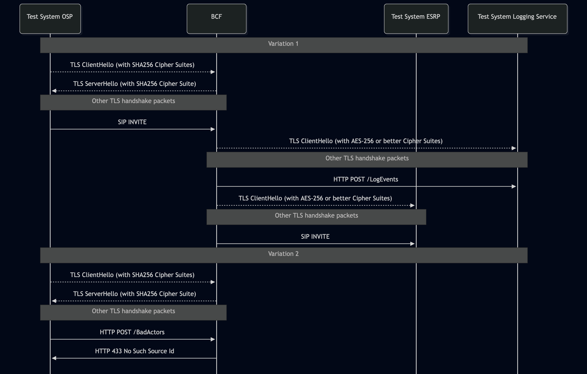

# Test Description: TD_BCF_010

<!-- Single TD exists - reuse for the rest of the group - TD_BCF_010 (from RQ_BCF_147 / BCF)
 Req IDs in Group - RQ_BCF_147, RQ_BRG_111, RQ_CHFE_329, RQ_ECRF-LVF_073, RQ_ESRP_133, RQ_LOG_188, RQ_PS_112 -->

## Overview
### Summary
SHA-256 support and using of AES-256 or better

### Description
This test case verifies: 
- support of SHA-256 by the BCF
- if BCF uses AES-256 or better towards ESInet for SIP signalling

### References
* Requirements : RQ_BCF_017, RQ_BCF_147
* Test Case    : TC_BCF_010

### Requirements
IXIT config file for BCF

## Configuration
### Implementation Under Test Interface Connections
<!-- Identify each of the FEs that are part of the configuration and how they are connected -->
* Test System (OSP)
  * IF_OSP_BCF - connected to BCF IF_BCF_OSP
* BCF
  * IF_BCF_OSP - connected to Test System IF_OSP_BCF
  * IF_BCF_ESRP - connected to Test System IF_ESRP_BCF
  * IF_BCF_LOG - connected to Test System Logging Service IF_LOG_BCF
* Test System (ESRP)
  * IF_ESRP_BCF - connected to IF_BCF_ESRP
* Test System Logging Service
  * IF_LOG_BCF - connected to IF_BCF_LOG

### Test System Interfaces
<!-- Identify each of the test system interfaces and whether it will be in active or monitor mode -->
* Test System (OSP)
  * IF_OSP_BCF - Active
* BCF
  * IF_BCF_OSP - Active
  * IF_BCF_ESRP — Active
  * IF_BCF_LOG — Active
* Test System (ESRP)
  * IF_ESRP_BCF - Active 
* Test System Logging Service
  * IF_LOG_BCF - Active 

 
### Connectivity Diagram
<!--
https://mermaid.live/edit#pako:eNp9UsFuwjAM_ZXI5wbRtCs0hx3GYJrEBKI7TZVQ1oa2Gk1QSDcY4t-XtFAo03az37OfX2IfIJEpBwoY41gkUqyKjMYCIZ3zklOUMvURi5pcreVXkjOl0XRhKxB6nixn0Xz5MJpgfG8SE1igJW0-nT01pAks0CHH0WLesDa60NvqPVNsk6NXvtUo2m81L1Gr3B3dYFykN60tdTXvVuJk8Bdm3fyle23pUndq7j7j_-apzLJCZCji6rNIeEen81lGBhzIVJEC1ariDpRclcymcLAlMdTbioGaUPG02mG7N5zItVQxxOJo-jdMvElZniWUrLIc6IqttyarNinT_LFgxmbZospM5mokK6GBesStRYAeYAcUu34vGBISeIHrh6E79IgDe6B3Bg6GLhm4fWIo4h8d-K7n9nth2A-IHwY-8QbE9RxglZbRXiRnUzwttFQvzUXWh3m2Nq6Zk7PjD2BczwI
-->




## Pre-Test Conditions

### Test System OSP
* Interfaces are connected to network
* Interfaces have IP addresses assigned by DHCP
* Device is active
* No active calls
* Test System OSP has its own certificate signed by PCA
* ng911 repository cloned to local storage

### BCF
* Interfaces are connected to network
* Interfaces have IP addresses assigned by DHCP
* Default configuration is loaded
* Device has configured `Test System ESRP` as a next hop
* Device is initialized with steps from IXIT config file
* Device is active
* Device is in normal operating state
* No active calls

### Test System ESRP
* Interfaces are connected to network
* Interfaces have IP addresses assigned by DHCP
* Device is active
* No active calls
* Test System ESRP has its own certificate signed by PCA
* ng911 repository cloned to local storage

### Test System Logging Service

* Interfaces are connected to the network.
* Interfaces have IP addresses assigned.
* ng911 repository cloned to local storage
* Wireshark[^2] is installed.
* (TLS) Generated own PCA-signed certificate and private key files (test_system.crt, test_system.key)
* (TLS) PCA certificate copied to local storage

## Test Sequence
### Test Preamble
#### Test System OSP
* Copy following XML scenario files to local storage:
  ```
    SIP_INVITE_from_OSP.xml
    sip_service_ssl_sha256.yaml
    http_service_ssl_sha256.yaml
  ```
* Install Wireshark[^2]
* Copy to local storage PCA-signed certificate and private key files:
```
  OSP-cacert.pem
  OSP-cakey.pem
```
* Copy to local storage PCA-signed certificate and private key files for BCF:
```
  BCF-cacert.pem
  BCF-cakey.pem
```
* Configure Wireshark to decode SIP over TLS packets[^3]

#### Test System ESRP
* Install SIPp by following steps from documentation[^1]
* Copy following XML scenario file to local storage:
  ```
  SIP_INVITE_RECEIVE.xml
  ```
* Install Wireshark[^2]
* Copy to local storage PCA-signed certificate and private key files:
```
  ESRP-cacert.pem
  ESRP-cakey.pem
```
* Configure Wireshark to decode SIP over TLS packets[^3]
* Using Wireshark on 'Test System ESRP' start packet tracing on IF_ESRP_BCF interface - run following filter:
     * (TLS transport)
       > ip.addr == IF_ESRP_BCF_IP_ADDRESS and tls
* Prepare 'Test System ESRP' to receive SIP message - run SIPp tool with following command:
     * (TLS transport)
       ```
       sudo sipp -t l1 -tls_cert ESRP-cacert.pem -tls_key ESRP-cakey.pem -sf SIP_INVITE_RECEIVE.xml -i 
       IF_ESRP_BCF_IP -p 5061 -trace_logs -trace_msg -timeout 10 -max_recv_loops 1 -m 999
       ```

#### Test System Logging Service
* (TLS v1.2) Configure Wireshark to decode HTTP over TLS, use tests system and BCF certificate keys [^3]
* (TLS v1.3) Configure logging of session keys and configure Wireshark to decode HTTP over TLS [^4]
* Using Wireshark on 'Test System' start packet tracing on IF_LOG_BCF interface - run following filter:
   * (TLS)
     > ip.addr == IF_LOG_BCF_IP_ADDRESS and tls
* The Logging Service must be configured to accept and process HTTP POST requests to the /LogEvents endpoint.
  To verify the Logging Service receiver manually, start http_entry.py using one of the commands below (TLS on port 4443 or TCP on port 8080), then send a test POST request to /LogEvents from another terminal:
    * Step 1 - Prepare logEventId and JSON body
      ```
      ID="urn:emergency:uid:logid:$(date +%s%N):logger.state.pa.us"
      BODY="{\"logEventId\":\"$ID\"}"
      ```
    * Step 2 - Run server:
      * (TLS)
      ```
      python3 http_entry.py --ip IF_LOG_BCF --port 4443 --role RECEIVER --path /LogEvents --method POST --body "$BODY" --content_type application/json --response_code 201 --server_cert /tmp/cert.crt --server_key /tmp/cert.key
      ```
    * Step 3 - In another terminal, send a POST request to verify it is working:
      * (TLS)
      ```
      curl -k -X POST https://IF_LOG_BCF:4443/LogEvents -d '{"log":"test"}'
      ```

### Test Body
#### Variations

1. SIP_over_TLS
2. HTTPS

#### Stimulus
- Send SIP INVITE to the BCF - run sip_service on Test System OSP, example:
  - Variation 1 (SIP_over_TLS)
    ```
       sudo python3 sip_entry.py --bind-ip IF_OSP_BCF_IP_ADDRESS --bind-port 5061 --remote-ip IF_BCF_OSP_IP_ADDRESS --remote-port 5061 --protocol TLS --scenario SIP_INVITE_from_OSP.xml --message-timeout 5000 --transaction-timeout 5000 --tls-cert OSP-cacert.pem --tls-key OSP-cakey.pem --ssl-config-file test_suite/services/stub_server/sip_service/config/sip_service_ssl_sha256.yaml
    ```
  - Variation 2 (HTTPS)
    ```
       sudo python3 http_entry.py --ip IF_OSP_BCF_IP_ADDRESS --port 8080 --role SENDER --path /BadActors --method POST --body test@ng911.example.com --server_cert OSP-cacert.pem --server_key OSP-cakey.pem --ssl-config-file test_suite/services/stub_server/http/config/http_service_ssl_sha256.yaml
    ```
- using Wireshark verify if Test System OSP starts SSL handshake with TLS ClientHello containing 'Cipher Suites' with SHA-256 only

#### Response
Using Wireshark verify:
- if BCF accepts SHA-256 - TLS ServerHello contains Cipher Suite with SHA-256
- if BCF uses AES-256 or better towards the ESInet:
  - TLS ClientHello from BCF to the ESRP contains Cipher Suites not worse than AES-256
  - TLS ClientHello from BCF to the Logging Service contains Cipher Suites not worse than AES-256

VERDICT:
* ERROR - if TLS ClientHello from Test System OSP does not contain Cipher Suites with SHA-256 only
* PASSED - if all checks passed for variation
* FAILED - other cases


### Test Postamble
#### Test System OSP
* stop all SIPp processes (if still running)
* stop Wireshark (if still running)
* archive traced packets in Wireshark
* archive all logs generated
* remove all SIPp scenarios
* disconnect interfaces from BCF
* (TLS transport) remove certificates

#### BCF
* disconnect IF_BCF_OSP
* disconnect IF_BCF_ESRP
* reconnect interfaces back to default

#### Test System ESRP
* stop all SIPp processes (if still running)
* stop Wireshark (if still running)
* archive traced packets in Wireshark
* remove certificate files
* disconnect interfaces from BCF
* (TLS transport) remove certificates


## Post-Test Conditions
### Test System OSP
* Test tools stopped
* interfaces disconnected from BCF

### BCF
* device connected back to default
* device in normal operating state

### Test System ESRP
* Test tools stopped
* interfaces disconnected from BCF


## Sequence Diagram
<!--
https://mermaid.live/edit#pako:eNrVlE1v2kAQhv_KaE-NZFNs82H2EIlQWpBoQLWVQ-XL1p6YFXiXrtc0BPHfu2tDQwpScuilF3_svO_Ms1-zJ6nMkFDium4iUikeeU4TAVBwpaQaplqqksIjW5doh_USC6SQMbVKRO0p8WeFIsVPnOWKFVYEsGFK85RvmNAwjxbASoix1BDtSo2FHbrU3Y0-W515XcbG0beLJHbsUjmbf_lbOJN5zkUOEaotT7HxNM97qRHkFpVFcqyZwgNTnGkuBXiNyIRc9_bWgFGIZxGM1hyFnuB6LeHDL66XEE2GfrcHI75ZmlRRxTWWN43ZuKzZ5GjMFgLVG-abq3Q1wFxblc20ZCIrl2yFZv7pCnX5QnuEjaYLmN4_TOPxK5Z6ltcnMhxHroWRCn6g1qbStTm9cJmMx1V7k8sWP9aexPECFvMoho9mb8ZbA1G-IrRb-08Rm4TvZGzE54v3nsPi_-eH5WxT7ljWXPzzVamhalEnCEw1Uzw1PLJSKcI0O90q4pBc8YxQrSp0SIGqYPaX7K0iIXUDSQg1nwqz6sm1rcRN5VqqhCTiYPzmHn-XsjilULLKl4TWLcgh1SZj-tRs_owqFBmqkayEJtTzBnUSQvfkidCwFXj9vhd6YdAO-m0T2xHq-r1WEHhhGHRDE_G7A__gkOe6bLs1GLR7fmfQ6_hB3_cCh7BKy2gn0hMTZtysz9emddYd9EQ2riNHsMNvJhWrCw
-->



## Comments

Version:  010.3f.5.1.2

Date:     20261007

## Footnotes
[^1]: SIPp - tool for SIP packet simulations. Official documentation: https://sipp.sourceforge.net/doc/reference.html#Getting+SIPp
[^2]: Wireshark - tool for packet tracing and anaylisis. Official website: https://www.wireshark.org/download.html
[^3]: Wireshark configuration to decrypt SIP over TLS packets: https://www.zoiper.com/en/support/home/article/162/How%20to%20decode%20SIP%20over%20TLS%20with%20Wireshark%20and%20Decrypting%20SDES%20Protected%20SRTP%20Stream
[^4]: TLS v1.3 session keys logging + Wireshark configuration to decrypt traffic: https://my.f5.com/manage/s/article/K50557518
