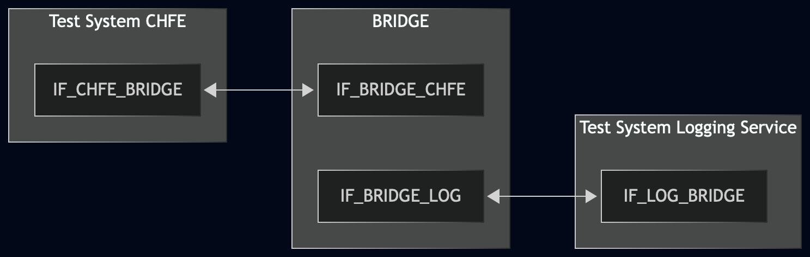
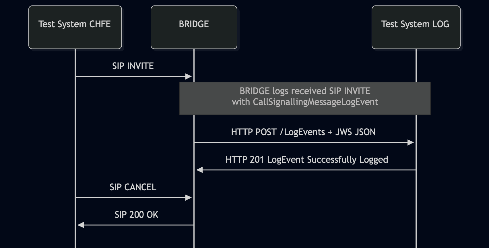

# Test Description: TD_BRIDGE_008

## Overview

### Summary

Validation of the LogEvents POST request properties sent by the BRIDGE.

### Description

Verifies BRIDGE's outgoing HTTP POST to `/LogEvents` if contains no request parameters and contains a JSON Web Signature (JWS) body.


### References

* Requirements : RQ_BRG_120
* Test Case : TC_BRIDGE_008 

### Requirements

IXIT config file for BRIDGE

### SIP/HTTP transport types
Test can be performed with 2 different SIP and HTTP transport types. Steps describing actions for specific one are marked as following:
- (TLS) - used by default inside ESInet on production environment
- (TCP) - used if default TLS is not possible

## Configuration

### Implementation Under Test Interface Connections

* Test System CHFE
  * IF_CHFE_BRIDGE - connected to IF_BRIDGE_CHFE
* BRIDGE
  * IF_BRIDGE_CHFE - connected to IF_CHFE_BRIDGE
  * IF_BRIDGE_LOG - connected to IF_LOG_BRIDGE
* Test System Logging Service
  * IF_LOG_BRIDGE - connected to IF_BRIDGE_LOG

### Test System Interfaces

* Test System CHFE
  * IF_CHFE_BRIDGE - Active
* BRIDGE
  * IF_BRIDGE_CHFE - Active
  * IF_BRIDGE_LOG - Active
* Test System Logging Service
  * IF_LOG_BRIDGE - Active

### Connectivity Diagram



<!--
https://mermaid.live/edit#pako:eNp9Ul1PgzAU_SvNfYZlFBjQGBPdl0tmTDaftGap0AFxtEspurnsv1tg-LGofWrPPef03PYeIJYJBwK2bVMRS7HOU0IFQkWulFRXsZaqJGjNNiWvYZ3xghOUMPVCRaOhYr2Rb3HGlEbzRc1BqKyeU8W2GRreTMaPFO55qdFyX2peNBCFp5ZYr9nEMZTZZFVXVteL2Wj6ReAiObM8Eb7JcStvC6tf_N0fhPnd9B97Uz0LPJdpmosULbl6zWN-5u213kb2Z3TTILqw7cs6aoe4HeJRARakKk-AaFVxCwquClYf4VCzKTRvToGYreJJtbPr17djuZGKAhVHo98y8SBl0VkoWaUZkObXLKi2CdN8lDPTYfGJKpOPq6GshAbiul5jAuQAOyCh13NDz8G-5-IAO4FvwR4IxlHPifoD38E4dB3sHS14b27t9wZRhH3fGYSeG0R-EFrAKi2XexF3mXiSm1m6baetGbou2bipnIIdPwBQn8VS
-->

## Pre-Test Conditions

### Test System CHFE, Test System Logging Service

* Interfaces are connected to the network.
* Interfaces have IP addresses assigned.
* Test systems are active.

### BRIDGE

* Interfaces are connected to the network.
* Interfaces have IP addresses assigned.
* IUT is active.
* IUT is in normal operating state.
* Default configuration is loaded.
* IUT is initialized using the IXIT config file, including the configured
  Logging Service endpoint.

## Test Sequence

### Test Preamble

#### Test System CHFE

* Install SIPp by following steps from documentation[^1]
* Install Wireshark[^2]
* Copy following XML scenario file to local storage:
  `SIP_INVITE_with_CANCEL.xml`
* Using Wireshark on 'Test System' start packet tracing on IF_CHFE_BRIDGE
  interface - run following filter:
   * (TLS)
     > ip.addr == IF_CHFE_BRIDGE_IP_ADDRESS and tls
   * (TCP)
     > ip.addr == IF_CHFE_BRIDGE_IP_ADDRESS and sip

#### Test System Logging Service

* Ensure the project repository is available on Test System Logging Service. Run the repository-relative commands below from the repository root.
* For the current HTTP/TCP lab mapping, prepare a valid LogEvents response body:

  ```
  mkdir -p /tmp/BRIDGE_008
  ID="$(python3 -c 'import uuid; print(uuid.uuid4().hex)')"
  printf '{"logEventId":"urn:emergency:uid:logid:%s:test.example"}\n' "$ID" > /tmp/BRIDGE_008/logeventid.json
  ```

* Start the Logging Service receiver with the two routes required by the current BCF test environment:

  ```
  python3 test_suite/services/stub_server/http/http_entry.py \
    --ip IF_LOG_BRIDGE_IP_ADDRESS \
    --port 8080 \
    --role RECEIVER \
    --path '["/LogEvents","/Versions"]' \
    --method '["POST","GET"]' \
    --response_code '["201","200"]' \
    --body '["file./tmp/BRIDGE_008/logeventid.json","file.test_suite/test_files/JSON/versions/Logging_Service_Versions_object_example_v010.3f.5.0.0.json"]' \
    --content_type application/json
  ```

* Install Wireshark[^2].
* Using Wireshark on 'Test System' start packet tracing on IF_LOG_BRIDGE
  interface - run following filter:
   * (TLS)
     > ip.addr == IF_LOG_BRIDGE_IP_ADDRESS and tls
   * (TCP)
     > ip.addr == IF_LOG_BRIDGE_IP_ADDRESS and sip

### Test Body

#### Stimulus

Simulate a basic emergency call from Test System CHFE to BRIDGE using the existing SIPp scenario. Example SIPp command:

* (TCP transport)
  ```
  sudo sipp -t t1 -sf SIP_INVITE_with_CANCEL.xml -i IF_CHFE_BRIDGE -p 5060 -m 1 IF_BRIDGE_CHFE:5060
  ```
* (TLS transport)
  ```
  sudo sipp -t l1 -sf SIP_INVITE_with_CANCEL.xml -tls_cert cacert.pem -tls_key cakey.pem -i IF_CHFE_BRIDGE -p 5061 IF_BRIDGE_CHFE_IPv4:5061
  ```

#### Response

Using Wireshark, verify the LogEvent request messages sent by the BRIDGE to IF_LOG_BRIDGE:

* the HTTP method is `POST`;
* the request URI contains the configured `.../LogEvents` entry point;
* the request target URI contains no request parameters or query component. Example of a failing URI:
  ```
  IF_LOG_BCF:8080/api/LogEvents?param=test
  ```
* the request contains a valid JWS JSON body containing the following members:
  * `"protected"` or `"header"` - with a Base64Url-encoded value;
  * `"payload"` - with a Base64Url-encoded value;
  * `"signature"` - with a Base64Url-encoded value or an empty string for an unsigned JWS.

VERDICT:

* ERROR - if the stimulus SIP INVITE message was not sent from Test System CHFE to BRIDGE.
* PASSED - if all recorded LogEvent requests sent by the BRIDGE pass all checks.
* FAILED - any other cases.

### Test Postamble

#### Test System CHFE, Test System Logging Service

* Stop all SIPp / HTTP mock server processes if still running.
* Archive generated logs.
* Stop packet capture.
* Disconnect test interfaces.

#### BRIDGE

* Restore the default interface configuration.

## Post-Test Conditions

### Test System CHFE, Test System Logging Service

* Test tools are stopped.
* Test interfaces are disconnected.

### BRIDGE

* Device is connected back to the default configuration.
* Device is in normal operating state.

## Sequence Diagram




<!--
https://mermaid.live/edit#pako:eNp1UmFvmzAU_CtP_jrIggMJWFOkjmZtujSJRrRJE188eCHWwM6MyZpF-e8zUKaq2z4Zznf3znp3IZnKkTDium4qMyX3omCpBKiE1krfZEbpmsGelzW2sDlghQxyrr-nstPU-KNBmeGt4IXmVUsCOHJtRCaOXBqI7z8sgNeww9pAcq4NVh32N_P9p-Xt3T_w1ebutYGFUtkzWy93Pu_FDJLlFpbrz8vds9FaGQR1Qt1qnIHVn1CqogaNGYoT5i-k777pOfwU5gAxL8tEFNIeQhaPWNe8wJUqFieUpp_Qe9kIdgCD-91uC9tNsoO3A62GN_DwJYGHZLPuJZb5InInoWMPBgEkTZbZUfumLM8tWmD-38fGN-t4sXoVpeX113Q8hs1H4pBCi5wwoxt0SIW64u0vubTClHR7TQmznxrz5sltN-xmqlQ6Jam8Wr1dxVelqsFCq6Y4ENY1wyHNMedm6MAfVKPMUceqkYawIAo7E8Iu5Imw0B9NQt-jgT-hM-rNAoecCaM0GnnReBp4lIYTj_pXh_zqpo5H0yiiQeBNQ38yi4KZdeONUclZZkMmzIXt62Pf6K7YQ7JFd_Mc7PobWTXrHg
-->

## Comments

Version:  010.3f.5.0.0
Date:     20260924

## Footnotes
[^1]: SIPp - tool for SIP packet simulations. Official documentation: https://sipp.sourceforge.net/doc/reference.html#Getting+SIPp
[^2]: Wireshark - tool for packet tracing and analysis. Official website: https://www.wireshark.org/download.html
[^3]: WireMock - tool for simulating HTTP-based APIs. Official website: https://wiremock.org/
