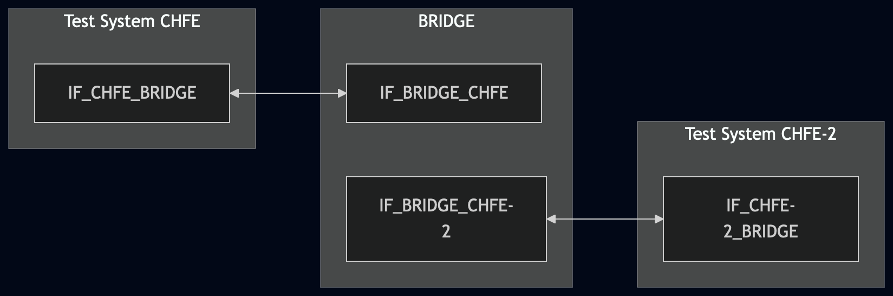
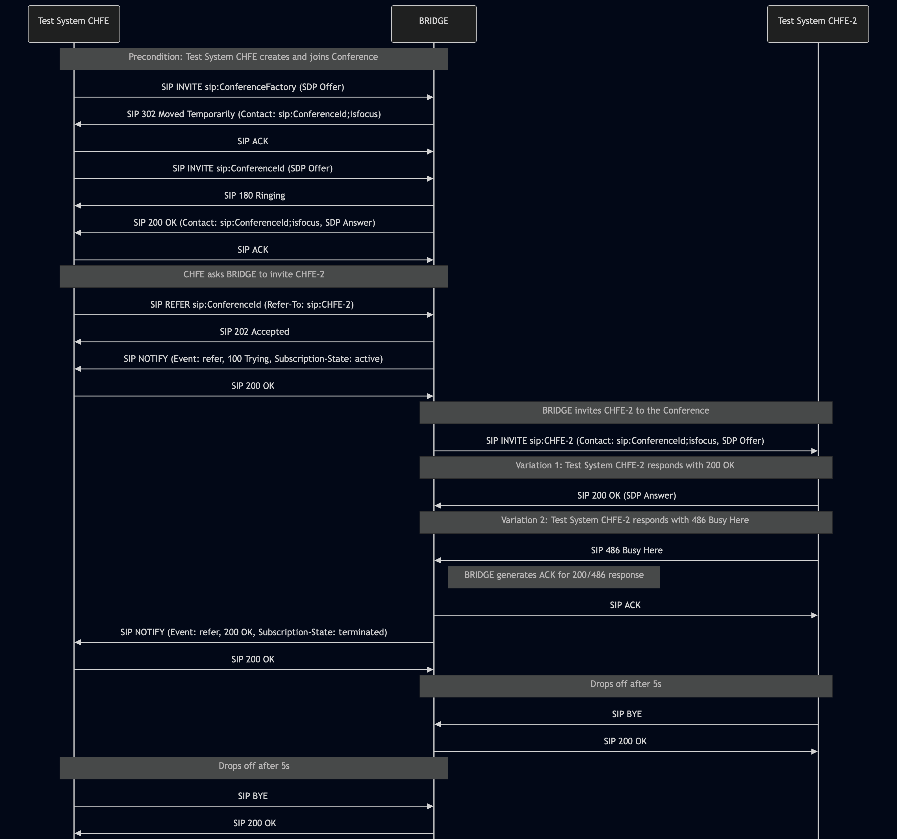
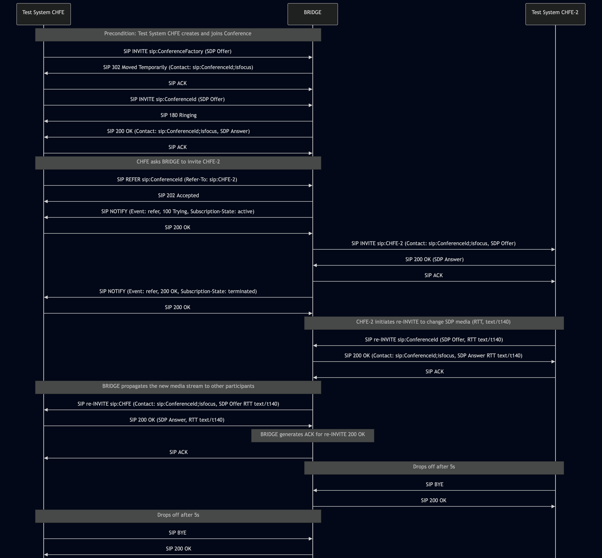

# Test Description: TD_BRIDGE_010

## Overview
### Summary
SIP ACK handling

### Description
This test verifies that: 
- the BRIDGE use the ACK request to acknowledge the completion of a request. It ensures the BRIDGE correctly sends an ACK for a 2XX series response as part of a three-way handshake, as well as for a non-2XX response.
- the BRIDGE properly handles conference session updates within an established dialog by sending an ACK request.

### References
* Requirements : RQ_BRG_147
* Test Case : TC_BRIDGE_010

### Requirements
IXIT config file for BRIDGE

### SIP transport types
Test can be performed with SIP transport. Steps describing actions for specific one are marked as following:
- (TLS) - used by default inside ESInet on production environment
- (TCP) - used if default TLS is not possible

## Configuration
### Implementation Under Test Interface Connections
* Test System CHFE
  * IF_CHFE_BRIDGE - connected to IF_BRIDGE_CHFE
* BRIDGE
  * IF_BRIDGE_CHFE - connected to IF_CHFE_BRIDGE
  * IF_BRIDGE_CHFE-2 - connected to IF_CHFE-2_BRIDGE
* Test System CHFE-2
  * IF_CHFE-2_BRIDGE - connected to IF_BRIDGE_CHFE-2

### Test System Interfaces
* Test System CHFE
  * IF_CHFE_BRIDGE - Active
* BRIDGE
  * IF_BRIDGE_CHFE - Active
  * IF_BRIDGE_CHFE-2 - Active
* Test System CHFE-2
  * IF_CHFE-2_BRIDGE - Active

### Connectivity Diagram



<!--
https://mermaid.live/edit#pako:eNqNUltrgzAY_SvygfiixUu1GsYe1stW2F7aPY1AyTStUk1KjKyd-N-Xau2kZbA8hHznnJzv5FJDzBMKCHS9zlgmkVYbMqUFNZBmJETsDVPDkHO-x4AwxDkpyyzG0DS6jtk2519xSoTUXleYaWosF5vpy2K-eVotZ8_zB8t6VEhXtMRVNcAs96LrigvVKbu5rD53ghxS7Z2WUlufSkkL7dfuvnGHU5ZgduMw5O-j_IVb7sDxH7l6_SDZzcGUE5iwE1kCSIqKmlBQUZBzCfVZgqF9B3XtailoUh2t83tYMc-5wIBZo_YfCPvgvOgtBK92KaAtyUtVVYeESDrLiMpYXFGhOlMx5RWTgHyn9QBUwxFQ4I-CcOLYjhM6E8-zFXkC5HjRKAjcseO4duTbkdeY8N02tUeRG_qR7XqhHY09NwpNIJXk6xOL-0g0ySQXb90na_9aH2zeMpdczQ_f_79t
-->

## Pre-Test Conditions

### Test System CHFE, Test System CHFE-2
* Interfaces are connected to network
* Interfaces have IP addresses assigned by DHCP
* Device is active
* ng911 repository cloned to local storage
* (TLS) Generated own PCA-signed certificate and private key files (test_system.crt, test_system.key)
* (TLS) Certificate and key used by BRIDGE copied to local storage
* (TLS) PCA certificate copied to local storage
 
### BRIDGE
* Interfaces are connected to network
* Interfaces have IP addresses assigned by DHCP
* Device is active
* Device is in normal operating state
* IUT is initialized using IXIT config file
* IUT supports Real-Time Text
* No active calls


## Test Sequence
### Test Preamble

#### Test System CHFE
* Install SIPp by following steps from documentation[^1]
* Copy following XML scenario files to local storage:
```
  CHFE_BRIDGE_010_var_1_var_2.xml
  CHFE_BRIDGE_010_var_3.xml
```
* Install Wireshark[^2]
* (TLS v1.2) Configure Wireshark to decode SIP over TLS, use tests system and IUT certificate keys [^3]
* (TLS v1.3) Configure logging of session keys and configure Wireshark to decode SIP over TLS [^4]
* Using Wireshark on 'Test System' start packet tracing on IF_CHFE_BRIDGE interface - run following filter:
   * (TLS)
     > ip.addr == IF_CHFE_BRIDGE_IP_ADDRESS and tls
   * (TCP)
     > ip.addr == IF_CHFE_BRIDGE_IP_ADDRESS and sip


#### Test System CHFE-2
* Install SIPp by following steps from documentation[^1]
* Copy following XML scenario files to local storage:
```
  CHFE-2_BRIDGE_010_var_1.xml
  CHFE-2_BRIDGE_010_var_2.xml
  CHFE-2_BRIDGE_010_var_3.xml
```
* Install Wireshark[^2]
* (TLS v1.2) Configure Wireshark to decode SIP over TLS, use tests system and IUT certificate keys [^3]
* (TLS v1.3) Configure logging of session keys and configure Wireshark to decode SIP over TLS [^4]
* Using Wireshark on 'Test System' start packet tracing on IF_CHFE-2_BRIDGE interface - run following filter:
   * (TLS)
     > ip.addr == IF_CHFE-2_BRIDGE_IP_ADDRESS and tls
   * (TCP)
     > ip.addr == IF_CHFE-2_BRIDGE_IP_ADDRESS and sip

* (Variation 1) Prepare to receive the SIP INVITE generated by BRIDGE and respond with `SIP 200 OK` using the XML scenario above. 
Subsequently, it must verify the receipt of a SIP ACK from the BRIDGE (CHECK 1) and gracefully terminate the session by sending a SIP BYE.

Use scenario file: `CHFE-2_BRIDGE_010_var_1.xml`

* (Variation 2) Prepare to receive the SIP INVITE generated by BRIDGE and respond with `SIP 486 Busy Here` using the XML scenario above.
Subsequently, it must verify the receipt of a SIP ACK from the BRIDGE (CHECK 2) for the non-2XX response

Use scenario file: `CHFE-2_BRIDGE_010_var_2.xml`

* (Variation 3) Using the XML scenario prepare to receive the SIP INVITE generated by BRIDGE and respond with SIP 200 OK (audio only) to rejoin the conference. 
Subsequently, initiate a SIP re-INVITE to the BRIDGE adding a Real-Time Text (RTT) media stream. 
Upon receiving a SIP 200 OK response (and verifying the m=text port is non-zero), acknowledge it by sending a SIP ACK.

Use scenario file: `CHFE-2_BRIDGE_010_var_3.xml`

* Run SIP Service process,replace {XML_SCENARIO_FILE} with the right XML file path depending on current variation:
  * (TLS transport)
    >  sudo python3 test_suite/services/stub_server/sip_service/sip_entry.py \
  --scenario {XML_SCENARIO_FILE} \
  --scenario-type auto \
  --bind-ip {IF_CHFE-2_BRIDGE} --bind-port 5061 \
  --remote-ip {IF_BRIDGE_CHFE-2} --remote-port 5061 \
  --tls-cert {CHFE-2_CERT_FILE_PATH} --tls-key {CHFE-2_KEY_FILE_PATH} \
  --tls-ca {PCA_CERT_FILE_PATH} \
  --set CHFE2_tel {CHFE2_tel_number} \
  --protocol TLS

  * (TCP transport)
    > sudo python3 test_suite/services/stub_server/sip_service/sip_entry.py \
  --scenario {XML_SCENARIO_FILE}\
  --scenario-type auto \
  --bind-ip {IF_CHFE-2_BRIDGE} --bind-port 5060 \
  --remote-ip {IF_BRIDGE_CHFE-2} --remote-port 5060 \
  --set CHFE2_tel {CHFE2_tel_number} \
  --protocol TCP

### Test Body
#### Variations

1. Adding participant to the conference with 200 OK response, Use XML scenario file:

`CHFE_BRIDGE_010_var_1_var_2.xml`

2. Adding participant to the conference with 4xx error response, Use XML scenario file:

`CHFE_BRIDGE_010_var_1_var_2.xml`

3. Conference media update, Use XML scenario file:

`CHFE_BRIDGE_010_var_3.xml`

#### Stimulus

Run SIP Service scenario depending on current variation (replace {XML_SCENARIO_FILE} with the XML file path):
  * (TLS transport)
    >  sudo python3 test_suite/services/stub_server/sip_service/sip_entry.py \
  --scenario {XML_SCENARIO_FILE} \
  --scenario-type auto \
  --bind-ip {IF_CHFE_BRIDGE} --bind-port 5061 \
  --remote-ip {IF_BRIDGE_CHFE} --remote-port 5061 \
  --tls-cert {CHFE_CERT_FILE_PATH} --tls-key {CHFE_KEY_FILE_PATH} \
  --tls-ca {PCA_CERT_FILE_PATH} \
  --set CHFE_tel {CHFE_tel_number} \
  --set IF_CHFE2_BRIDGE {IF_CHFE-2_BRIDGE} \
  --protocol TLS

  * (TCP transport)
    >  sudo python3 test_suite/services/stub_server/sip_service/sip_entry.py \
  --scenario {XML_SCENARIO_FILE} \
  --scenario-type auto \
  --bind-ip {IF_CHFE_BRIDGE} --bind-port 5060 \
  --remote-ip {IF_BRIDGE_CHFE} --remote-port 5060 \
  --set CHFE_tel {CHFE_tel_number} \
  --set IF_CHFE2_BRIDGE {IF_CHFE-2_BRIDGE} \
  --protocol TCP
    
1. The Test System CHFE will create and join the conference on the BRIDGE
2. Test System CHFE will send SIP REFER to BRIDGE to request adding Test System CHFE-2 to the conference
3. BRIDGE should invite Test System CHFE-2 to the conference
4. (Variation 1) Test System CHFE-2 should accept incoming INVITE with 200 OK what should end with SIP ACK sent by the BRIDGE
5. (Variation 2) Test System CHFE-2 should reject incoming INVITE with 486 Busy Here what should end with SIP ACK sent by the BRIDGE
6. (Variation 3) Test System CHFE-2 should accept and join the conference. After a while it should send re-INVITE changing SDP media (audio->text). BRIDGE should accept the re-INVITE and send separate re-INVITE to Test System CHFE which after 200 OK response should end with SIP ACK sent by the BRIDGE
7. After a while Test System CHFE-2 should drop off the conference by sending SIP BYE

#### Response
Using Wireshark verify if: 
- (Variation 1, Variation 2) The BRIDGE sends a SIP ACK towards Test System CHFE-2 after receiving 200/486 response for SIP INVITE sent
- (Variation 3) The BRIDGE sends a SIP ACK towards Test System CHFE after receiving 200 OK response for SIP re-INVITE sent
- outgoing SIP ACK:
  * (Variation 1, Variation 3) has the Request-URI set to the URI found in the `Contact` header field of the received SIP 200 OK response;
  * (Variation 2) has the Request-URI set to the same URI used in the Request-URI of the corresponding SIP INVITE;
  * (Variation 1, Variation 3) has a `Via` header field containing a newly generated `branch` parameter that is different from the one used in the corresponding SIP INVITE, as it constitutes a separate transaction;
  * (Variation 2) has a Via header field containing the exact same branch parameter as the one used in the corresponding SIP INVITE, as it is part of the same client transaction;
  * has a `From` header field matching the `From` header field of the corresponding SIP INVITE;
  * has a `To` header field matching the `To` header field of the received SIP 200/486 response, including the `tag` parameter;
  * has a `Call-ID` header field matching the `Call-ID` of the corresponding SIP INVITE;
  * has a `CSeq` header field with the method set to `ACK` and the sequence number matching the `CSeq` number of the corresponding SIP INVITE;
  * contains a `Max-Forwards` header field.
  * (optional)(Variation 2) if the corresponding SIP INVITE has a `Route` header field, then outgoing SIP ACK must contain its exact copy


VERDICT:

* PASSED - if all checks passed
* FAILED - any other cases

#### Example


(Variation 1) Example transaction:
```
INVITE sip:CHFE-2@192.168.1.10:5060 SIP/2.0 
Via: SIP/2.0/TCP 192.168.1.20:5060;branch=z9hG4bK-inv-11111 
From: sip:conference@192.168.1.20;tag=bridge-tag-1 
To: sip:CHFE-2@192.168.1.10 
Call-ID: call-12345@192.168.1.20 
CSeq: 1 INVITE 
Contact: sip:conference-contact@192.168.1.20:5060;isfocus 
Call-Info: urn:emergency:uid:callid:123ABCdefg123ABCdefg123ABCdefg12:test.com;purpose=emergency-CallId 
Call-Info: urn:emergency:uid:incidentid:123ABCdefg123ABCdefg123ABCdefg12:test.com;purpose=emergency-IncidentId 
Max-Forwards: 70 
Content-Type: application/sdp 
Content-Length: ... 
(SDP Offer)

SIP/2.0 200 OK 
Via: SIP/2.0/TCP 192.168.1.20:5060;branch=z9hG4bK-inv-11111 
From: sip:conference@192.168.1.20;tag=bridge-tag-1 
To: sip:CHFE-2@192.168.1.10;tag=chfe2-tag-1 
Call-ID: call-12345@192.168.1.20 
CSeq: 1 INVITE 
Contact: sip:CHFE-2-contact@192.168.1.10:5060 
Content-Type: application/sdp 
Content-Length: ...
(SDP Answer)

ACK sip:CHFE-2-contact@192.168.1.10:5060 SIP/2.0
Via: SIP/2.0/TCP 192.168.1.20:5060;branch=z9hG4bK-ack-22222
From: sip:conference@192.168.1.20;tag=bridge-tag-1
To: sip:CHFE-2@192.168.1.10;tag=chfe2-tag-1
Call-ID: call-12345@192.168.1.20
CSeq: 1 ACK
Max-Forwards: 70
```

(Variation 2) Example transaction:
```
INVITE sip:CHFE-2@192.168.1.10:5060 SIP/2.0 
Via: SIP/2.0/TCP 192.168.1.20:5060;branch=z9hG4bK-inv-11111
Route: <sip:192.168.1.20;lr>
From: sip:conference@192.168.1.20;tag=bridge-tag-1 
To: sip:CHFE-2@192.168.1.10 
Call-ID: call-12345@192.168.1.20 
CSeq: 1 INVITE 
Contact: sip:conference-contact@192.168.1.20:5060;isfocus 
Call-Info: urn:emergency:uid:callid:123ABCdefg123ABCdefg123ABCdefg12:test.com;purpose=emergency-CallId 
Call-Info: urn:emergency:uid:incidentid:123ABCdefg123ABCdefg123ABCdefg12:test.com;purpose=emergency-IncidentId 
Max-Forwards: 70 
Content-Type: application/sdp 
Content-Length: ... 
(SDP Offer)

SIP/2.0 486 Busy Here
Via: SIP/2.0/TCP 192.168.1.20:5060;branch=z9hG4bK-inv-11111 
From: sip:conference@192.168.1.20;tag=bridge-tag-1
To: sip:CHFE-2@192.168.1.10;tag=chfe2-tag-2
Call-ID: call-67890@192.168.1.20
CSeq: 1 INVITE

ACK sip:CHFE-2@192.168.1.10:5060 SIP/2.0
Via: SIP/2.0/TCP 192.168.1.20:5060;branch=z9hG4bK-inv-11111
Route: <sip:192.168.1.20;lr>
From: sip:conference@192.168.1.20;tag=bridge-tag-1 
To: sip:CHFE-2@192.168.1.10;tag=chfe2-tag-2
Call-ID: call-67890@192.168.1.20
CSeq: 1 ACK
Max-Forwards: 70
```

(Variation 3) Example transaction:
```
INVITE sip:CHFE-contact@192.168.1.30:5060 SIP/2.0
Via: SIP/2.0/TCP 192.168.1.20:5060;branch=z9hG4bK-reinv-33333
From: sip:conference@192.168.1.20;tag=bridge-tag-3
To: sip:CHFE@192.168.1.30
Call-ID: chfe-call-55555@192.168.1.30
CSeq: 3 INVITE
Contact: sip:conference-contact@192.168.1.20:5060;isfocus
Max-Forwards: 70
Content-Type: application/sdp
Content-Length: ...
(SDP body with m=text)

SIP/2.0 200 OK
Via: SIP/2.0/TCP 192.168.1.20:5060;branch=z9hG4bK-reinv-33333
From: sip:conference@192.168.1.20;tag=bridge-tag-3
To: sip:CHFE@192.168.1.30;tag=chfe-tag-1
Call-ID: chfe-call-55555@192.168.1.30
CSeq: 3 INVITE
Contact: sip:CHFE-contact@192.168.1.30:5060
Content-Type: application/sdp
Content-Length: ...
(SDP body with the port to m=text)

ACK sip:CHFE-contact@192.168.1.30:5060 SIP/2.0
Via: SIP/2.0/TCP 192.168.1.20:5060;branch=z9hG4bK-ack-44444
From: sip:conference@192.168.1.20;tag=bridge-tag-3
To: sip:CHFE@192.168.1.30;tag=chfe-tag-1
Call-ID: chfe-call-55555@192.168.1.30
CSeq: 3 ACK
Max-Forwards: 70
```

### Test Postamble

#### Test System CHFE, Test System CHFE-2

* Stop all SIPp processes if still running
* Stop the SIP service process started by `sip_entry.py` if still running
* Archive generated logs
* Stop packet capture
* Disconnect test interfaces

#### BRIDGE

* Restore the default interface configuration

## Post-Test Conditions

### Test System CHFE, Test System CHFE-2

* Test tools are stopped
* Test interfaces are disconnected

### BRIDGE

* Device is connected back to the default configuration
* Device is in normal operating state

## Sequence Diagram

Variation 1 and 2



<!--
https://mermaid.live/edit#pako:eNqlVu9v2jAQ_VdOnhCtlHQkQABPqkRbuqKqPwSoUqd8yRIDXsHObKctQ_zvuySkpYMwpkn5kFzO7949P-eyJKGMGKHEtm1fhFKM-YT6AmDOlZKqGxqpNIVxMNPMF1lSpbLkghsKy6qZsjmrUqhGgXqqWuCTmZRPPqE-CWeB1jz0yWpVqfjCF5r9TJgI2QUPJiqYpzUAKhW47EEcKMNDHgfC6Dy-EYHzK0wJNIyYNjBcaMPmWWw782zQv_ia5eZ3u7HcXWC2m3JM02-lYSCfmcri1hqKwr1iKE_EDZeCbq2HULHAMA2BiOCH5ELDOYrJVNpyDpyVOT0t8Ib9e-jfPvRHPdA8pu_Zl0Eq-gKOhhf3cDfG6HEOkK9EiBQpB6jXXLhBshESmsdSBYrPcCWCGUShfyD3o0_NzheuxzJM9HEpq-75dSHGoZz70UF0nXYNBlxM8CrNcWs1uLs-rAcL0qJdoV_equ7vp2xz1x57KpwDRgIXzxyzC3eUgA96l73BDjUGDB_skVzzz0CO9zTtQjcMWWxYVJp0ezfqXz7CUe-ZCdRFpRUscFCvkVqgpKhG8l2HisepR-2hQUNSQA35MytXJ9d7W6A8x8qPDC10yUXRa1VSmfAbsGX1D-Tdbd_ki_9hizd9VUrxAd0fpK2DQ3cccBRMx3iCNbxwM33ru5DF3alLbusPDjugvntA_Ubbg7NEL-AKuy6nsSNtg4bik6kBOX4z8nqbJkwwlX2P0Pwwlipt53OKlZPQezYqOy7vdQ42Yi7YbhMapuZc4G3030a8UDLW2PIYgjHCQlNDuXpnj73yRjcdsK_oX2oeVHJXi8QiE8UjQo1KmEXmqFGQPpJl-t4n2XTFYYq3ikXJq51OWTuUM6l84osVrseh9k3KeQGhZDKZEppNa4skcYSKr-ftWxSPWMTUuUyEIdRttGoZCqFL8kqo4zknnluvdzyv1XGaTtMiC0LtjnfS6NTqdc_x3IbbbLVXFvmV1XVOam7baXqdTrPVqtedZsMiQWLkcCHCghXDoSnVTf6fkf1uFNx62Zs1tdVvZoOMVg
-->

Variation 3



<!--
https://mermaid.live/edit#pako:eNqdVn9v2kgQ_SqjPaEkkk3B_HBx1Uo0IXdW1SQCLlJP_mdrL2QveJfuLmk4xHe_2TVQWmxCGhFpvTv7ZubNG3tWJJUZIxHxfT8RqRQTPo0SAZBzpaTqp0YqHcGEzjRLhDOq1VZccBPB6sw8sJydRXCWUfV45kFCZlI-JiRKSDqjWvM0Iet1rZaIRGj2bcFEyq44nSqaWx8Ac6oMT_mcCgOXf10PgGoYM21gtNSG5W7v0PLjML7609kWq3KsoAzMD2ws1rxWg3q9Dud3imHaGTdcCg_uqeLULqHpARXZ3kYAiuWUC8CsQdOcXViAPbj3J__trtz3h3F_HN_eQCuCS2SfKcsR_D3PqGFwrpgf39zH48HFb3u5kQgkn5hy-XsbyiLYzzs64AlSxTAC7Tj4V3Kh98IrgB2dHz5s8UbxHRSxgubz6If1NbUiWsL56OoObie4u0mmuIkQFqkAaDUC-IzBZhhQPpcKyZ_hTQQziBL9ghxnf3R677ieyHShLyqj6l9-2lbp1Jjj7KRwm28bMORiir9Km6DRgNtPp-XggXXaF_r7zuvxfKqKu-mlx22HgJHAxRNH66IL7OVKB8PB9WBYwsiQ4YM_lpscHNDFkcQD6KcpmxuWVRrd3I7j6y9wPnhiArlR1oMHTeRsrJZIKzKy-KpTxedWp_7IoCgjQB75E6tmqOC8xGlwWPOCjleUZ18TDrPUeaGfn0pZFomr5au4KeDLeTFM5VzgMnuZmzIBBT8rCHmxb3ruXgS7V5HVUvpAxZQ5OnKWcYraGI899P9s3phmu3GEnh84R1rOA8Q7gCsj8Hfbq9RBWbyl3VYYeFAUa9NjcyXndOrIsp8Iwb5vyNEGX6a55U3igdr_UunK6v_Ck23o14q0MscXFXvIfzkDu9ynTDDlUke-YCLVXvyV3XgiwVjpK6RWg5xMgE5Q5NDRUF2xj18GL-mlOD9e1aM-T3JZ1nDEI1PFMxIZtWAeybFjqX0kK3ueEDdS4QSFS8WyxbNvRys_lTOpEpKINd5H3fwjZb6FUHIxfSCRG9E8snCTw2bI2u2iTDKmLuVCGBI1ez0HQqIVecbHsFNvh2G31-5022G718TTJW53w3qj02za_Qb-t9ce-c-5bdTDMGh3e91WLwzfNlthyyN0YeRoKdJtUKh7_Oh_LmZLN2JuQxu4k01k6_8BNWwZMQ
-->

## Comments

Version:  010.3f.5.0.0

Date:     20261102

## Footnotes
[^1]: SIPp - tool for SIP packet simulations. Official documentation: https://sipp.sourceforge.net/doc/reference.html#Getting+SIPp

[^2]: Wireshark - tool for packet tracing and analysis. Official website: https://www.wireshark.org/download.html

[^3]: Wireshark configuration to decrypt TLS packets: https://www.zoiper.com/en/support/home/article/162/How%20to%20decode%20SIP%20over%20TLS%20with%20Wireshark%20and%20Decrypting%20SDES%20Protected%20SRTP%20Stream

[^4]: TLS v1.3 session keys logging + Wireshark configuration to decrypt traffic: https://my.f5.com/manage/s/article/K50557518
