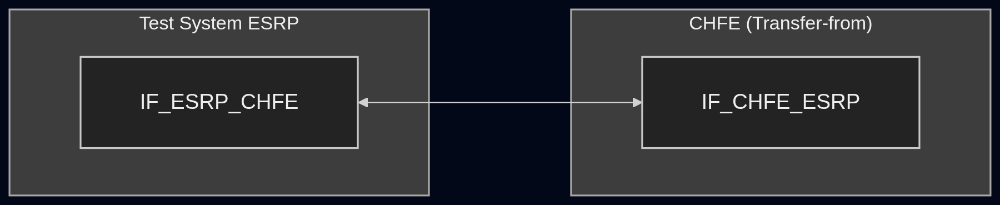
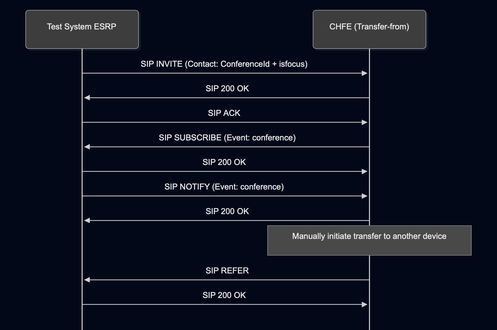

# Test Description: TD_CHFE_019

## Overview

### Summary

Refer-To 'serviceurn' parameter.

### Description

This test verifies that when the CHFE performs a call transfer, the SIP REFER generated by the CHFE contains a suitable service URN in the `serviceurn` header parameter of the `Refer-To` header field.

The test uses the Route All Calls Via a Conference-aware UA transfer model to establish an observable transfer flow. Test System ESRP acts as the Conference-aware UA for this test.

### References

* Requirements : RQ_CHFE_281
* Test Case    : n/a

### Requirements

Implementation eXtra Information for Testing (IXIT) config file for CHFE.

### SIP transport types

Test can be performed with 2 different SIP transport types. Steps describing actions for a specific transport are marked as follows:

- (TLS) - should be used by default
- (TCP) - used in the lab for testing purposes only if default TLS is not possible

## Configuration

### Implementation Under Test Interface Connections

* Test System ESRP
  * IF_ESRP_CHFE - connected to CHFE IF_CHFE_ESRP

* CHFE (Transfer-from)
  * IF_CHFE_ESRP - connected to Test System ESRP IF_ESRP_CHFE

### Test System Interfaces

* Test System ESRP
  * IF_ESRP_CHFE - Active

* CHFE (Transfer-from)
  * IF_CHFE_ESRP - Active

### Connectivity Diagram

<!--
https://mermaid.live/edit#pako:eNqlU1Fr2zAQ_itCednAHklKSmbGYGsbOtjDqMNelhEU6ZyIyJI5yW28kv_ek505zlbYw3QP4b7v8913F-mZS6eAZ7ww7knuBAb29WFlV5bR8fVmi6Lasbv84duPFV-CDyxvfICyhVb8ZyeM58tiHbH1zf3ijrTDtNeBVX_VPunjD3uzRGF9AZgW6Mq3f9aPmvXJyzB9rf6wP_uQph8vCvxWSSO8v4WC6UJIYIU2JhtNr2IkPqDbQzaS8xinNH3SKuyyybtZdUikMw6zEbQnKZwNqde_IJvMq8NFhws3ydBI17hfSmgMtKs9WblSMXor4n2Mf1oZFmvn_79iPOElYCm04tkzDzso44VRAvfEtOl3gVpsDPgoiHtYiFKbhlSfiDAJuwfzCEFLkTBP_3DqAXVBX0dtTisj5eS6OhCyEXK_RVdbasZH49l4M5kTXKEuBTY30VkkulnOxBIOoSc742fys0MF2NPd4EQbbaFH1TgGoR6ks2rYrLsQcVjAoF9hjsn5_cQVyBof40yxgUD60NIjyyshtd3y7HqccLrn-x6YTAmphFJtNp0dqZ6og8sbK3kWsIaE15USAW61oFdTduDxBVHZMbs
-->



## Pre-Test Conditions

### Test System ESRP

* Interface is connected to the network.
* Interface has an IP address assigned.
* Device is active.
* ng911 repository cloned to local storage
* (TLS) Required PCA-signed certificates, private keys and PCA certificate are available.
* (TLS) Matching TLS decryption material appropriate for the negotiated session is available to the packet-capture setup.

### CHFE (Transfer-from)

* Interface is connected to the network.
* Interface has an IP address assigned.
* IUT is active and in normal operating state.
* IUT is initialized using the IXIT config file.
* Test System ESRP is configured as the ESRP used for the test.
* An agent is logged in.
* The IUT is able to accept and answer the incoming test call.
* No active calls

## Test Sequence

### Test Preamble

#### Test System ESRP

* Install Wireshark[^2].
* Copy the TD-specific SIP Service scenario `ESRP_CHFE_019.xml` to local storage.
* (TLS v1.2) Configure Wireshark to decode HTTP over TLS, use tests system and FE certificate keys [^3]
* (TLS v1.3) Configure logging of session keys and configure Wireshark to decode SIP over TLS [^4]
* Start packet capture on the interface connected to CHFE:
  * (TLS)

    `ip.addr == IF_ESRP_CHFE_IP_ADDRESS and tls`

  * (TCP)

    `ip.addr == IF_ESRP_CHFE_IP_ADDRESS and sip`

### Test Body

#### Stimulus

1. On Test System ESRP run custom SIP service using following command (replace names in {} with values):
  * (TLS transport)
    >   sudo python3 test_suite/services/stub_server/sip_service/sip_entry.py \
  --scenario test_suite/test_files/SIPp_scenarios/sip_service/CHFE_019/ESRP_CHFE_019.xml \
  --scenario-type auto --bind-ip {IF_ESRP_CHFE_IP} --bind-port 5061 \
  --remote-ip {IF_CHFE_ESRP_IP} --remote-port 5061 \
  --tls-cert {ESRP_CERT_FILE_PATH} --tls_key {ESRP_KEY_FILE_PATH} \
  --tls-ca {PCA_CERT_FILE_PATH} \
  --protocol TLS
  * (TCP transport)
    >   sudo python3 test_suite/services/stub_server/sip_service/sip_entry.py \
  --scenario test_suite/test_files/SIPp_scenarios/sip_service/CHFE_019/ESRP_CHFE_019.xml \
  --scenario-type auto --bind-ip {IF_ESRP_CHFE_IP} --bind-port 5060 \
  --remote-ip {IF_CHFE_ESRP_IP} --remote-port 5060 \
  --protocol TCP
2. On CHFE (Transfer-from), answer the incoming test call.
3. On CHFE (Transfer-from), manually initiate a call transfer to another device e.g. tel: +12025551212

#### Response

Using the decoded SIP traffic captured between CHFE and Test System ESRP, identify the SIP REFER generated by CHFE for the active test dialog as a result of the transfer stimulus.
For the identified SIP REFER verify that:

* a `Refer-To` header field is present;
* the `Refer-To` header field contains a `serviceurn` header parameter;
* the value of the `serviceurn` header parameter starts with one of the following patterns:
  * `urn:service:sos`
  * `urn:service:test.sos`
  * `urn:emergency:service:sos`

Example:
```
Refer-To: <sip:chfe@chfe.test.example:5060>;serviceurn="urn:service:sos.police"
```


VERDICT:

* ERROR - Test System ESRP fails to send stimulus
* PASSED -  if all checks passed
* FAILED - any other cases

### Test Postamble

#### Test System ESRP

* Stop the SIP Service process, if still running.
* Stop packet tracing.
* Archive required test evidence.
* Remove test-specific temporary files, if applicable.
* Disconnect the test interface, if required.
* (TLS) Remove test-specific certificates and keys, if applicable.

#### CHFE (Transfer-from)

* End the test call, if still active.
* Restore any configuration changed specifically for the test.
* Return the device to its normal operating state.

## Post-Test Conditions

### Test System ESRP

* Test tools are stopped.
* Test-specific temporary files are removed.
* Test interface is returned to its normal state.

### CHFE (Transfer-from)

* IUT is in normal operating state.
* No test call remains active.

## Sequence Diagram

<!--
https://mermaid.live/edit#pako:eNqFlV1P2zAUhv-K5d0MLUFOP9I0F0jQtaJCA9R2aEy5MclJapHYne10LVX_--wkhQAr1BdN_D7nw_bxyQ7HIgEcYtd1Ix4LnrIsjDhCBZNSyPNYC6lClNJcgZ3WSyggRAmVjxGvbBT8KYHH8J3RTNLCQgitqNQsZivKNRrPZ7eIKrQApdF8qzQU1dx7cnQ5GVuy-v-6kJSrFKSbSlGcRLzmraV7dmaREM2nt2h6fTddGHwkuKaxDpF5MFY2pWmCviGmUhGX6qQ2t3bG3HqpzTuEoJurI77PR1eHuO8M5z8v5qPZ9MKEHq-Bm8Dxc-CTI_4-DHZ9s5hO7o97O5p6LV8LDUisQaLa5Q_KS5rnW8Q404waUTcbirRAlAtzlBIlsGYxHF3kbDwZzz5ZDHZwJlmCQy1LcHABsqD2Fe-sYYSrkolwaB4lJOXGtcXjxiIXMsJOi7mjktGHHJSFd3XUCKfmXCe0YPm29nFuoNxBl5CvwVQOdZAyy3IVSJY2_g5mc_bUBPb81aYlPtD4MZOi5EktfyF98uAFLWIlWUHldgEbPaozrTiofi0uZxzaQELsaAHU3qCLx6zRu4kd73QhEzi4oEM73iKfZqJYxmn-YS418qknUxpgMm4zvaEdb5kq6zYWpHa8wY7Fs8y-Of9DE3l18kndUX5QmTH-y0p94vxXvLdih7zesVqyihe8SH9ZopcV3uKXwLKltrN-_6VIxKblgrxa04vQ8lKAUjRrab2W1mqnVnpuqPuI780NMv3vtxDF4RKZ2syWOKwoB5erxNzfpsE-z5reUG1_yTUOuwNSOcHhDm_M62mvG_imqn3iDXzfDxy8xaEbDE-9XjAk3W6n4_mk5-0d_FSF9U7NJg06pOMRMuh3B0HPwbTUYr7l8SEpSJjd1vp7UX02DqmNK6XJbP8PIezqMA
-->



## Comments

Version:  010.3f.5.0.0

Date:     20260923

## Footnotes

[^1]: SIPp - tool for SIP packet simulations. Official documentation: https://sipp.sourceforge.net/doc/reference.html#Getting+SIPp
[^2]: Wireshark - tool for packet tracing and analysis. Official website: https://www.wireshark.org/download.html
[^3]: NENA-STA-010.3f-2021, Section 4.7.1.
[^4]: Wireshark configuration to decrypt SIP over TLS packets: https://www.zoiper.com/en/support/home/article/162/How%20to%20decode%20SIP%20over%20TLS%20with%20Wireshark%20and%20Decrypting%20SDES%20Protected%20SRTP%20Stream
[^5]: TLS v1.3 session keys logging and Wireshark configuration to decrypt traffic: https://my.f5.com/manage/s/article/K50557518
