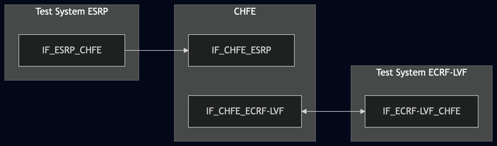
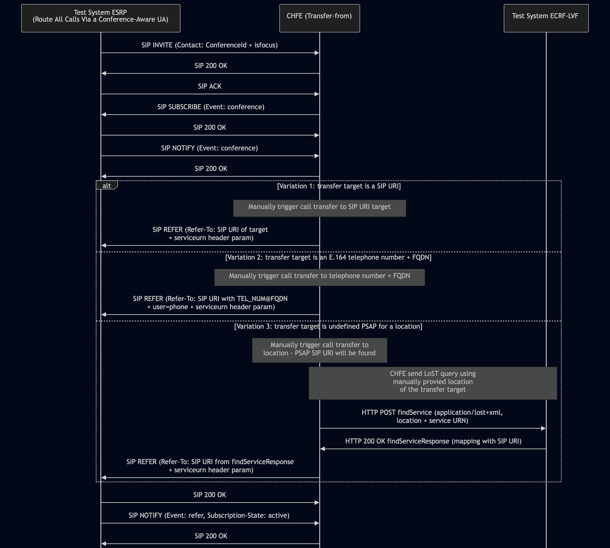

# Test Description: TD_CHFE_019

## Overview

### Summary

Refer-To header field

### Description

This test verifies Refer-To header field in SIP REFER message generated by the CHFE:
- if contains "serviceurn" parameter with URN of "urn:service:sos", "urn:service:test:sos", "urn:emergency:service:sos" or their subservices
- if its value is a valid SIP URI


### References

* Requirements : RQ_CHFE_281, RQ_CHFE_044, RQ_CHFE_045, RQ_CHFE_047
* Test Case    : TC_CHFE_019

### Requirements

Implementation eXtra Information for Testing (IXIT) config file for CHFE.

### SIP/HTTP transport types

Test can be performed with 2 different SIP/HTTP transport types. Steps describing actions for a specific transport are marked as follows:

- (TLS) - should be used by default
- (TCP) - used in the lab for testing purposes only if default TLS is not possible

## Configuration

### Implementation Under Test Interface Connections

* Test System ESRP
  * IF_ESRP_CHFE - connected to CHFE IF_CHFE_ESRP

* CHFE
  * IF_CHFE_ESRP - connected to Test System ESRP IF_ESRP_CHFE
  * IF_CHFE_ECRF-LVF - connected to Test System ECRF-LVF IF_ECRF-LVF_CHFE

* Test System ECRF-LVF
  * IF_ECRF-LVF_CHFE - connected to CHFE IF_CHFE_ECRF-LVF

### Test System Interfaces

* Test System ESRP
  * IF_ESRP_CHFE - Active

* CHFE
  * IF_CHFE_ESRP - Active
  * IF_CHFE_ECRF-LVF - Active

* Test System ECRF-LVF
  * IF_ECRF-LVF_CHFE - Active

### Connectivity Diagram

<!--
https://mermaid.live/edit#pako:eNp1UtFqgzAU_ZVwn01Rq52GsZeuskEHox17GIGSaapSTUqMrF3pvy_G2c7C3u655-Tck8s9QSozDgQwxlSkUmzLnFCBkC54zQnKmNp1sJJyR1BasaYpUyqselvJr7RgSqPlqtMg9JxsFuvV62b-lCwwfjCwq2zvIug781WCl-_Jfa8aoCWp6LVN-5krti_QG280Wh8bzWt0tbqd13e5yG5eX7lRgFufUaz_vEZJRtohzfgjf13AgVyVGRCtWu5AzVXNOginjqZgF06BmFLxrD3gbvU4lZVUFKg4m_d7Jj6krAcLJdu8ALJlVWNQu8-Y5o8lM1HrS1eZ8VzNZSs0EC-wHkBOcAASepM4jKdBGAWuF80C34Gj0YSziRv7nh_77tSP3PjswLcd6k6iu9AB1mq5Pop0SMGzUkv10l-RPaYhy8Iyv1HOP-22umA
-->



## Pre-Test Conditions

### Test System ESRP / Test System ECRF-LVF (Variation 3)

* Interface is connected to the network.
* Interface has an IP address assigned.
* Device is active.
* ng911 repository cloned to local storage
* (TLS) Required PCA-signed certificates, private keys and PCA certificate are available.
* (TLS) Matching TLS decryption material appropriate for the negotiated session is available to the packet-capture setup.

### CHFE

* Interface is connected to the network.
* Interface has an IP address assigned.
* IUT is active and in normal operating state.
* IUT is initialized using the IXIT config file.
* Test System ESRP is configured as the ESRP used for the test.
* Test System ECRF-LVF is configured as a default ECRF-LVF
* "/lost" is configured as a default entrypoint for the ECRF-LVF
* An agent is logged in.
* The IUT is able to accept and answer the incoming test call.
* No active calls

## Test Sequence

### Test Preamble

#### Test System ESRP

* Install Wireshark[^2].
* Copy the TD-specific SIP Service scenario `ESRP_CHFE_019.xml` to local storage.
* (TLS v1.2) Configure Wireshark to decode SIP over TLS, use tests system and FE certificate keys [^3]
* (TLS v1.3) Configure logging of session keys and configure Wireshark to decode SIP over TLS [^4]
* Start packet capture on the interface connected to CHFE:
  * (TLS)

    `ip.addr == IF_ESRP_CHFE_IP_ADDRESS and tls`

  * (TCP)

    `ip.addr == IF_ESRP_CHFE_IP_ADDRESS and sip`

#### Test System ECRF-LVF (Variation 3)
* Copy following LoST response files to local storage:
  ```
  findServiceResponse.xml
  ```
* Install Wireshark[^2]
* Install OpenSSL v1.1.1 or higher[^5]
* (TLS v1.2) Configure Wireshark to decode HTTP over TLS, use test system and CHFE certificate keys[^3]
* (TLS v1.3) Configure logging of session keys and configure Wireshark to decode HTTP over TLS[^4]
* Using Wireshark on 'Test System ECRF-LVF' start packet tracing on IF_ECRF-LVF_CHFE interface - run following filter:
   * (TLS)
     > ip.addr == IF_ECRF-LVF_CHFE_IP_ADDRESS and tls
   * (TCP)
     > ip.addr == IF_ECRF-LVF_CHFE_IP_ADDRESS and http
* Run HTTP server acting as ECRF-LVF (LoST server) for Variation 3:
  * (TLS)
  ```
  python3 http_entry.py --ip IF_ECRF-LVF_CHFE_IP_ADDRESS --port 4443 --role RECEIVER --path /lost --method POST --body_file findServiceResponse.xml --content_type application/lost+xml --response_code 200 --server_cert test_system.crt --server_key test_system.key
  ```
  * (TCP)
  ```
  python3 http_entry.py --ip IF_ECRF-LVF_CHFE_IP_ADDRESS --port 8080 --role RECEIVER --path /lost --method POST --body_file findServiceResponse.xml --content_type application/lost+xml --response_code 200
  ```


### Test Body

#### Variation
1. SIP URI transfer target
2. E.164 telephone number transfer target
3. Transfer target is a PSAP assigned to location provided manually

#### Stimulus

1. On Test System ESRP run custom SIP service using following command (replace names in {} with values):
  * (TLS transport)
    >   sudo python3 test_suite/services/stub_server/sip_service/sip_entry.py \
  --scenario test_suite/test_files/SIPp_scenarios/sip_service/CHFE_019/ESRP_CHFE_019.xml \
  --scenario-type auto --bind-ip {IF_ESRP_CHFE_IP} --bind-port 5061 \
  --remote-ip {IF_CHFE_ESRP_IP} --remote-port 5061 \
  --tls-cert {ESRP_CERT_FILE_PATH} --tls_key {ESRP_KEY_FILE_PATH} \
  --tls-ca {PCA_CERT_FILE_PATH} \
  --protocol TLS
  * (TCP transport)
    >   sudo python3 test_suite/services/stub_server/sip_service/sip_entry.py \
  --scenario test_suite/test_files/SIPp_scenarios/sip_service/CHFE_019/ESRP_CHFE_019.xml \
  --scenario-type auto --bind-ip {IF_ESRP_CHFE_IP} --bind-port 5060 \
  --remote-ip {IF_CHFE_ESRP_IP} --remote-port 5060 \
  --protocol TCP

2. On CHFE, answer the incoming test call.
3. On CHFE, manually initiate a call transfer to one of the following targets:
   * Variation 1 - any SIP URI e.g. `sip:psap@chfe-2.ng911.example`
   * Variation 2 - any E.164 telephone number e.g. `+16502389205`
   * Variation 3 - enter the location of a transfer target to trigger LoST query (to find target's SIP URI)
4. Confirm the transfer, if the CHFE requires confirmation.

#### Response

Using the decoded SIP traffic captured between CHFE and Test System ESRP, identify the SIP REFER generated by CHFE for the active test dialog as a result of the transfer stimulus.
For all variations the identified SIP REFER verify that:
* exactly one `Refer-To` header field is present;
* the URI in the `Refer-To` header field is a SIP URI, i.e. its scheme is `sip`(case-insensitive);
* a `tel` URI, `urn` or any other URI scheme is NOT acceptable.
* the `Refer-To` header field contains exactly one `serviceurn` header parameter;
* the `serviceurn` value is a quoted string;
* the value of the `serviceurn` starts with one of the following patterns, any subservices are allowed (e.g. sos.ambulance, sos.animal-control, sos.fire, sos.gas, sos.marine, sos.mountain, sos.physician, sos.poison, sos.police):
  * `urn:service:sos` 
  * `urn:service:test.sos`
  * `urn:emergency:service`

VERDICT:

* ERROR - Test System ESRP fails to send stimulus
* PASSED -  if all checks passed
* FAILED - any other cases

#### Examples

Examples of valid Refer-To header fields:
```
Refer-To: <sip:chfe2@chfe2.test.example>;serviceurn="urn:service:sos.ambulance"
Refer-To: <sip:chfe@chfe.test.example:5060>;serviceurn="urn:emergency:service:responder.police"
Refer-To: <sip:+12025551212@chfe.test.example>;user=phone;serviceurn="urn:service:test.sos.animal-control"
```
Examples of NON-acceptable Refer-To header fields:

`Refer-To: <tel:+12025551212>;serviceurn="urn:service:sos"` - tel URI

`Refer-To: <sip:chfe2@chfe2.test.example> ` - no servicerun

`Refer-To: <sip:chfe2@chfe2.test.example>;serviceurn="urn:service:sos";serviceurn="urn:service:responder.police"` - duplicated serviceurn

`Refer-To: <sip:chfe2@chfe2.test.example>;serviceurn="urn:service:counseling"`- wrong urn

### Test Postamble

#### Test System ESRP/Test System ECRF-LVF

* Stop the SIP Service process, if still running.
* Stop packet tracing.
* Archive required test evidence.
* Remove test-specific temporary files, if applicable.
* Disconnect the test interface, if required.
* (TLS) Remove test-specific certificates and keys, if applicable.

#### CHFE (Transfer-from)

* End the test call, if still active.
* Restore any configuration changed specifically for the test.
* Return the device to its normal operating state.

## Post-Test Conditions

### Test System ESRP/Test System ECRF-LVF

* Test tools are stopped.
* Test-specific temporary files are removed.
* Test interface is returned to its normal state.

### CHFE (Transfer-from)

* IUT is in normal operating state.
* No test call remains active.

## Sequence Diagram

<!--
https://mermaid.live/edit#pako:eNqtVWFz2jgQ_Ss7-kQmOMVgkuBpM6XUTJkkhNpOZu6GmY5iC9DUllxJpuEy-e-3sjFJS3LNXY8PgKTd997uSrv3JJEpIz5xHGcuEikWfOnPBUDOlZJqmBiptA8Lmmlmt82K5cyHlKqvdplJ-dWHJKNa82Qu5qKC0exbyUTCPnK6VDS3hgAFVYYnvKDCQBCFM6AaYqYNRBttWF7tvb1VZ61QlobBMMtgRLNMww2nQGGE0piyqM7wO1UMrocH-8CjT-PAAle_rVhRodHLWSiZP2MdjMLxngzccy5uxjYYa29lOWdnFtCHaDKDyfRmEiM4CjI0Mf4TZZMUDoHrhUxKvaWzfuhuUWr3bqcDV-cvYA9H5w3vnmN0_SEahZMPSB2smUDiZEd88ALeP5JNr-LJ-I-X0V6UXh_TzMANVZwaLgW4PphttsFQtWQGE4Fls37X4aR2sZ-pxOLKNZrVSi6pKLHMG3TnyyVuJ7h6giUbiC3sI9KevjAYByG0QmZLHkt_5ykXjSZ7wQ5BM7XmCSuVgBWjKdLgraDNDWF41Z9E1n0-MgHBkXvsgWEZK1ZSMBBlfos2hzD-_HH6OwH_EvL1kX_nZgVxcPFlen353oJsM1BiCt7VHP8yHb1n01GKlC24YCnMouEMFlJh7TOZVD6_kQurtoEBpwZ_jA1tbxmSIfsjx08k7epF-3VH0EykcCGjGLBBqQ2mgYul5YC8UVIoueYYx47VHtsLtGI_B75fkIrpUxzPYHaFJJiRNKqTCy1aFBmvMd9kUpvDuzxrww8B7kqB8U0PHuGrntQ83Qq-fopPCUKmC4mdF1o5MmFYde23yTr4L5fHds1nKV71imxN_oe2pKysNkTlrU4UL2yenMhQg0MIuy9fv7Jb4Tdpk6XiKfGNKlmb5Ezl1C7JvTWZk2q0zYmPfxVLyzvHDjknkZlUczIXD-iPU-NPKfMGQslyuSJ-NRzbpCxSlLWdebtd7KiYmhHeUUN8t3t6WqEQ_57c4brfPxq4Pe_Yc08897h32muTDfF77tHJoN9xO93BoH886J90H9rkr4q4czTwev2u1_VczzvxPItHSyOjjUgaWSzlOLUv67lejfdGXFCdbLU9_A08iH4R
-->



## Comments

Version:  010.3f.5.0.2

Date:     20261104

## Footnotes

[^1]: SIPp - tool for SIP packet simulations. Official documentation: https://sipp.sourceforge.net/doc/reference.html#Getting+SIPp
[^2]: Wireshark - tool for packet tracing and analysis. Official website: https://www.wireshark.org/download.html
[^3]: NENA-STA-010.3f-2021, Section 4.7.1.
[^4]: Wireshark configuration to decrypt SIP over TLS packets: https://www.zoiper.com/en/support/home/article/162/How%20to%20decode%20SIP%20over%20TLS%20with%20Wireshark%20and%20Decrypting%20SDES%20Protected%20SRTP%20Stream
[^5]: TLS v1.3 session keys logging and Wireshark configuration to decrypt traffic: https://my.f5.com/manage/s/article/K50557518
