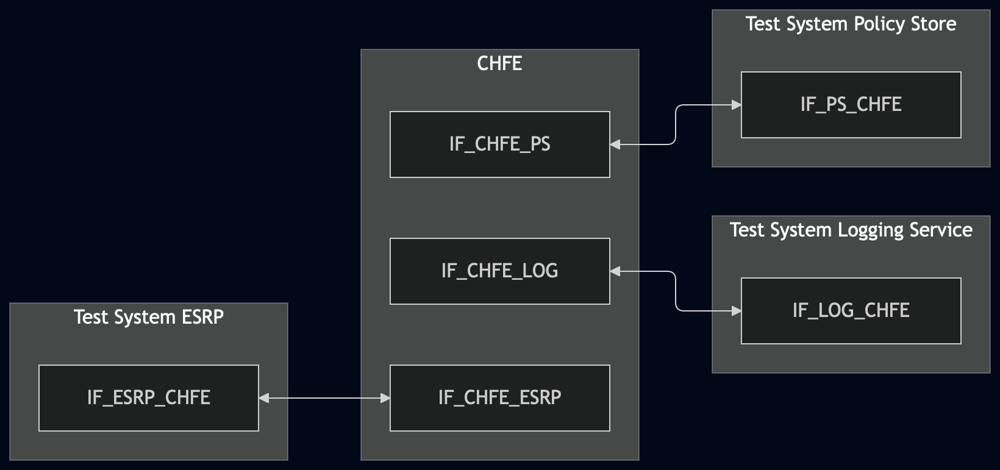
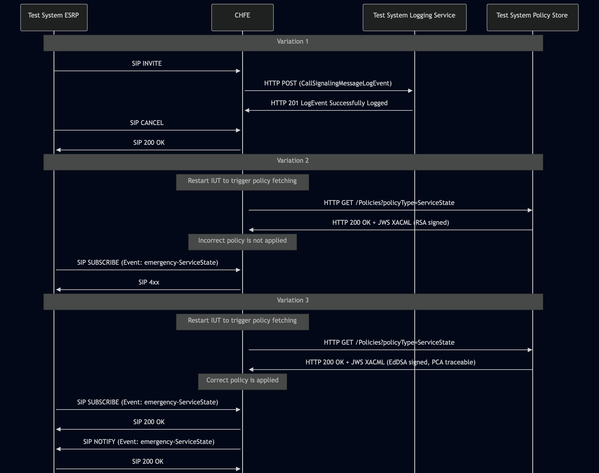

# Test Description: TD_CHFE_021

## Overview
### Summary
Verification of JWS Protected Header algorithm and certificate chain in LogEvents sent by CHFE

### Description
Test covers that CHFE, when sending LogEvents to the Logging Service, forms a JWS Protected Header that:
* contains exactly one "alg" field set to "EdDSA" (signed) or "none" (unsigned)
* for signed LogEvents — includes the signing entity's X.509 certificate with all intermediate certificates up to the 
  trusted root, either by value (x5c) or by reference (x5u + x5t#256)

### References
* Requirements : RQ_CHFE_390, RQ_CHFE_392
* Test Case    : CHFE_021

### Requirements
IXIT config file for IUT

### HTTP transport types
Test can be performed with 2 different SIP and HTTP transport types. Steps describing actions for specific one are marked as following:
- (TLS) - used by default inside ESInet on production environment
- (TCP) - used if default TLS is not possible

## Configuration
### Implementation Under Test Interface Connections
<!-- Identify each of the FEs that are part of the configuration and how they are connected -->
* Test System ESRP
  * IF_ESRP_CHFE - connected to IF_CHFE_ESRP
* CHFE
  * IF_CHFE_ESRP - connected to IF_ESRP_CHFE
  * IF_CHFE_LOG - connected to IF_LOG_CHFE
  * IF_CHFE_PS - connected to IF_PS_CHFE
* Test System Logging Service
  * IF_LOG_CHFE - connected to IF_CHFE_LOG
* Test System Policy Store
  * IF_PS_CHFE - connected to IF_CHFE_PS

### Test System Interfaces
<!-- Identify each of the test system interfaces and whether it will be in active or monitor mode -->
* Test System ESRP
  * IF_ESRP_CHFE - Active
* CHFE
  * IF_CHFE_ESRP - Active
  * IF_CHFE_LOG - Active
  * IF_CHFE_PS - Active
* Test System Logging Service
  * IF_LOG_CHFE - Active
* Test System Policy Store
  * IF_PS_CHFE - connected to IF_CHFE_PS

### Connectivity Diagram
<!--
https://mermaid.live/edit#pako:eNqNkl1PgzAUhv9Kc5JlN2xhDDZojDe6qcmMZHhlmpgKlTVCu5SiTsJ_t-uGikuMXDTnvOfroacNpDJjgGEwaLjgGqNmqDesZEOMhhlVL0MHESikfCGACaQFrSqeEmjbwYCI50K-pRuqNFqtiUDmu1k-LpJ1_HhxvVycjUbnxt-bVvzKsMrq7uqYYCwr9eNxcgzHyY_o4azqp1zR7Qbds0qjZFdpVqLvEb9BDioTGRF_1K9knnORo4SpV56yXqs-ounUsfzq953z81dOyLoLOBXj5H-wsSx4ukOJlqpP2rst0wUcyBXPAGtVMwdKpkq6d6Gx-GCXbXZrTMWy-n20XzoBIlpTuaXiQcqyK1ayzjeAn2lRGa_eZlSzS04NXfmlKjOTqQtZCw3Y90LbBHAD74A9PxiHU2_uRu50HrphGDiwAzwLxtFs5k_cKPT9WTCZtw582LHuOIiM7vtu5E3m4dQ3BbTWMtmJtINiGTeXcHt4xfYxd2gLGzmStZ-A1t4c
-->




## Pre-Test Conditions

### Test System ESRP/Test System Logging Service/Test System Policy Store
* Interfaces are connected to network
* Interfaces have IP addresses assigned by DHCP
* Device is active
* ng911 repository cloned to local storage
* (TLS) Generated own PCA-signed certificate and private key files (test_system.crt, test_system.key)
* (TLS) Certificate and key used by CHFE copied to local storage
* (TLS) PCA certificate copied to local storage

### CHFE
* Interfaces are connected to network
* Interfaces have IP addresses assigned by DHCP
* Device configured to use Logging Service Test System as a Logging Service
* Device is active
* Device is in normal operating state
* IUT is initialized using IXIT config file

## Test Sequence
### Test Preamble

#### Test System ESRP
* Install SIPp by following steps from documentation[^1]
* Copy following XML scenario file to local storage:

  `SIP_INVITE_with_CANCEL.xml`
  `SIP_SUBSCRIBE_ServiceState.xml`

* Install Wireshark[^2]
* (TLS v1.2) Configure Wireshark to decode SIP over TLS, use tests system and IUT certificate keys [^3]
* (TLS v1.3) Configure logging of session keys and configure Wireshark to decode SIP over TLS [^4]
* Using Wireshark on 'Test System' start packet tracing on IF_ESRP_CHFE interface - run following filter:
   * (TLS)
     > ip.addr == IF_ESRP_CHFE_IP_ADDRESS and tls
   * (TCP)
     > ip.addr == IF_ESRP_CHFE_IP_ADDRESS and sip

#### Test System Logging Service
* Install Wireshark[^2]
* Install OpenSSL v1.1.1 or higher[^5].
* (TLS v1.2) Configure Wireshark to decode HTTP over TLS, use tests system and CHFE certificate keys [^3]
* (TLS v1.3) Configure logging of session keys and configure Wireshark to decode HTTP over TLS [^4]
* Using Wireshark on 'Test System' start packet tracing on IF_LOG_CHFE interface - run following filter:
   * (TLS)
     > ip.addr == IF_LOG_CHFE_IP_ADDRESS and tls
   * (TCP)
     > ip.addr == IF_LOG_CHFE_IP_ADDRESS and http
* The Logging Service must be configured to accept and process HTTP POST requests. To verify this manually, you can simulate a listening HTTP endpoint on port 8080 using command in the terminal:
    * Step 1 - Prepare logEventId and JSON body
      ```
      ID="urn:emergency:uid:logid:$(date +%s%N):logger.state.pa.us"
      BODY="{\"logEventId\":\"$ID\"}"
      ```
    * Step 2 - Run server:
      * (TLS)
      ```
      python3 http_entry.py --ip IF_LOG_CHFE --port 4443 --role RECEIVER --path /LogEvents --method POST --body "$BODY" --content_type application/json --response_code 201 --server_cert /tmp/cert.crt --server_key /tmp/cert.key
      ```
      * (TCP)
      ```
      python3 http_entry.py --ip IF_LOG_CHFE --port 8080 --role RECEIVER --path /LogEvents --method POST --body "$BODY" --content_type application/json --response_code 201
      ```
    * Step 3 - In another terminal, send a POST request to verify it is working:
      * (TLS)
      ```
      curl -k -X POST https://localhost:4443/LogEvents -d '{"log":"test"}'
      ```   
      * (TCP)
      ```
      curl -X POST http://localhost:8080/LogEvents -d '{"log":"test"}'
      ```   

#### Test System Policy Store
* Install Wireshark[^2]
* Copy following XML file to local storage:
  ```
     XACML_ServiceState.xml
  ```
* Edit the `XACML_ServiceState.xml` scenario file, find and change following string values:
  * `ALLOWED_FQDN` -> change to FQDN of the Test System ESRP
  * `IUT_FQDN` -> change to FQDN of the CHFE
* (TLS v1.2) Configure Wireshark to decode HTTP over TLS, use tests system and CHFE certificate keys [^3]
* (TLS v1.3) Configure logging of session keys and configure Wireshark to decode HTTP over TLS [^4]
* Using Wireshark on 'Test System' start packet tracing on IF_PS_CHFE interface - run following filter:
   * (TLS)
     > ip.addr == IF_PS_CHFE_IP_ADDRESS and tls
   * (TCP)
     > ip.addr == IF_PS_CHFE_IP_ADDRESS and http
* Prepare certificate files to be used for JWS generation:
  * Variation 2 (unsupported algorithm for JWS):
    ```
    openssl genrsa -out test_system.key 2048
    ```
    ```
    openssl req -new -key test_system.key -out test_system.csr -sha256 -subj "/C=US/ST=Texas/L=College Station/O=TAMU/CN=ps.ng911.dev.lab"
    ```
    ```
    openssl req -new -in test_system.csr -CA PCA.crt -CAkey PCA.key -CAcreateserial -out test_system.crt -days 1 -sha256
    ```
  * Variation 3 (correct):
    ```
    openssl genpkey -algorithm Ed448 -out test_system.key
    ```
    ```
    openssl req -new -key test_system.key -out test_system.csr -subj "/C=US/ST=Texas/L=College Station/O=TAMU/CN=ps.ng911.dev.lab"
    ```
    ```
    openssl req -new -in test_system.csr -CA PCA.crt -CAkey PCA.key -CAcreateserial -out test_system.crt -days 1
    ```
* The Policy Store must be configured to accept and process HTTP GET requests.
  * generate JWS object and save to file jws.json, example:
  ```
  python3 -m main generate_jws XACML_ServiceState.xml --cert test_system.crt --key test_system.key --output_file jws.json
  ```
  * simulate a listening HTTP endpoint on port 8080 using command in the terminal:
  * (TLS):
    * `python3 http_entry.py --ip IF_PS_CHFE --port 4443 --role RECEIVER --path /Policies?policyType=ServiceState --method GET --body jws.json --server_cert test_system.crt --server_key test_system.key`
  * (TCP):
    * `python3 http_entry.py --ip IF_PS_CHFE --port 8080 --role RECEIVER --path /Policies?policyType=ServiceState --method GET --body jws.json`

    
### Test Body

#### Variations
1. JWS with LogEvents sent by the CHFE
2. Rejecting policy JWS signed by a certificate using unsupported algorithm
3. Applying XACML policies from correct JWS

#### Stimulus

##### Variation 1
Run SIPp scenario by using following command on Test System ESRP, example:
  * (TLS transport)
    ``` 
    sudo sipp -t l1 -i IF_ESRP_CHFE_IPv4 -p 5061 -bind_local -tls_cert test_system.crt -tls_key test_system.key -sf 
    SIP_INVITE_with_CANCEL.xml IF_CHFE_ESRP_IPv4:5061
    ```
  * (TCP transport)
    ```
    sudo sipp -t t1 -i IF_ESRP_CHFE_IPv4 -p 5060 -bind_local -sf SIP_INVITE_with_CANCEL.xml IF_CHFE_ESRP_IPv4:5060
    ```

##### Variations 2-3
1. Restart CHFE to trigger fetching policies from the Test System Policy Store
2. From 'Test System ESRP' start subscription to emergency-ServiceState event - run following SIPp scenario file, example command:
  * (TLS transport)
    ``` 
    sudo sipp -t l1 -timeout 7s -i IF_ESRP_CHFE_IPv4 -p 5061 -bind_local -tls_cert test_system.crt -tls_key test_system.key -sf 
    SIP_SUBSCRIBE_ServiceState.xml IF_CHFE_ESRP_IPv4:5061
    ```
  * (TCP transport)
    ```
    sudo sipp -t t1 -timeout 7s -i IF_ESRP_CHFE_IPv4 -p 5060 -bind_local -sf SIP_SUBSCRIBE_ServiceState.xml IF_CHFE_ESRP_IPv4:5060
    ```

#### Response

##### Variation 1

Using traced packets on Wireshark check:
* If CHFE sends HTTP POST to Test System Logging Service with JWS body. Then decode JWS fields from Base64url and verify the following:
  * The "payload" field decoded from Base64url contains a valid LogEvent JSON object (e.g. CallSignalingMessageLogEvent). This confirms the JWS wraps actual LogEvent content.
  * Decode the "protected" field from Base64url into a raw string;
  * Verify that the raw decoded string contains the exact substring "alg" only once (to prevent duplicate key injection like {"alg": "none", "alg": "EdDSA"} );
  * Parse the raw string into a JSON object and verify the value of the "alg" field is either:
    * "none";
    * "EdDSA";
    * no other values are permitted for the "alg" field.

  * If "protected" contains "alg": "none":
    * check that "signature" is empty
  
  * If "protected" contains "alg": "EdDSA":
    * check if "signature" contains non-empty string value
    * using PCA-signed key file used by CHFE verify if JWS object is properly signed, use decode_jws method, example command:
      
    ```
           python3 -m main decode_jws JWS_FILE_PATH --key CHFE.key --password pass123
    ```

    * verify if method did not return any decoding errors
    * verify if key file used by CHFE for JWS signing is Edwards-curve Digital Signature Algorithm with Curve448, run example command:
    ```
       openssl pkey -in CHFE.key -text -noout
    ```
      Command must return "ED448", example:
    ```
    ED448 Private-Key:
    priv:
        cb:18:b3:9a:3a:09:ba:87:ad:86:79:0c:84:08:79:
        2a:16:31:76:19:a1:0f:92:1e:11:e5:7f:2c:7a:01:
        66:7e:f8:2a:04:47:8a:da:25:c2:c8:99:3a:52:20:
        37:54:a5:ea:d9:1d:a0:70:29:d8:3b:20
    pub:
        07:cc:7b:cc:d0:ff:e6:1c:79:fc:65:df:18:fc:f2:
        89:15:db:68:6a:08:2c:b6:7d:20:45:e8:81:64:b6:
        4c:8f:62:f1:63:df:f5:b3:38:ea:14:d4:28:0a:2b:
        88:62:7d:32:ed:c3:ab:8d:fc:a3:e0:80
    ```
    * The Protected Header shall contain one of the following keys:
      * `x5c` - with value being an array with X.509 certificate and all intermediate certificates up to one signed 
        by the trusted root. Example:
      ```
        {
            "alg": "EdDSA",
            "x5c": ["BASE64_CERT", "BASE64_INTERMEDIATE_CERT"]
        }
      ```
      * `x5u` with string value containing a valid URL pointing to a certificate chain.
        `x5u` field MUST be used with `x5t#256` field - the SHA-256 thumbprint of the certificate, to allow detection of when the certificate chain needs to be retrieved. Example:
          ```
          {
          "alg": "EdDSA",
          "x5u": "https://certs.example.agency.gov/chfe-signing.crt",
          "x5t#256": "BASE64URL_SHA256_THUMBPRINT"
          }
          ```
        * Verify the `x5u` URL is resolvable and download the certificate chain (respons 200):
            ```
            curl -o cert_chain.pem <x5u_URL_value>
            ```
        * Verify the downloaded chain is complete up to the PCA root — inspect certificates in the chain
        * Extract the leaf certificate (first in chain) and compute its SHA-256 thumbprint:
           ```
          openssl x509 -in cert_chain.pem -outform DER | openssl dgst -sha256 -binary | base64 | tr '+/' '-_' | tr -d '='
          ```
          Output MUST match the value in "x5t#256" field of the Protected Header

  * If "protected" contain "alg": "none":
    * check that "signature" is empty

##### Variation 2

Using traced packets on Wireshark check:
* If CHFE did not apply provided XACML policy - SIP SUBSCRIBE request from Test System ESRP is rejected with 4xx error

##### Variation 3

Using traced packets on Wireshark check:
* If CHFE applied provided XACML policy - SIP SUBSCRIBE request from Test System ESRP is accepted and CHFE sends SIP NOTIFY with Event: emergency-ServiceState back to the Test System ESRP

VERDICT:
* PASSED - if all checks passed
* FAILED - any other cases

### Test Postamble
#### Test System ESRP
* stop SIPp (if still running)
* stop Wireshark (if still running)
* archive all logs generated
* disconnect interfaces from IUT
* (TLS) remove certificates

#### Test System Logging Service/Test System Policy Store
* stop Wireshark (if still running)
* archive all logs generated
* disconnect interfaces from IUT
* (TLS) remove certificates

#### CHFE
* restore default configuration
* disconnect interfaces from Test Systems
* reconnect interfaces back to default

## Post-Test Conditions
### Test System ESRP/Test System Logging Service/Test System Policy Store
* Test tools stopped
* interfaces disconnected from IUT

### CHFE
* device connected back to default
* device in normal operating state

## Sequence Diagram
<!--
https://mermaid.live/edit#pako:eNrVVV1v2jAU_StXlhCtBl2g4cvSOtE0bdkoIJx2H8qL55jUarCZ41QwxH-fE0phhVV9mrS8JLHPuffcc-XrJWIq4gijarUaSqbkRMQ4lABTobXSXWaUTjFMaJLyUBagUmkppDAYlmVzz6e8jKEcUf1QrkCIEqUeQoRDxBKapoKFaLUqlUIZypT_zLhk_ELQWNNpnmP9zKg2gokZlQZ8Mh4BTSHgqQGySA2fFmuH0d71pZ-j8_dhRH949TJcX8WxkDEQrh8F44d5I_KSNlKJYAsg1o8dzkAZDuqR60JlxfIw3FEtqBFKQm0LzLerZ2fvcqkYSG8EvcFdL9iRne_kCCsZw3UQjGA0JAEceTRJiIglTazqG56mNOa2Bv-RS3O8pVvaNn5Brzs12ACBZIxZ7iRLkkVhAY9eE-d1B57f3xeXI9eIuuPA8PNbnagfAq7Tja3J1nno3QZgFBgtrDgNs7XfE27YvS18T0oevyjzyg_gfdEdwdOPa1qwmPEPTw0mhpqdjo2IJf_hUl4HvINPXwh87Xo3fTgaky6k1nIeHf9dd8-eFq05MxupIgWpDNDZLBEH3N2aS27PiTfunftwVDQHgz1FOraHY1HdFX28V_TWfnc-f6v3p_-V93508ey-rcTrWlWUcfoj4a80w9trxb9pw8tTsAcYDIPe5be3Z9hTuc6AKijWIkLY6IxXkI0ypfkvWubUEBWD2M5d-6l5lM2r-UCuMpUoHaJQrizfzrXvSk03IbTK4nuEi8FeQdkssjqeRvPzquYy4tpTmTQI1-rNIgjCSzRHuO42Ttqn9ZbTcU5bbafdblTQAuFm46TTbLo1p9N23Waj1lpV0K8irXPS6Nh113U69VqrfepaAs2MIgvJNqJ4JOx8vVnfSMXFtJHmFztPyla_Ada5AgM
-->



## Comments

Version:  010.3d.5.0.0

Date:     20260925

## Footnotes

[^1]: SIPp - tool for SIP packet simulations. Official documentation: https://sipp.sourceforge.net/doc/reference.html#Getting+SIPp
[^2]: Wireshark - tool for packet tracing and anaylisis. Official website: https://www.wireshark.org/download.html
[^3]: Wireshark configuration to decrypt TLS packets: https://www.zoiper.com/en/support/home/article/162/How%20to%20decode%20SIP%20over%20TLS%20with%20Wireshark%20and%20Decrypting%20SDES%20Protected%20SRTP%20Stream
[^4]: TLS v1.3 session keys logging + Wireshark configuration to decrypt traffic: https://my.f5.com/manage/s/article/K50557518
[^5]: OpenSSL v1.1.1 or higher - toolkit required for TLS operations and certificate/key handling. Official website and downloads: https://www.openssl.org/source/ . Installation documentation: https://github.com/openssl/openssl/blob/master/INSTALL.md