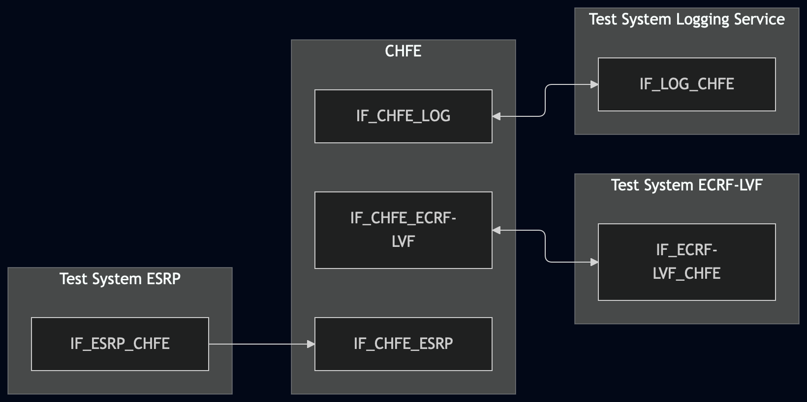
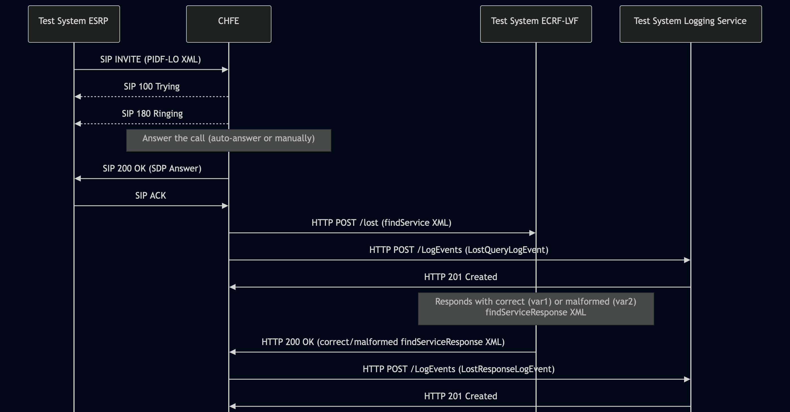

# Test Description: TD_CHFE_022

## Overview
### Summary
Validation of logging event messages: LostQueryLogEvent, LostResponseLogEvent

### Description
The test ensures that the CHFE, when it queries an ECRF using LoST, generates and sends to the Logging Service:
* a `LostQueryLogEvent` containing the entire LoST query
* a `LostResponseLogEvent` containing the entire LoST response

Additionally, relation between `queryId` and `responseId` is verified between both log events

### References
* Requirements : RQ_CHFE_362, RQ_CHFE_363, RQ_CHFE_377
* Test Case    : TC_CHFE_022

### Requirements
IXIT config file for CHFE

### HTTP and SIP transport types
Test can be performed with 2 different SIP and HTTP transport types. Steps describing actions for specific one are marked as following:
- (TLS) - should be used by default
- (TCP) - used in lab for testing purposes only if default TLS is not possible

## Configuration
### Implementation Under Test Interface Connections
* Test System ESRP
  * IF_ESRP_CHFE - connected to IF_CHFE_ESRP
* CHFE
  * IF_CHFE_ESRP - connected to IF_ESRP_CHFE
  * IF_CHFE_ECRF-LVF - connected to IF_ECRF-LVF_CHFE
  * IF_CHFE_LOG - connected to IF_LOG_CHFE
* Test System ECRF-LVF
  * IF_ECRF-LVF_CHFE - connected to IF_CHFE_ECRF-LVF
* Test System Logging Service
  * IF_LOG_CHFE - connected to IF_CHFE_LOG

### Test System Interfaces
* Test System ESRP
  * IF_ESRP_CHFE - Active
* CHFE
  * IF_CHFE_ESRP - Active
  * IF_CHFE_ECRF-LVF - Active
  * IF_CHFE_LOG - Active
* Test System ECRF-LVF
  * IF_ECRF-LVF_CHFE - Active
* Test System Logging Service
  * IF_LOG_CHFE - Active

### Connectivity Diagram

<!--
https://mermaid.live/edit#pako:eNp9Ul1vgjAU_SvNfQbDlwLNshen2xKXLbrsYSExHVQgQmtK2XTG_75SRINze7vnntNzT3u7h5gnFDCYphmxmLNVnuKIISQzWlKMEiLWDSw4X2MUF6Sq8jhiWr0q-FecESHRbN5oEHqcLieL-cty_DCdmOatgk2leydB2xnPp-bsbXrTqjqoyb5y9nx_FKnqyLeKqv5IBdlk6JVWEi12laQlOo-6zNN2KUsuTp-5XsBLn17s34wK99eAXrxrBldu_7_LjKdpzlK0oOIzj2nP7PxKRx8wIBV5AliKmhpQUlGSBsK-kUSgFx0BVqWgSb01m5WbMS-4iCBiB3V-Q9g752VnIXidZoBXpKgUqjcJkfQuJypneeoKNZmKMa-ZBOxagTYBvIetgt4gsD3XDx0rdJwwGA4N2AG2R8PB0Ha80A89y_Vdyz8Y8K3nWgPfDUJl49ieHfgjxzaA1JIvdizuUtEkl1w8tb9Zf-ou20Qzx2iHH0im4K0
-->



## Pre-Test Conditions
### Test System ESRP/Test System ECRF-LVF/Test System Logging Service
* Interfaces are connected to network
* Interfaces have IP addresses assigned by DHCP
* Device is active
* No active calls
* ng911 repository cloned to local storage
* (TLS) Generated own PCA-signed certificate and private key files (test_system.crt, test_system.key)
* (TLS) Certificate and key used by CHFE copied to local storage
* (TLS) PCA certificate copied to local storage

### CHFE
* Interfaces are connected to network
* Interfaces have IP addresses assigned by DHCP
* Default configuration is loaded
* IUT is initialized using IXIT config file
* IUT configured to use Test System ESRP as default ESRP
* IUT configured to use Test System ECRF-LVF as its default ECRF-LVF - LoST server URI:
  * (TLS) `https://IF_ECRF-LVF_CHFE_IP_ADDRESS:4443/lost`
  * (TCP) `http://IF_ECRF-LVF_CHFE_IP_ADDRESS:8080/lost`
* IUT configured to use Test System Logging Service as a default Logging Service:
  * (TLS) `https://IF_LOG_CHFE_IP_ADDRESS:4443/LogEvents`
  * (TCP) `http://IF_LOG_CHFE_IP_ADDRESS:8080/LogEvents`
* IUT has configured tel numbers from which calls are accepted and auto-answered (if supported, see IXIT config file)
* Agent logged in (f.e. tester@psap.example.com)
* IUT is active
* IUT is in normal operating state
* No active calls

## Test Sequence
### Test Preamble

#### Test System ESRP
* Install SIPp by following steps from documentation[^1]
* Copy following XML scenario file to local storage:
  ```
  SIP_INVITE_location_PIDF-LO_Boundary1.xml
  ```
  `SIP_INVITE_location_PIDF-LO_Boundary1.xml` - sends an emergency SIP INVITE containing `Call-Info` header fields with callId and incidentId, a `Geolocation` header field and a PIDF-LO (location by value) in a multipart body
* Install Wireshark[^2]
* (TLS v1.2) Configure Wireshark to decode SIP over TLS, use test system and IUT certificate keys[^3]
* (TLS v1.3) Configure logging of session keys and configure Wireshark to decode SIP over TLS[^4]
* Using Wireshark on 'Test System ESRP' start packet tracing on IF_ESRP_CHFE interface - run following filter:
   * (TLS)
     > ip.addr == IF_ESRP_CHFE_IP_ADDRESS and tls
   * (TCP)
     > ip.addr == IF_ESRP_CHFE_IP_ADDRESS and sip

#### Test System ECRF-LVF
* Copy following LoST response files to local storage:
  ```
  findServiceResponse.xml
  findServiceResponse_malformed_xml_body.xml
  ```
* Install Wireshark[^2]
* Install OpenSSL v1.1.1 or higher[^5]
* (TLS v1.2) Configure Wireshark to decode HTTP over TLS, use test system and CHFE certificate keys[^3]
* (TLS v1.3) Configure logging of session keys and configure Wireshark to decode HTTP over TLS[^4]
* Using Wireshark on 'Test System ECRF' start packet tracing on IF_ECRF-LVF_CHFE interface - run following filter:
   * (TLS)
     > ip.addr == IF_ECRF-LVF_CHFE_IP_ADDRESS and tls
   * (TCP)
     > ip.addr == IF_ECRF-LVF_CHFE_IP_ADDRESS and http
* Run HTTP server acting as ECRF (LoST server) - depending on current variation use one of following response files as `LOST_RESPONSE_FILE`:
  * Variation 1 - `findServiceResponse.xml`
  * Variation 2 - `findServiceResponse_malformed_xml_body.xml`
  * (TLS)
  ```
  python3 http_entry.py --ip IF_ECRF-LVF_CHFE_IP_ADDRESS --port 4443 --role RECEIVER --path /lost --method POST --body_file LOST_RESPONSE_FILE --content_type application/lost+xml --response_code 200 --server_cert test_system.crt --server_key test_system.key
  ```
  * (TCP)
  ```
  python3 http_entry.py --ip IF_ECRF-LVF_CHFE_IP_ADDRESS --port 8080 --role RECEIVER --path /lost --method POST --body_file LOST_RESPONSE_FILE --content_type application/lost+xml --response_code 200
  ```

#### Test System Logging Service
* Install Wireshark[^2]
* Install OpenSSL v1.1.1 or higher[^5]
* (TLS v1.2) Configure Wireshark to decode HTTP over TLS, use test system and CHFE certificate keys[^3]
* (TLS v1.3) Configure logging of session keys and configure Wireshark to decode HTTP over TLS[^4]
* Using Wireshark on 'Test System Logging Service' start packet tracing on IF_LOG_CHFE interface - run following filter:
   * (TLS)
     > ip.addr == IF_LOG_CHFE_IP_ADDRESS and tls
   * (TCP)
     > ip.addr == IF_LOG_CHFE_IP_ADDRESS and http
* The Logging Service must be configured to accept and process HTTP POST requests. To verify this manually, you can simulate a listening HTTP endpoint on port 8080 using command in the terminal:
    * Step 1 - Prepare logEventId and JSON body
      ```
      ID="urn:emergency:uid:logid:$(date +%s%N):logger.state.pa.us"
      BODY="{\"logEventId\":\"$ID\"}"
      ```
    * Step 2 - Run server:
      * (TLS)
      ```
      python3 http_entry.py --ip IF_LOG_CHFE_IP_ADDRESS --port 4443 --role RECEIVER --path /LogEvents --method POST --body "$BODY" --content_type application/json --response_code 201 --server_cert test_system.crt --server_key test_system.key
      ```
      * (TCP)
      ```
      python3 http_entry.py --ip IF_LOG_CHFE_IP_ADDRESS --port 8080 --role RECEIVER --path /LogEvents --method POST --body "$BODY" --content_type application/json --response_code 201
      ```
    * Step 3 - In another terminal, send a POST request to verify it is working:
      * (TLS)
      ```
      curl -k -X POST https://localhost:4443/LogEvents -d '{"log":"test"}'
      ```
      * (TCP)
      ```
      curl -X POST http://localhost:8080/LogEvents -d '{"log":"test"}'
      ```

### Test Body

#### Variations
1. Variation 1 - correct LoST response (`findServiceResponse.xml` used for Test System ECRF response)
2. Variation 2 - LoST response with malformed XML body (`findServiceResponse_malformed_xml_body.xml` used for Test System ECRF response)

#### Stimulus
1. Establish a call from Test System ESRP - run SIPp scenario by using following command on Test System ESRP, example:
   * (TLS)
     ```
     sudo sipp -t l1 -i IF_ESRP_CHFE_IP_ADDRESS -p 5061 -tls_cert test_system.crt -tls_key test_system.key -sf SIP_INVITE_location_PIDF-LO_Boundary1.xml IF_CHFE_ESRP_IP_ADDRESS:5061
     ```
   * (TCP)
     ```
     sudo sipp -t t1 -i IF_ESRP_CHFE_IP_ADDRESS -p 5060 -sf SIP_INVITE_location_PIDF-LO_Boundary1.xml IF_CHFE_ESRP_IP_ADDRESS:5060
     ```
2. Answer the incoming call on the CHFE (automatically if auto-answer is configured, otherwise manually by the logged-in agent).

#### Response

**Variation 1 + Variation 2**

Using traced packets on Wireshark verify if CHFE sends two HTTP POST requests to Test System Logging Service (/LogEvents entrypoint):
- each containing a JWS body conforming to NENA-STA-010.3 (5.10 JSON Web Signatures) - JWS format is verified in TD_CHFE_013
- decoded `payload` of the first JWS body contains a `LostQueryLogEvent` object and of the second one a `LostResponseLogEvent` object, with following fields:

##### LostQueryLogEvent
- `logEventType`: `"LostQueryLogEvent"`
- `timestamp` with correct date-time format (f.e. 2020-03-10T11:00:01-05:00)
- `elementId` which has value with FQDN of CHFE
- `agencyId` which has value with FQDN of an agency
- `queryAdapter` with string value consisting of the entire LoST query - identical to the XML body of the HTTP POST sent by CHFE to Test System ECRF (captured on IF_ECRF-LVF_CHFE), a well-formed `<findService>` request (namespace `urn:ietf:params:xml:ns:lost1`)
- `queryId` with non-empty string value
- `direction`: `"outgoing"`
- `callId` which has value f.e.: `urn:emergency:uid:callid:1234567890:bcf.ng911.example`. Check:
  * if value contains `urn:emergency:uid:callid:`
  * if `urn:emergency:uid:callid:` is followed by 10 to 32 alphanumeric characters (String ID)
  * if String ID is followed by `:` and domain name
  * if it has the same value as callId in the `emergencyCallIncidentId` tag of findService XML LoST query sent by CHFE to Test System ECRF-LVF, e.g.:
    ```
     <nena:emergencyCallIncidentId
        callId="urn:emergency:uid:callid:123ABCdefg123ABCdefg123ABCdefg12:test.com"
        incidentTrackingId="urn:emergency:uid:incidentid:123ABCdefg123ABCdefg123ABCdefg12:test.com"/>
    ```
- `incidentId` which has value f.e.: `urn:emergency:uid:incidentid:1234567890:bcf.ng911.example`. Check:
  * if value contains `urn:emergency:uid:incidentid:`
  * if `urn:emergency:uid:incidentid:` is followed by 10 to 32 alphanumeric characters (String ID)
  * if String ID is followed by `:` and domain name
  * if it has the same value as incidentTrackingId in the `emergencyCallIncidentId` tag of findService XML LoST query sent by CHFE to Test System ECRF-LVF, e.g.:
    ```
     <nena:emergencyCallIncidentId
        callId="urn:emergency:uid:callid:123ABCdefg123ABCdefg123ABCdefg12:test.com"
        incidentTrackingId="urn:emergency:uid:incidentid:123ABCdefg123ABCdefg123ABCdefg12:test.com"/>
    ```
- `callIdSip` which has the same value as `Call-ID` header field of the SIP INVITE from Test System ESRP (f.e. `1234567890qwertyuiop@caller.example.com`)
- (optional) `agencyAgentId` field with string value
- (optional) `agencyPositionId` field with string value
- (optional) zero or one `clientAssignedIdentifier` field with string value
- (optionally) zero or one `extension` with JSON object
- (optional) `ipAddressPort` field with normalized IP address and port number (`"###.###.###.###:port"`) or FQDN

##### LostResponseLogEvent
- `logEventType`: `"LostResponseLogEvent"`
- `responseAdapter` with string value consisting of the entire LoST query response (XML body of HTTP 200 OK sent back by Test System ECRF-LVF to CHFE)
- `timestamp` with correct date-time format (f.e. 2020-03-10T11:00:01-05:00)
- `elementId` which has value with FQDN of CHFE (same as in `LostQueryLogEvent`)
- `agencyId` which has value with FQDN of an agency (same as in `LostQueryLogEvent`)
- `responseId` with string value which **MUST** be equal to `queryId` of the `LostQueryLogEvent`

  Example - if `LostQueryLogEvent` contains:
  ```
  "queryId": "urn:emergency:uid:queryid:f47ac10b-58cc-4372-a567-0e02b2c3d479:chfe.example.com"
  ```
  then `LostResponseLogEvent` should contain:
  ```
  "responseId": "urn:emergency:uid:queryid:f47ac10b-58cc-4372-a567-0e02b2c3d479:chfe.example.com"
  ```
- `direction`: `"incoming"`
- `callId` which has value f.e.: `urn:emergency:uid:callid:1234567890:bcf.ng911.example`. Check:
  * if value contains `urn:emergency:uid:callid:`
  * if `urn:emergency:uid:callid:` is followed by 10 to 32 alphanumeric characters (String ID)
  * if String ID is followed by `:` and domain name
  * if it has the same value as `callId` in the `emergencyCallIncidentId` tag of findService XML LoST query sent by CHFE to Test System ECRF-LVF, e.g.:
    ```
     <nena:emergencyCallIncidentId
        callId="urn:emergency:uid:callid:123ABCdefg123ABCdefg123ABCdefg12:test.com"
        incidentTrackingId="urn:emergency:uid:incidentid:123ABCdefg123ABCdefg123ABCdefg12:test.com"/>
    ```
- `incidentId` which has value f.e.: `urn:emergency:uid:incidentid:1234567890:bcf.ng911.example`. Check:
  * if value contains `urn:emergency:uid:incidentid:`
  * if `urn:emergency:uid:incidentid:` is followed by 10 to 32 alphanumeric characters (String ID)
  * if String ID is followed by `:` and domain name
  * if it has the same value as `incidentTrackingId` in the `emergencyCallIncidentId` tag of findService XML LoST query sent by CHFE to Test System ECRF-LVF, e.g.:
    ```
     <nena:emergencyCallIncidentId
        callId="urn:emergency:uid:callid:123ABCdefg123ABCdefg123ABCdefg12:test.com"
        incidentTrackingId="urn:emergency:uid:incidentid:123ABCdefg123ABCdefg123ABCdefg12:test.com"/>
    ```
- `callIdSip` which has the same value as `Call-ID` header field of the SIP INVITE from Test System ESRP (f.e. `1234567890qwertyuiop@caller.example.com`)
- (optional) `agencyAgentId` field with string value
- (optional) `agencyPositionId` field with string value
- (optional) zero or one `clientAssignedIdentifier` field with string value
- (optionally) zero or one `extension` with JSON object
- - (optional) `ipAddressPort` field with normalized IP address and port number (`"###.###.###.###:port"`) or FQDN

**Variation 2 only**
   ##### LostResponseLogEvent
  - `malformedResponse` with a string value consisting of a malformed LoST response received from the Test System ECRF-LVF.
 
VERDICT:
* PASSED - if all checks passed for the variation, including `responseId` equal to `queryId`
* FAILED - any other cases

### Test Postamble
#### Test System ESRP
* stop all SIPp processes (if still running)
* stop Wireshark (if still running)
* archive all logs generated
* remove all XML scenario files
* disconnect interfaces from IUT
* (TLS) remove certificates

#### Test System ECRF-LVF
* stop all python HTTP server processes (if still running)
* stop Wireshark (if still running)
* archive all logs generated
* remove all LoST response files
* disconnect interfaces from IUT
* (TLS) remove certificates

#### Test System Logging Service
* stop all python HTTP server processes (if still running)
* stop Wireshark (if still running)
* archive all logs generated
* disconnect interfaces from IUT
* (TLS) remove certificates

#### CHFE
* restore default configuration
* disconnect interfaces from Test Systems
* reconnect interfaces back to default

## Post-Test Conditions
### Test System ESRP/Test System ECRF-LVF/Test System Logging Service
* Test tools stopped
* Interfaces disconnected from IUT

### CHFE
* IUT connected back to default
* IUT in normal operating state

## Sequence Diagram

<!--
https://mermaid.live/edit#pako:eNqVVNFu4jAQ_JWVn0AibRKgEOuEVFF6RaWFI6g6nfLic0waNbG5dUJLUf_97CT0Wnp96FPizczseOL1nnAVC0KJ4ziR5Equ04RGEqC4F7mgEDN8sMtMqQcKPGNap9wW8hRR4TkvFGoKa5ZpEclKRIs_pZBcXKQsQZZbMMCGYZHydMNkAZNwuQCmYSV0AeFOFyKvah-R46vLiUXa5390xsvLDzqm5szuLj-iZ_Pvx-CZSpJUJhAK3Kbc-K9Z1oszGtmmFMLpAqa3d9PVBFqL6YURn8PPm1m7hlqMY7CWUmM914UV7ozsp4ihC0vz_RVyqwoBaisQ6pbnUj-ahfkDwFmWQYuVhXJYXVUIOZOlqe_eenjbwDcW5tfQCi8WjVb7k42dj6_tpt_rmAQpXK1WC1jMwxWcZsok1lqnMm5yOt7_aGSyfUcxwU62QhYaWjPD_lEK3B1qDdNQXq1UTN_1YIyCFSI-jqW2tBR6o2Ss4TEt7oErRMGNsS1Dr13Hkq0V5iKuan77228cvXFd03XlvonDnpUjD3VyjfjpP8lPhL4Uw4H4hSRIhySYxoQWWIoOyQXmzC7J3nIjUk1pRKh5RRGXT46dV4erTGFEIvli-Obw_1IqP0igKpN7QquB7ZByE5s2zaS-VlHIWOBYlbIg1HO9oFIhdE-eCO32ToZerzsIfDfw_WDY73fIzsDO-id9z-8Fg6Dndgddd_DSIc9VY_dk0B0GXXfoez1vODjz_Q6xRzrcSX6wJeLU3CQ39V1UXUkHc5PqS-Pt5S-xbnTS
-->



## Comments

Version:  010.3f.5.0.4

Date:     20261026

## Footnotes
[^1]: SIPp - tool for SIP packet simulations. Official documentation: https://sipp.sourceforge.net/doc/reference.html#Getting+SIPp
[^2]: Wireshark - tool for packet tracing and analysis. Official website: https://www.wireshark.org/download.html
[^3]: Wireshark configuration to decrypt TLS packets: https://www.zoiper.com/en/support/home/article/162/How%20to%20decode%20SIP%20over%20TLS%20with%20Wireshark%20and%20Decrypting%20SDES%20Protected%20SRTP%20Stream
[^4]: TLS v1.3 session keys logging + Wireshark configuration to decrypt traffic: https://my.f5.com/manage/s/article/K50557518
[^5]: OpenSSL v1.1.1 or higher - toolkit required for TLS operations and certificate/key handling. Official website and downloads: https://www.openssl.org/source/ . Installation documentation: https://github.com/openssl/openssl/blob/master/INSTALL.md
