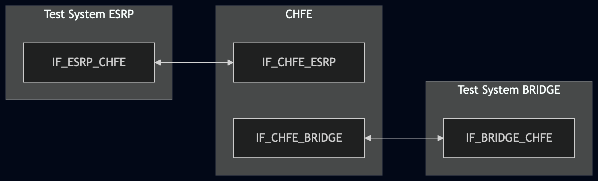
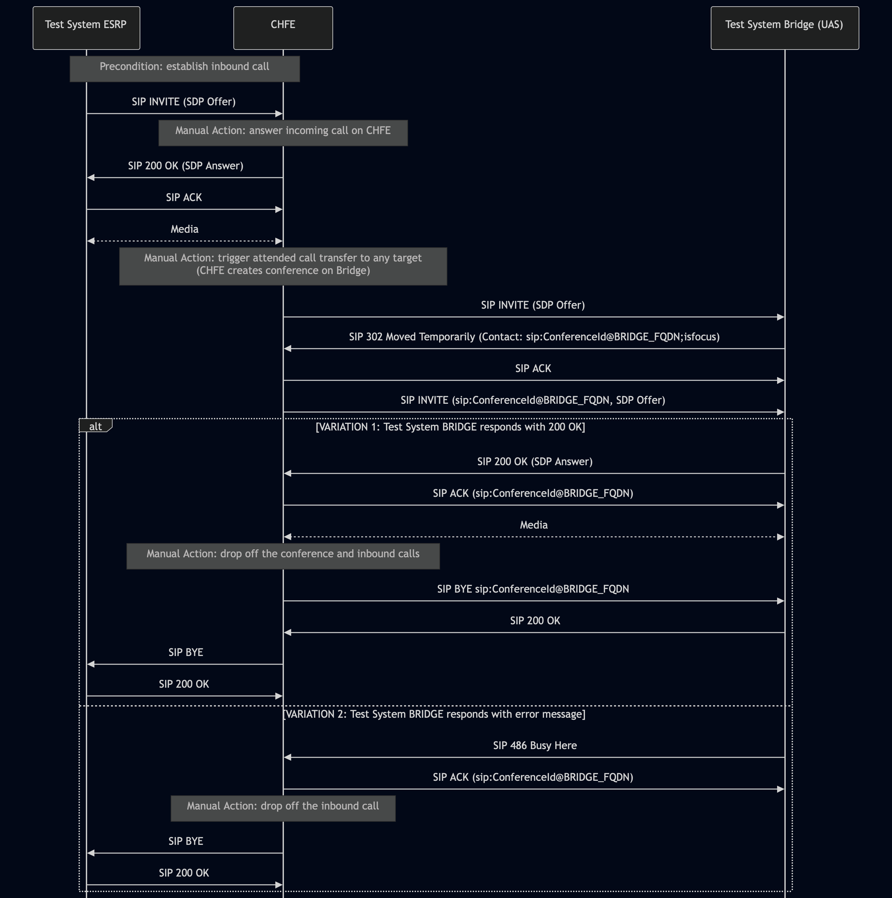

# Test Description: TD_CHFE_023

## Overview
### Summary
SIP ACK handling

### Description
This test verifies that the CHFE:
* sends correct SIP ACK for a 2XX response for SIP INVITE,
* sends correct SIP ACK for any error responses for SIP INVITE
* does not send any SIP ACK after receiving a 200 OK for a BYE

### References
* Requirements : RQ_CHFE_393
* Test Case    : TC_CHFE_023

### Requirements
IXIT config file for CHFE

### SIP transport types
Test can be performed with SIP transport. Steps describing actions for specific one are marked as following:
- (TLS) - used by default inside ESInet on production environment
- (TCP) - used if default TLS is not possible

## Configuration
### Implementation Under Test Interface Connections
* Test System ESRP
  * IF_ESRP_CHFE - connected to IF_CHFE_ESRP
* CHFE
  * IF_CHFE_ESRP - connected to IF_ESRP_CHFE
  * IF_CHFE_BRIDGE - connected to IF_BRIDGE_CHFE
* Test System BRIDGE
  * IF_BRIDGE_CHFE - connected to IF_CHFE_BRIDGE

### Test System Interfaces
* Test System ESRP
  * IF_ESRP_CHFE - Active
* CHFE
  * IF_CHFE_ESRP - Active
  * IF_CHFE_BRIDGE - Active
* Test System BRIDGE
  * IF_BRIDGE_CHFE - Active
 
### Connectivity Diagram


<!--
https://mermaid.live/edit#pako:eNqFUl1rgzAU_StyQXzR4lethrGH9WMrbDDaPY1AyTStUk1KjKyd-N8XtR_SPSwP4Z57zz335JIaYp5QQKDrdcYyibTakCktqIE0IyFib5gahpzzPQaEIc5JWWYxhqbRdcy2Of-OUyKk9rrCTFNnudjM16v3zfRlMX-wrEeF27BLXhld5mm1nD1fOD3oCj2rv8vqayfIIdU-aCm19amUtNBuUvcD-yxlCWZ3_bfq0MIfpYGxgdY_fob8s86f5ygdMGEnsgSQFBU1oaCiIC2EuqVg6LaulqxCQZPqaLXbt2Kec4EBs0b1Hwj75LwAtCV5qTQEr3bpFVWHhEg6y4iyOOCo0VRMecUkoCgwgVSSr08svhihSSa5eOt_QfcZukGAajgCcuzxKPAdPxy7ke36kzAy4aTSoTeaOK7rerYfOKHthI0JP503ezTxI9uLwtALxp4qhhdr827S2VnzC_s5vLI
-->

## Pre-Test Conditions
### Test System ESRP, Test System BRIDGE
* Interfaces are connected to network
* Interfaces have IP addresses assigned by DHCP
* Device is active
* ng911 repository cloned to local storage
* (TLS) Generated own PCA-signed certificate and private key files (test_system.crt, test_system.key)
* (TLS) Certificate and key used by CHFE copied to local storage
* (TLS) PCA certificate copied to local storage
 
### CHFE
* Interfaces are connected to network
* Interfaces have IP addresses assigned by DHCP
* Test System BRIDGE is configured as a default BRIDGE for conference calls and call transfers
* Device is active
* Device is in normal operating state
* IUT is initialized using IXIT config file
* No active calls

## Test Sequence
### Test Preamble

#### Test System ESRP
* Install SIPp by following steps from documentation[^1]
* Copy following XML scenario file to local storage:

  `SIP_basic_call_with_RTP_and_receive_BYE.xml`
  `g711ulaw_rtp_stream.pcap`

* Install Wireshark[^2]
* (TLS v1.2) Configure Wireshark to decode SIP over TLS, use tests system and IUT certificate keys [^3]
* (TLS v1.3) Configure logging of session keys and configure Wireshark to decode SIP over TLS [^4]
* Using Wireshark on 'Test System' start packet tracing on IF_ESRP_CHFE interface - run following filter:
   * (TLS)
     > ip.addr == IF_ESRP_CHFE_IP_ADDRESS and tls
   * (TCP)
     > ip.addr == IF_ESRP_CHFE_IP_ADDRESS and sip

#### Test System BRIDGE
* Copy following XML scenario files to local storage:

```
  BRIDGE_CHFE_023_var_1.xml
  BRIDGE_CHFE_023_var_2.xml
```

* Install Wireshark[^2]
* (TLS v1.2) Configure Wireshark to decode SIP over TLS, use tests system and IUT certificate keys [^3]
* (TLS v1.3) Configure logging of session keys and configure Wireshark to decode SIP over TLS [^4]
* Using Wireshark on 'Test System' start packet tracing on IF_BRIDGE_CHFE interface - run following filter:
   * (TLS)
     > ip.addr == IF_BRIDGE_CHFE_IP_ADDRESS and tls
   * (TCP)
     > ip.addr == IF_BRIDGE_CHFE_IP_ADDRESS and sip

* Run SIP Service process on Test System BRIDGE, replace {XML_SCENARIO_FILE} with the right XML file path depending on current variation:
  * (Variation 1) Use scenario file: `BRIDGE_CHFE_023_var_1.xml`
  * (Variation 2) Use scenario file: `BRIDGE_CHFE_023_var_2.xml`
  * (TLS transport)
    > sudo python3 test_suite/services/stub_server/sip_service/sip_entry.py \
  --scenario {XML_SCENARIO_FILE} \
  --scenario-type auto \
  --bind-ip {IF_BRIDGE_CHFE} --bind-port 5061 \
  --remote-ip {IF_CHFE_BRIDGE} --remote-port 5061 \
  --tls-cert {BRIDGE_CERT_FILE_PATH} --tls-key {BRIDGE_KEY_FILE_PATH} \
  --tls-ca {PCA_CERT_FILE_PATH} \
  --protocol TLS

  * (TCP transport)
    > sudo python3 test_suite/services/stub_server/sip_service/sip_entry.py \
  --scenario {XML_SCENARIO_FILE} \
  --scenario-type auto \
  --bind-ip {IF_BRIDGE_CHFE} --bind-port 5060 \
  --remote-ip {IF_CHFE_BRIDGE} --remote-port 5060 \
  --protocol TCP

### Test Body

#### Variations

1. ACK for 2XX response. For Test System BRIDGE use XML scenario file:

`BRIDGE_CHFE_023_var_1.xml`

2. ACK for non-2XX responses. For Test System BRIDGE use XML scenario file:

`BRIDGE_CHFE_023_var_2.xml`

#### Stimulus

1. Run SIP Service scenario `SIP_basic_call_with_RTP_and_receive_BYE.xml` by using following command on Test System ESRP, example:
  * (TLS transport)
    ``` 
    sudo sipp -t l1 -tls_cert test_system.crt -tls_key test_system.key -i IF_ESRP_CHFE_IP -p 5061 -sf SIP_basic_call_with_RTP_and_receive_BYE.xml IF_CHFE_ESRP_IP:5061
    ```
  * (TCP transport)
    ```
    sudo sipp -t t1 -i IF_ESRP_CHFE_IP -p 5060 -sf SIP_basic_call_with_RTP_and_receive_BYE.xml IF_CHFE_ESRP_IP:5060
    ```

2. Answer incoming call on the CHFE
3. On the CHFE, trigger an attended call transfer to any target (the CHFE will create conference on Test System BRIDGE)
4. After receiving a response from Test System BRIDGE (200 OK / 486 Busy Here) end all ongoing calls on CHFE

#### Response

Using Wireshark verify if: 
* (Variation 1) CHFE sends a SIP ACK towards Test System BRIDGE after receiving 200 OK response for SIP INVITE sent
* (Variation 2) CHFE sends a SIP ACK towards Test System BRIDGE after receiving 302 and 486 response for SIP INVITE sent
* CHFE does not send SIP ACK to Test System BRIDGE or Test System ESRP after receiving 200 OK response for any SIP BYE sent
* SIP ACK outgoing from CHFE:
  * (Variation 1) has the Request-URI set to the URI found in the `Contact` header field of the received `SIP 200 OK` (the URI only, without the `isfocus` header field parameter);
  * (Variation 2) has the Request-URI matching the Request-URI of the corresponding SIP INVITE;
  * (Variation 1) has a `Via` header field containing a newly generated `branch` parameter that is different from the one used in the corresponding SIP INVITE, as it constitutes a separate transaction;
  * (Variation 2) has a single `Via` header field equal to the top `Via` header field of the corresponding SIP INVITE, including the same `branch` parameter, as it is part of the same client transaction;
  * has a `To` header field matching the `To` header field of the received response (`SIP 200 OK`/`SIP 486 Busy Here`/`302 Moved`), including the `tag` parameter;
  * has a `From` header field matching the `From` header field of the corresponding SIP INVITE, including the `tag` parameter;
  * has a `Call-ID` header field matching the `Call-ID` of the corresponding SIP INVITE;
  * has a `CSeq` header field with the method set to `ACK` and the sequence number matching the `CSeq` number of the corresponding SIP INVITE;
  * contains a `Max-Forwards` header field.
  * (Variation 2) if the corresponding SIP INVITE has a Route header field, then outgoing SIP ACK must contain its exact copy

VERDICT:
* PASSED - if all checks passed
* FAILED - any other cases

#### Example

(Variation 1) Example transaction:
```
INVITE sip:conf-factory@192.168.1.20:5060 SIP/2.0
Via: SIP/2.0/TCP 192.168.1.10:5060;branch=z9hG4bK-inv-11111
From: <sip:CHFE@192.168.1.10>;tag=chfe-tag-1
To: <sip:conf-factory@192.168.1.20>
Call-ID: call-12345@192.168.1.10
CSeq: 1 INVITE
Contact: <sip:CHFE-contact@192.168.1.10:5060>
Call-Info: <urn:emergency:uid:callid:123ABCdefg123ABCdefg123ABCdefg12:test.com>;purpose=emergency-CallId
Call-Info: <urn:emergency:uid:incidentid:123ABCdefg123ABCdefg123ABCdefg12:test.com>;purpose=emergency-IncidentId
Max-Forwards: 70
Content-Type: application/sdp
Content-Length: ...
(SDP Offer)

SIP/2.0 200 OK
Via: SIP/2.0/TCP 192.168.1.10:5060;branch=z9hG4bK-inv-11111
From: <sip:CHFE@192.168.1.10>;tag=chfe-tag-1
To: <sip:conf-factory@192.168.1.20>;tag=tsbridge-v1
Call-ID: call-12345@192.168.1.10
CSeq: 1 INVITE
Contact: <sip:conf-023@192.168.1.20:5060>;isfocus
Content-Type: application/sdp
Content-Length: ...
(SDP Answer)

ACK sip:conf-023@192.168.1.20:5060 SIP/2.0
Via: SIP/2.0/TCP 192.168.1.10:5060;branch=z9hG4bK-ack-22222
From: <sip:CHFE@192.168.1.10>;tag=chfe-tag-1
To: <sip:conf-factory@192.168.1.20>;tag=tsbridge-v1
Call-ID: call-12345@192.168.1.10
CSeq: 1 ACK
Max-Forwards: 70
```

(Variation 2) Example transaction:
```
INVITE sip:bridge@192.168.1.20:5060 SIP/2.0
Via: SIP/2.0/TCP 192.168.1.10:5060;branch=z9hG4bK-inv-33333-inv1
Route: <sip:192.168.1.20;lr>
From: <sip:CHFE@192.168.1.10>;tag=chfe-tag-3-inv1
To: <sip:bridge@192.168.1.20>
Call-ID: call-678901@192.168.1.10
CSeq: 1 INVITE
Contact: <sip:CHFE-contact@192.168.1.10:5060>
Call-Info: <urn:emergency:uid:callid:123ABCdefg123ABCdefg123ABCdefg12:test.com>;purpose=emergency-CallId
Call-Info: <urn:emergency:uid:incidentid:123ABCdefg123ABCdefg123ABCdefg12:test.com>;purpose=emergency-IncidentId
Max-Forwards: 70
Content-Type: application/sdp
Content-Length: ...
(SDP Offer)

SIP/2.0 302 Moved Temporarily
Via: SIP/2.0/TCP 192.168.1.10:5060;branch=z9hG4bK-inv-33333-inv1
From: <sip:CHFE@192.168.1.10>;tag=chfe-tag-3-inv1
To: <sip:bridge@192.168.1.20>;tag=tsbridge-v3-inv1
Call-ID: call-678901@192.168.1.10
Contact: <sip:conf1@192.168.1.20:5060>;isfocus
CSeq: 1 INVITE
Content-Length: 0

ACK sip:bridge@192.168.1.20:5060 SIP/2.0
Via: SIP/2.0/TCP 192.168.1.10:5060;branch=z9hG4bK-inv-33333-inv1
Route: <sip:192.168.1.20;lr>
From: <sip:CHFE@192.168.1.10>;tag=chfe-tag-3-inv1
To: <sip:bridge@192.168.1.20>;tag=tsbridge-v3-inv1
Call-ID: call-678901@192.168.1.10
CSeq: 1 ACK
Max-Forwards: 70

INVITE sip:conf1@192.168.1.20:5060 SIP/2.0
Via: SIP/2.0/TCP 192.168.1.10:5060;branch=z9hG4bK-inv-33333
Route: <sip:192.168.1.20;lr>
From: <sip:CHFE@192.168.1.10>;tag=chfe-tag-3
To: <sip:conf1@192.168.1.20:5060>
Call-ID: call-67890@192.168.1.10
CSeq: 1 INVITE
Contact: <sip:CHFE-contact@192.168.1.10:5060>
Call-Info: <urn:emergency:uid:callid:123ABCdefg123ABCdefg123ABCdefg12:test.com>;purpose=emergency-CallId
Call-Info: <urn:emergency:uid:incidentid:123ABCdefg123ABCdefg123ABCdefg12:test.com>;purpose=emergency-IncidentId
Max-Forwards: 70
Content-Type: application/sdp
Content-Length: ...
(SDP Offer)

SIP/2.0 486 Busy Here
Via: SIP/2.0/TCP 192.168.1.10:5060;branch=z9hG4bK-inv-33333
From: <sip:CHFE@192.168.1.10>;tag=chfe-tag-3
To: <sip:conf1@192.168.1.20:5060>;tag=tsbridge-v3
Call-ID: call-67890@192.168.1.10
CSeq: 1 INVITE
Content-Length: 0

ACK sip:conf1@192.168.1.20:5060 SIP/2.0
Via: SIP/2.0/TCP 192.168.1.10:5060;branch=z9hG4bK-inv-33333
Route: <sip:192.168.1.20;lr>
From: <sip:CHFE@192.168.1.10>;tag=chfe-tag-3
To: <sip:conf1@192.168.1.20:5060>;tag=tsbridge-v3
Call-ID: call-67890@192.168.1.10
CSeq: 1 ACK
Max-Forwards: 70
```

### Test Postamble

#### Test System ESRP, Test System BRIDGE

* Stop all SIPp/SIP Service processes if still running
* Archive generated logs
* Stop packet capture
* Disconnect test interfaces
* (TLS) remove certificates

#### CHFE

* Restore the default configuration
* disconnect interfaces from Test Systems
* reconnect interfaces back to default

## Post-Test Conditions 

### Test System ESRP, Test System BRIDGE

* Test tools are stopped
* Test interfaces are disconnected

### CHFE

* Device is connected back to the default configuration
* Device is in normal operating state

## Sequence Diagram
<!--
https://mermaid.live/edit#pako:eNqtVW1P2zAQ_isnTxVUSlGTNiVkCK1AGRUCOsqQNkWaTOIGi8TubGfQVf3vu8QUSrt2TNuXvPhenudefDclsUwYCUmj0YhELMWIp2EkAHKulFTd2EilQxjRTLNIVEq12pQLbkKYbpk7lrOtELYSqu63HIhIJuV9RMKIxBnVmscRmc1qtUhEQrPvBRMxO-Y0VTQvMQBqNTjpwZgqw2M-psJoe75wAr3h1QCohmumDQwn2rC8OlvVPDpFZ6hZvlelh1f944-9ZU-Hiicpg-3P3WG9pGntLqRhIH8wVSE5lccQBophhhJuuBQhoBN6m3F9B1zcykIkENMss_alVePgwJoN-wPoX9z0r3uwPTwewOVoxFR9GcjqnlNR0Aww7xUGFfoBZRwrk3ORVgggxUKE5RcilYAWyWs24fLMInUr8_oaTt2jsxfJ_n7jWXjOEk5XU_FbhkbxNEUhNYaJhNkk4CkyxyjBSIxhAoaqlJn9W3UA21WVYsWoYRrKjmOq7IsyLFuM-qvIbNk2Z9HqvAqu1fTgHGknWO18LBVVPJsguBSGxti8mo_Do2fwfvLB-vh28un44p2_957rkYwLvZ7Lc_Y28NwE4sByFPZJMwM33at-97p_eQFu-LpbbQ8rpsfYiBoeuLl7qri1XpONtU2xPrjN7JfMbffMPTz1z1zhDx2UKDkGORoBTpPFfqB4oxZvlt7I-PBLb2NN35CeFf8vlwq9v0hXLtKiOcNBuVA_7w31Y-WkhZxpTVO2kWc76MBhoSdwiiH-twL-TX1WR92_5kskkSAOSfHqk9CogjkkZyqn5S-ZlkoRqfYMrhX8VCwpHhvlvmnEMpMqIpGYoT2O-K9S5nMXShbpHQmrveWQYpzgtHnaPM-nqhxY6gjjMSR0A7dyQsIpeax-d_banttpubu-3_F8h0xI6Hk7Qbu12wyaftv12529mUN-VqjuTrPd8YLA91u-G3hegAa0MHI4EfGcE94K3Kbndt9Wa3fOrFdJnojNfgEwZ0Pw
-->




## Comments

Version:  010.3d.5.0.0

Date: 20261105

## Footnotes
[^1]: SIPp - tool for SIP packet simulations. Official documentation: https://sipp.sourceforge.net/doc/reference.html#Getting+SIPp

[^2]: Wireshark - tool for packet tracing and analysis. Official website: https://www.wireshark.org/download.html

[^3]: Wireshark configuration to decrypt TLS packets: https://www.zoiper.com/en/support/home/article/162/How%20to%20decode%20SIP%20over%20TLS%20with%20Wireshark%20and%20Decrypting%20SDES%20Protected%20SRTP%20Stream

[^4]: TLS v1.3 session keys logging + Wireshark configuration to decrypt traffic: https://my.f5.com/manage/s/article/K50557518