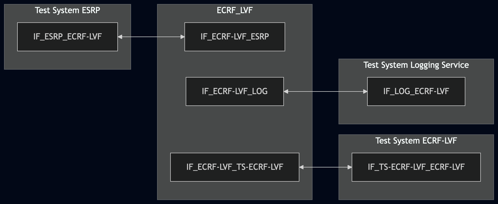
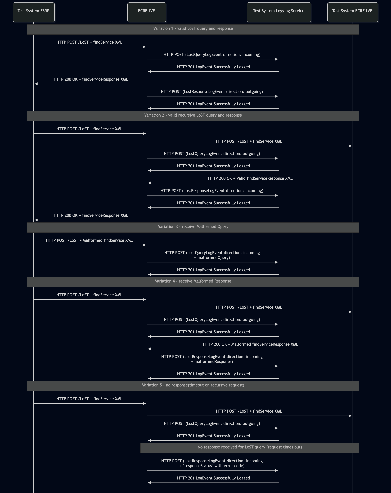

# Test Description: TD_ECRF-LVF_009

<!-- MULTIPLE TDs already exist - review & consolidate
 Existing TD(s) - TD_ECRF-LVF_009 (from RQ_ECRF-LVF_085 / ECRF-LVF); TD_ESRP_014 (from RQ_ESRP_149 / ESRP) -->

## Overview
### Summary
LostQueryLogEvent and LostResponseLogEvent


### Description
This test verifies LostQueryLogEvent and LostResponseLogEvent members including correlation between "responseId" and "queryId" fields.


### HTTP transport types
Test can be performed with 2 different HTTP transport types. Steps describing actions for specific one are marked as following:
- (TLS transport) - used by default inside ESInet on production environment
- (TCP transport) - used as a fallback if use of TLS is not possible

### References
* Requirements : RQ_ECRF-LVF_085, RQ_ECRF-LVF_091, RQ_ECRF-LVF_086
* Test Case    : TC_ECRF_LVF_009

### Requirements
IXIT config file for ECRF-LVF

## Configuration
### Implementation Under Test Interface Connections
<!-- Identify each of the FEs that are part of the configuration and how they are connected -->
* Test System ESRP
  * IF_ESRP_ECRF-LVF - connected to IF_ECRF-LVF_ESRP
* ECRF-LVF(IUT)
  * IF_ECRF-LVF_ESRP - connected to IF_ESRP_ECRF-LVF
  * IF_ECRF-LVF_TS-ECRF-LVF - connected to IF_TS-ECRF-LVF_ECRF-LVF
  * IF_ECRF-LVF_LOG - connected to IF_LOG_ECRF-LVF
* Test System ECRF-LVF
  * IF_TS-ECRF-LVF_ECRF-LVF - connected to IF_ECRF-LVF_TS-ECRF-LVF
* Test System Logging Service
  * IF_LOG_ECRF-LVF - connected to IF_ECRF-LVF_LOG


### Test System Interfaces
<!-- Identify each of the test system interfaces and whether it will be in active or monitor mode -->
* Test System ESRP
  * IF_ESRP_ECRF-LVF - Active
* ECRF-LVF(IUT)
  * IF_ECRF-LVF_ESRP - Active
  * IF_ECRF-LVF_LOG - Active
* Test System ECRF-LVF
  * IF_TS-ECRF-LVF_ECRF-LVF - Active
* Test System Logging Service
  * IF_LOG_ECRF-LVF - Active

### Connectivity Diagram
<!--
https://mermaid.live/edit#pako:eNp9Ul1vgkAQ_Ctkn8EgipBL0xcrTROaNmL60JCQK6xAKnfmONpa43_vgYoK1nu6nZmdnfvYQswTBALLFf-OMyqk5s9Dpqn15EWzYP4azaZzz_DfvDvDuK-xQ9mQJ-UR9V8eD0K1a-G-bhEYHeMzpNNXVh-poOtMW2AptWBTSiy00_hrYfcMsqTjUPNRy3dD9T3PjnWdOEt9Evw3_SJ_r-vmHdw283ma5izVAhRfeYwXnv13UF6gQyryBIgUFepQoChoXcK2loQgMywwBKK2CRWfIYRsp3rWlL1zXhzbBK_SDMiSrkpVVeuESnzIqcpXtKhQ01BMecUkEMscNyZAtvBTlwPbrJc9coYTd6jIDZCh4w4c07KskWXbY9Od2Dsdfpux5sB1bB1oJXmwYfExBya55OJ5_5ObD737A_Qb04o
-->




## Pre-Test Conditions

### Test System ESRP/Test System Logging Service/Test System ECRF-LVF
* Interfaces are connected to network
* Interfaces have IP addresses assigned by DHCP
* Device is active
* No active calls
* (TLS transport) Test System has it's own certificate signed by PCA

### ECRF-LVF
* Interfaces are connected to network
* Interfaces have IP addresses assigned by DHCP
* Default configuration is loaded
* IUT is configured with planned changes
* IUT is initialized with steps from IXIT config file
* IUT is active
* IUT is in normal operating state
* IUT is provisioned with following service boundary:
```
Boundary1 - service SIP URI: sip:boundary1@example.com
40.717309464520554, -73.99120141285248
40.71672360940788, -73.9891917501422
40.71556789497267, -73.9898030924558
40.716159065144886, -73.9917916448061
```


## Test Sequence

### Test Preamble

#### Test System ESRP
* Install CuRL[^1]
* Install Wireshark[^2]
* Copy following HTTP scenario file to local storage:
  ```
  findService_geodetic_point.xml
  findService_geodetic_point_not_in_ecrf.xml
  findService_geodetic_point_malformed.xml
  ```
* (TLS transport) Copy to local storage PCA-signed TLS certificate and private key files:
  ```
     PCA-cacert.pem
     PCA-cakey.pem
  ```
* (TLS transport) Copy to local storage TLS certificate and private key files used by ECRF:
  ```
     ECRF-cacert.pem
     ECRF-cakey.pem

  ```
* (TLS transport) Configure Wireshark to decode HTTP over TLS packets from Test System ESRP and ECRF-LVF as well[^3]
* Using Wireshark on 'Test System ESRP' start packet tracing on IF_ESRP_ECRF-LVF interface - run following filter:
   * (TLS transport)
     > (ip.addr == IF_ESRP_ECRF-LVF_IP_ADDRESS) and tls
   * (TCP transport)
     > (ip.addr == IF_ESRP_ECRF-LVF_IP_ADDRESS) and http

#### Test System Logging Service
* Install Wireshark[^2]
* (TLS v1.2) Configure Wireshark to decode HTTP over TLS, use tests system and ECRF-LVF certificate keys [^3]
* (TLS v1.3) Configure logging of session keys and configure Wireshark to decode HTTP over TLS [^4]
* Using Wireshark on 'Test System' start packet tracing on IF_LOG_ECRF-LVF interface - run following filter:
   * (TLS)
     > ip.addr == IF_LOG_ECRF-LVF_IP_ADDRESS and tls
   * (TCP)
     > ip.addr == IF_LOG_ECRF-LVF_IP_ADDRESS and http
* The Logging Service must be configured to accept and process HTTP POST requests. To verify this manually, you can simulate a listening HTTP endpoint on port 8080 using command in the terminal:
    * Step 1 - Prepare logEventId and JSON body
      ```
      ID="urn:emergency:uid:logid:$(date +%s%N):logger.state.pa.us"
      BODY="{\"logEventId\":\"$ID\"}"
      ```
    * Step 2 - Run server:
      * (TLS)
      ```
      python3 http_entry.py --ip IF_LOG_ECRF-LVF --port 443 --role RECEIVER --path /LogEvents --method POST 
      --body "$BODY" --content_type application/json --response_code 201 --server_cert /tmp/cert.crt --server_key /tmp/cert.key
      ```
      * (TCP)
      ```
      python3 http_entry.py --ip IF_LOG_ECRF-LVF --port 8080 --role RECEIVER --path /LogEvents --method POST --body "$BODY" --content_type application/json --response_code 201
      ```
    * Step 3 - In another terminal, send a POST request to verify it is working:
      * (TLS)
      ```
      curl -k -X POST https://localhost:443/LogEvents -d '{"log":"test"}'
      ```   
      * (TCP)
      ```
      curl -X POST http://localhost:8080/LogEvents -d '{"log":"test"}'
      ```

#### Test System ECRF-LVF
* Install Wireshark[^2]
* (TLS transport) Configure Wireshark to decode HTTP over TLS packets from Test System ECRF-LVF and ECRF as well[^3]
* Copy following valid and malformed HTTP scenario files to local storage:
  ```
	 findServiceResponse_for_not_in_ecrf.xml
     findServiceResponse_malformed.xml
  ```
* Using Wireshark on 'Test System' start packet tracing on IF_ECRF-LVF_ECRF-LVF interface - run following filter:
   * (TLS transport)
     > (ip.addr == IF_ECRF-LVF_ECRF-LVF_IP_ADDRESS) and tls
   * (TCP transport)
     > (ip.addr == IF_ECRF-LVF_ECRF-LVF_IP_ADDRESS) and http
* Start http server responding for HTTPS POST requests:
    * Variation 2 
      * (TLS transport)
       ```
          python3 http_entry.py \ --ip IF_ECRF-LVF_ECRF-LVF_IP_ADDRESS \ --port 8080 \ --role RECEIVER \ --path /LoST \ --method POST \ --body file.findServiceResponse_for_not_in_ecrf.xml \ --content_type application/lost+xml \ --response_code 200 \ --server_cert test_system2.pem \ --server_key test_system2.key
       ```
      * (TCP transport)
       ```
          python3 http_entry.py \ --ip IF_ECRF-LVF_ECRF-LVF_IP_ADDRESS \ --port 8080 \ --role RECEIVER \ --path /LoST \ --method POST \ --body file.findServiceResponse_for_not_in_ecrf.xml \ --content_type application/lost+xml \ --response_code 200
       ```
    * Variation 4
      * (TLS transport)
       ```
          python3 http_entry.py \ --ip IF_ECRF-LVF_ECRF-LVF_IP_ADDRESS \ --port 8080 \ --role RECEIVER \ --path /LoST \ --method POST \ --body file.findServiceResponse_malformed.xml \ --content_type application/lost+xml \ --response_code 200 \ --server_cert test_system2.pem \ --server_key test_system2.key
       ```
      * (TCP transport)
       ```
          python3 http_entry.py \ --ip IF_ECRF-LVF_ECRF-LVF_IP_ADDRESS \ --port 8080 \ --role RECEIVER \ --path /LoST \ --method POST \ --body file.findServiceResponse_malformed.xml \ --content_type application/lost+xml \ --response_code 200
     ```  
* Variation 5 only - Do NOT start the HTTP server on Test System ECRF-LVF to simulate a timeout of the recursive LoST request.

### Test Body

#### Variations

* Variation 1 – valid LoST query and response. Verifies "LostQueryLogEvent" with "direction: incoming" + "LostResponseLogEvent" with "direction: outgoing"
    Use scenario file: findService_geodetic_point.xml
* Variation 2 - valid recursive LoST query and response. Verifies "LostQueryLogEvent" with "direction: outgoing" + "LostResponseLogEvent" with "direction: incoming"
    Use scenario file: findService_geodetic_point_not_in_ecrf.xml
* Variation 3 - malformed LoST query. Verifies "LostQueryLogEvent" with "direction: incoming" and "malformedQuery"
    Use scenario file: findService_geodetic_point_malformed.xml
* Variation 4 - malformed LoST response. Verifies "LostResponseLogEvent" with "direction: incoming" and "malformedResponse"
    Use scenario file: findService_geodetic_point_not_in_ecrf.xml
* Variation 5 - no response for recursive LoST query. Verifies "LostResponseLogEvent" with "direction: incoming" and "responseStatus" with error code (from Status Codes Registry section 10.29)
    Use scenario file: findService_geodetic_point_not_in_ecrf.xml

#### Stimulus
From 'Test System ESRP' send HTTP POST with findService request, replace {XML_SCENARIO_FILE} with path to file depending on variation:
   * (TLS)
     ```
        curl --cacert cacert.pem --cert client.pem --key client.key \
        -X POST https://IF_ECRF-LVF_ESRP_IP:PORT/LoST \
        -H "Content-Type: application/lost+xml" \
        --data-binary @{XML_SCENARIO_FILE}
     ```
   * (TCP)
     ```
        curl -X POST http://IF_ECRF-LVF_ESRP_IP:PORT/LoST \
        -H "Content-Type: application/lost+xml" \
        --data-binary @{XML_SCENARIO_FILE}
     ```


#### Response

Using Wireshark verify if:
1. For each findService LoST query (received or sent) ECRF-LVF sends an HTTP POST to the Test System Logging Service with a JWS body containing a JSON payload with a LogEvent:
   * "logEventType": "LostQueryLogEvent"
   * "timestamp" with correct date-time format (f.e. 2020-03-10T11:00:01-05:00);
   * "elementId" which has value with FQDN of ECRF-LVF
   * "agencyId" which has value with FQDN of the agency operating the ECRF-LVF
   * "direction" which has value: 
     * `incoming` - if LoST query was received from Test System ESRP
     * `outgoing` - if LoST query was sent by the ECRF-LVF to Test System ECRF-LVF
   * "queryAdapter" field is a string consisting of the entire LoST query (sent or received by the ECRF-LVF)
   * "queryId" field is a string (e.g. `urn:emergency:uid:queryid:globally_unique_id`);
   * (Variation 3) "malformedQuery" is a string consisting of the malformed LoST query received by the ECRF-LVF from Test System ESRP
   * "callId" which has value f.e.: `urn:emergency:uid:callid:1234567890:esrp.ng911.example` (taken from the `emergencyCallIncidentId` extension in the `<findService>` request)
   * "incidentId" which has value f.e.: `urn:emergency:uid:incidentid:1234567890:esrp.ng911.example` (taken from the same extension)
   * (optional) "clientAssignedIdentifier" field with string value
   * (optional) "agencyAgentId" field with string value
   * (optional) "agencyPositionId" field with string value
   * (optional) field "ipAddressPort" with string value representing normalized IP address and port number, or FQDN of 
    another element that participated in the transaction that triggered this LogEvent element(Test System ESRP)
   * (optional) "extension" field should contain a JSON object
2. For each findServiceResponse LoST query response (received or sent) ECRF-LVF sends an HTTP POST to the Test System Logging Service with a JWS body containing a JSON payload with a LogEvent:
   * "logEventType": "LostResponseLogEvent"
   * "timestamp" with correct date-time format (f.e. 2020-03-10T11:00:01-05:00);
   * "elementId" which has value with FQDN of ECRF-LVF
   * "agencyId" which has value with FQDN of the agency operating the ECRF-LVF
   * "direction" which has value:
     * `incoming` - if LoST query response was received by ECRF-LVF from the Test System ECRF-LVF
     * `outgoing` - if LoST query response was sent by the ECRF-LVF to Test System ESRP
   * "responseAdapter" field is a string consisting of the entire LoST response;
     * direction: outgoing - must contain the XML body of the findServiceResponse sent by ECRF-LVF to Test System ESRP
     * direction: incoming - must contain the XML body of the findServiceResponse received by ECRF-LVF from Test System ECRF-LVF (for a malformed response - the malformed XML body as received)
     * direction: incoming when no response was received from Test System ECRF-LVF (request timed out) - must contain an empty string
   * "responseId" field is a string, the value of `responseId` MUST match `queryId` from the corresponding LostQueryLogEvent:
     * The `responseId` for the ECRF-LVF -> ESRP response is equal to the `queryId` in the LostQueryLogEvent for the corresponding initial ESRP -> ECRF-LVF query 
     * The `responseId` for the TS-ECRF-LVF -> ECRF-LVF response is equal to the `queryId` in the LostQueryLogEvent for the corresponding recursive ECRF-LVF->TS-ECRF-LVF query
   * (Variation 4) "malformedResponse" is a string consisting the malformed LoST response received by the ECRF-LVF from Test System ECRF-LVF
   * (Variation 4) "responseStatus" is a string containing a status code from the Status Codes Registry (Section 10.29), since a malformed response is logged with a status code
   * (optional) "clientAssignedIdentifier" field with string value
   * (optional) "agencyAgentId" field with string value
   * (optional) "agencyPositionId" field with string value
   * (optional) field "ipAddressPort" with string value representing normalized IP address and port number, or FQDN of 
    another element that participated in the transaction that triggered this LogEvent element 
   * (optional) "extension" field should contain a JSON object
3. Make sure that all "LostResponseLogEvent" have their pair with "LostQueryLogEvent". Their "responseId" and "queryId" fields must match
4. (Variation 5) Check additionally if after no response for the last findService LoST query ECRF-LVF logged "LostResponseLogEvent" with "direction: incoming" and "responseStatus" with error code (from Status Codes Registry section 10.29)

VERDICT:
* PASSED - if all checks passed
* FAILED - any other cases

### Test Postamble
#### Test System ESRP/Test System Logging Service/Test System ECRF-LVF
* archive all logs generated
* stop Wireshark (if still running)
* remove all HTTP scenarios
* disconnect interfaces from ECRF
* (TLS transport) remove certificates

#### ECRF-LVF
* reconnect interfaces back to default
* restore previous configuration

## Post-Test Conditions 
### Test System ESRP/Test System Logging Service/Test System ECRF-LVF
* Test tools stopped
* interfaces disconnected from ECRF

### ECRF-LVF
* device connected back to default
* device in normal operating state


## Sequence Diagram
<!--
https://mermaid.live/edit#pako:eNrtVt9v2jAQ_ldOfipq0jaQALEmpKlrN2n0xwhC05QXLzGpNWIz26FlVf_32SaB_uABlfZp4yXCue_uu-_unLtHmcgpwsj3_ZRngk9ZgVMOUDIphfyYaSEVhimZKWqP9Q0tKYacyF8pdxhFf1eUZ_QTI4UkpTUCmBOpWcbmhGs4S0bXQBSMqdKQLJWmpTvbYnk6OreW9ukPJ-cvLYZXn5-7GoqiYLyAhMoFy-hLzNhv_D5hsI6xQlwKTUEsqHTcvBqFYUIkI5oJDgH4sCAzlpuQyRhM1nIJhOcgqZoLrurQFu4PBg79ZTy-husrY33sMIcwZTyvmcL3i2ENsVwGA5Mchg3kYCiU_majmBTPFtSkkjNJM0sGAzPFKk3erZULg22Crly0TwJY45Iqy6hS02o2WzrBaA5PQlvSa-AJXH19SnVUZ7gT5cZ4G2tR6ULswXoFg11L1l6XzDCopGIL-l7Fq4O_Y8X31a5WbUX0ObSu-cSJ9R6V37dfX9-uu094x7SLIUxtm1yQ2VTI0sjmCrJLe2wgbz7lH37K48EhlE0EB3i9lLsKEm4VZPR_ZB713daqv_nYPG-ABrPfOO3aB5HpAy7Wd-WBZiU12oJ5tblYpV0ElG79M23xSDeD3eh2uVGqmR7THEI-_vQc1GqBlVJZRq1mLN-mU1LUcEg00ZVKEdwyfQPUrnVgl759ro_6O2x-yEOFZDnCWlbUQyWVJbF_0b21SZFbGFOEHaG8uvPt6uhnYiZkilL-YPBmS_shRNm4kKIqbhB2K6eHqnlOdLNcrk8l5TmVp6LiGuFuEDonCN-jO4SD3lHc7kRxL-r323EcBpGHlgj7kXnR74Vx1O91ulE_ih889MfFDY76QbsXtsNe0I3DOOx2PEQqLZIlzxpWNGdmFb5YLctuZ264nbk3NbWHv5BClLE
-->




## Comments

Version:  010.3d.5.1.4

Date:     20261007


## Footnotes
[^1]: CURL for Linux https://linux.die.net/man/1/curl
[^2]: Wireshark - tool for packet tracing and anaylisis. Official website: https://www.wireshark.org/download.html
[^3]: Wireshark configuration to decrypt SIP over TLS packets: https://www.zoiper.com/en/support/home/article/162/How%20to%20decode%20SIP%20over%20TLS%20with%20Wireshark%20and%20Decrypting%20SDES%20Protected%20SRTP%20Stream
[^4]: Netcat for Linux https://linux.die.net/man/1/nc
[^5]: TLS v1.3 session keys logging + Wireshark configuration to decrypt traffic: https://my.f5.com/manage/s/article/K50557518
