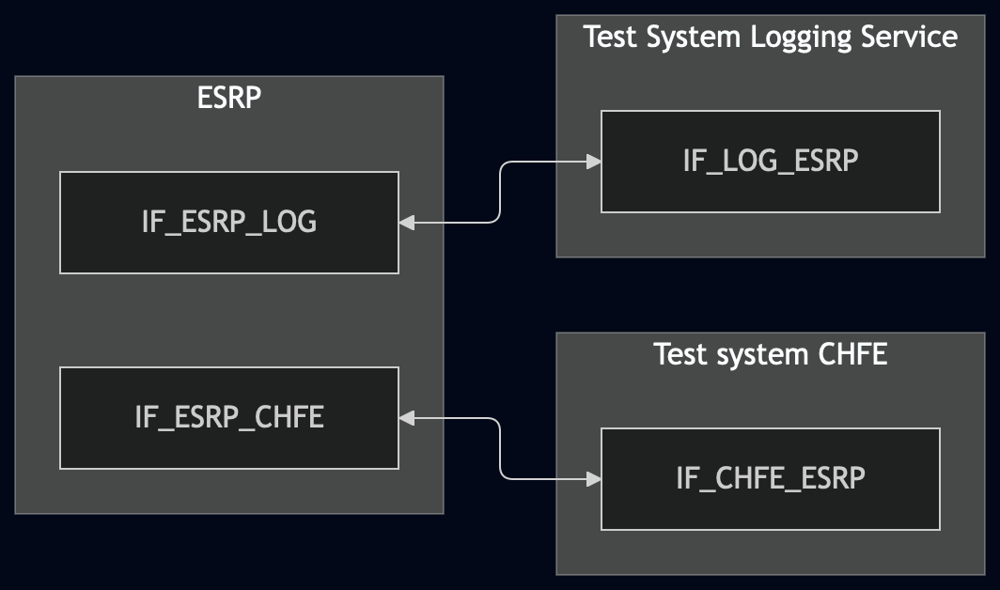
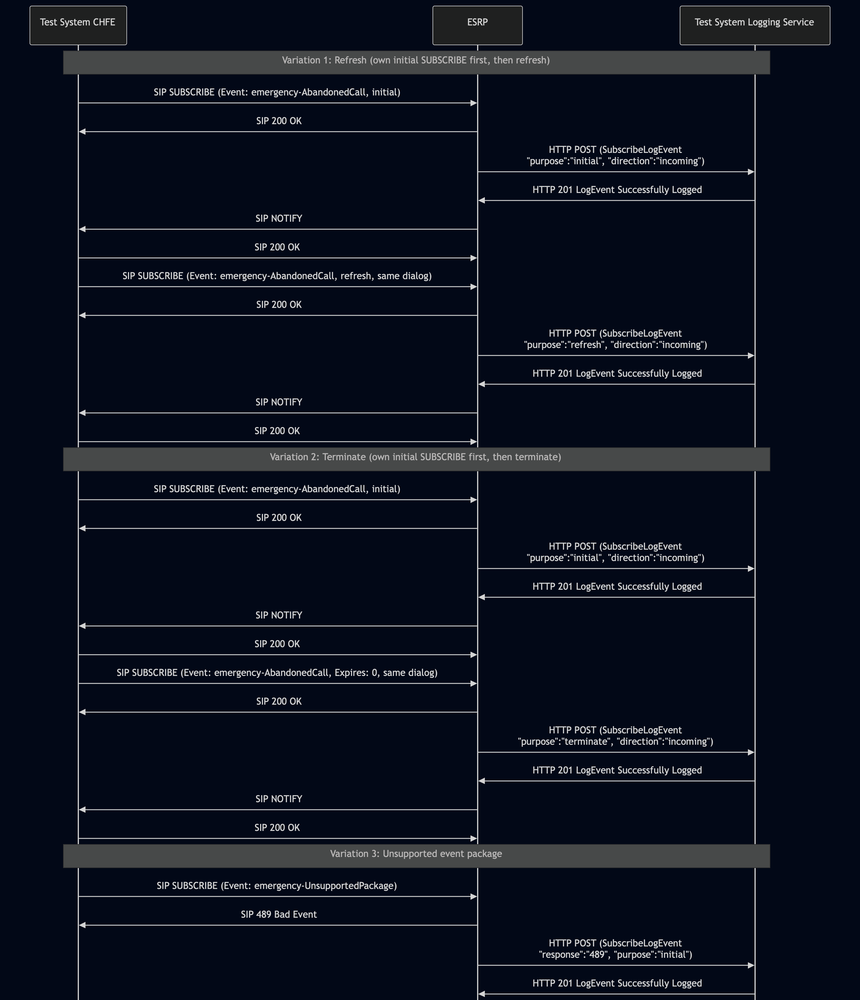

# Test Description: TD_ESRP_021

## Overview
### Summary
Logging of SubscribeLogEvent

### Description
Verify that ESRP logs a valid SubscribeLogEvent for each SUBSCRIBE transaction (initial, refresh, terminate) and that the logged LogEvent contains all mandatory SubscribeLogEvent members.

### HTTP transport types
Test can be performed with 2 different HTTP transport types. Steps describing actions for specific one are marked as following:
- (TLS transport) - used by default inside ESInet on production environment
- (TCP transport) - used as a fallback if use of TLS is not possible

### References
* Requirements : RQ_ESRP_162, RQ_ESRP_163
* Test Case    : TC_ESRP_021

### Requirements
IXIT config file for ESRP:
 - enabling AbandonedCall subscription for Test System CHFE (downstream PSAP)

## Configuration
### Implementation Under Test Interface Connections
<!-- Identify each of the FEs that are part of the configuration and how they are connected -->
* ESRP
  * IF_ESRP_LOG - connected to IF_LOG_ESRP
  * IF_ESRP_CHFE - connected to IF_CHFE_ESRP
* Test System CHFE
  * IF_CHFE_ESRP - connected to IF_ESRP_CHFE
* Test System Logging Service
  * IF_LOG_ESRP - connected to IF_ESRP_LOG


### Test System Interfaces
<!-- Identify each of the test system interfaces and whether it will be in active or monitor mode -->
* ESRP
  * IF_ESRP_LOG - Active
  * IF_ESRP_CHFE - Active
* Test System CHFE
  * IF_CHFE_ESRP - Active
* Test System Logging Service
  * IF_LOG_ESRP - Active

### Connectivity Diagram
<!--
https://mermaid.live/edit#pako:eNp9Ut9PwjAQ_leae97IcL8b4wuCmmA0jCezhNSubAtbS7pOQcL_btcNEUzs09133_fd9XIHoCJjgMG27ZRTwddljlOOkCpYzTDKiNx0aSXEBiNakaYpacoNe12JT1oQqdB80XEQepqtpsnidTV_ebi17Tud6shAl_XJ42w6ELpwYPScpn3PJdkW6Cy7sv4LdiY9ynh2ZbNkjULNvlGsRmfeoP7V_R910qvnIs9LnqOEyY-Ssgujy38aH7Agl2UGWMmWWVAzWZMuhUNHSsFsOAWsQ8mydmd3u7apqIRMIeVHrd8S_iZEfbKQos0LwGtSNTprtxlR7L4ketL6B5W6N5MT0XIF2HOMB-AD7AAH3iga3_hu5HluEI9DC_YajEdO7AZ-4Ie-H7qOf7Tgy_R0RlHoxfpFTuDHThRrAWmVSPacniZiWamEfO5PyFzSaa6pqQxjHb8BYFy7zA
-->




## Pre-Test Conditions

### Test System Logging Service/Test System CHFE
* Interfaces are connected to network
* Interfaces have IP addresses assigned by DHCP
* Device is active
* No active calls
* (TLS transport) Test System has it's own certificate signed by PCA

### ESRP
* Interfaces are connected to network
* Interfaces have IP addresses assigned by DHCP
* Default configuration is loaded
* IUT is configured with planned changes 
* IUT is initialized with steps from IXIT config file
* IUT is active
* IUT is provisioned with policy (AbandonedCall) allowing subscriptions from Test System CHFE

## Test Sequence

### Test Preamble

#### Test System Logging Service
* Install Wireshark[^2]
* (TLS v1.2) Configure Wireshark to decode HTTP over TLS, use tests system and ESRP certificate keys [^3]
* (TLS v1.3) Configure logging of session keys and configure Wireshark to decode HTTP over TLS [^4]
* Using Wireshark on 'Test System' start packet tracing on IF_LOG_ESRP interface - run following filter:
   * (TLS)
     > ip.addr == IF_LOG_ESRP_IP_ADDRESS and tls
   * (TCP)
     > ip.addr == IF_LOG_ESRP_IP_ADDRESS and http
* The Logging Service must be configured to accept and process HTTP POST requests. To verify this manually, you can simulate a listening HTTP endpoint on port 8080 using command in the terminal:
    * Step 1 - Prepare logEventId and JSON body
      ```
      ID="urn:emergency:uid:logid:$(date +%s%N):logger.state.pa.us"
      BODY="{\"logEventId\":\"$ID\"}"
      ```
    * Step 2 - Run server:
      * (TLS)
      ```
      python3 http_entry.py --ip IF_LOG_ESRP --port 443 --role RECEIVER --path /LogEvents --method POST \
      --body "$BODY" --content_type application/json --response_code 201 --server_cert /tmp/cert.crt --server_key /tmp/cert.key
      ```
      * (TCP)
      ```
      python3 http_entry.py --ip IF_LOG_ESRP --port 8080 --role RECEIVER --path /LogEvents --method POST \
      --body "$BODY" --content_type application/json --response_code 201
      ```
    * Step 3 - In another terminal, send a POST request to verify it is working:
      * (TLS)
      ```
      curl -k -X POST https://localhost:8080/LogEvents -d '{"log":"test"}'
      ```   
      * (TCP)
      ```
      curl -X POST http://localhost:8080/LogEvents -d '{"log":"test"}'
      ```

#### Test System CHFE
* Install SIPp by following steps from documentation[^1]
* Install Wireshark[^2]
* Copy following XML scenario files to local storage:
  ```
     SIP_SUBSCRIBE_AbandonedCall_Refresh.xml
     SIP_SUBSCRIBE_AbandonedCall_Terminate.xml
     SIP_SUBSCRIBE_UnsupportedEvent.xml
  ```
* (TLS transport) Copy to local storage PCA-signed TLS certificate and private key files:
  ```
     PCA-cacert.pem
     PCA-cakey.pem
  ```
* (TLS transport) Configure Wireshark to decode SIP over TLS using test system and ESRP keys[^3]
* Using Wireshark on Test System CHFE start packet tracing on IF_CHFE_ESRP interface:
  * (TLS transport)
    > ip.addr == IF_CHFE_ESRP_IP_ADDRESS and tls
  * (TCP transport)
    > ip.addr == IF_CHFE_ESRP_IP_ADDRESS and sip
    

### Test Body

#### Variations
1. *Incoming refresh SUBSCRIBE* - The scenario establishes its own initial SUBSCRIBE dialog, then sends an in-dialog SUBSCRIBE refresh before expiration.
  
Stimulus file: `SIP_SUBSCRIBE_AbandonedCall_Refresh.xml`

2. *Incoming terminate SUBSCRIBE* - Test System CHFE terminates an active subscription (Expires: 0), ESRP responds with SIP 200 OK to the SUBSCRIBE with Expires: 0
  
Stimulus file: `SIP_SUBSCRIBE_AbandonedCall_Terminate.xml`

3. *Unsupported event package* - Test System CHFE sends a SUBSCRIBE with `Event: emergency-UnsupportedPackage` 
 (an event package not present in the Event Package Registry, Section 10.35), ESRP rejects it.
  
Stimulus file: `SIP_SUBSCRIBE_UnsupportedEvent.xml`


#### Stimulus
Using XML scenario file SUBSCRIBE_SCENARIO_FILE run following SIPp command on Test System CHFE:
  * (TLS transport)
    > sudo sipp -t l1 -tls_cert PCA-cacert.pem -tls_key PCA-cakey.pem \ -sf SUBSCRIBE_SCENARIO_FILE -s user IF_CHFE_ESRP_IP_ADDRESS:5061
  * (TCP transport)
    > sudo sipp -t t1 -sf SUBSCRIBE_SCENARIO_FILE -s user IF_CHFE_ESRP_IP_ADDRESS:5060
    
### Response

Using traced packets on Wireshark on IF_LOG_ESRP interface verify:
* If for each SIP SUBSCRIBE sent ESRP sends an HTTP POST to the Test System Logging Service with a JWS body containing a JSON payload with a LogEvent:
  * "logEventType": "SubscribeLogEvent"
  * "timestamp" with correct date-time format (e.g. 2020-03-10T11:00:01-05:00)
  * "elementId" which has value with FQDN of ESRP
  * "agencyId" which has value with FQDN of an agency
  * "direction" which has value: `incoming`
  * "package" member is a string:
     * **Variation 1 and 2**
       * the "AbandonedCall" name of an entry in the Event Package Registry (Section 10.35)
     * **Variation 3**
       * not specified, but MUST NOT match a registered package name in the Event Package Registry (e.g. `"AbandonedCall"`, `"ElementState"`, `"ServiceState"`) - that would mean ESRP substituted a known package instead of the actual unsupported one
  * "peer" member is a string consisting of the URI or FQDN of the other party - Test System CHFE
  * "parameter" - array of objects with "type"/"value" members or an empty array if the SUBSCRIBE carried no 
    additional parameters. 
    
    For example param present in the SIP SUBSCRIBE:
    > Event: emergency-AbandonedCall; max-rate=0.5
  
    LogEvent should contain:
    ```
      "parameter": [
        {"max-rate": "0.5"}
      ]
    ```
  * "expiration" - integer value taken from the "Expires" header field of the SIP 200 OK response to the SUBSCRIBE transaction
     * **Variation 1 + Variation 2 (initial SIP SUBSCRIBE)**
        * integer, matching the value in the 200 OK response
     * **Variation 2 (terminating SIP SUBSCRIBE)**
        * integer value is `0`
     * **Variation 3**
        * any integer value (recommended: `0`)

  * "response" member is a string consisting of the response code the subscription received/sent(e.g. "200")
     * **Variation 1, Variation 2**
        * `"200"`
     * **Variation 3**
        *  `"4xx"` - error code matching actual response code

  * "purpose": 
    * Variation 1 (1st initial SIP SUBSCRIBE) - `"initial"`
    * Variation 1 (2nd refresh SIP SUBSCRIBE) - `"refresh"`
    * Variation 2 (1st initial SIP SUBSCRIBE) - `"initial"`
    * Variation 2 (2nd terminating SIP SUBSCRIBE) - `"terminate"`
    * Variation 3 - `"initial"`

  * "subscriptionId" - string, a unique identifier for the current subscription (ID in LogEvent_1 equal ID in LogEvent_2), 
e.g. `"urn:emergency:uid:subid:'globally unique id'"`
  * (optional) "clientAssignedIdentifier" field with string value
  * (optional) "agencyAgentId" field with string value
  * (optional) "agencyPositionId" field with string value
  * (optional) "extension" field should contain a JSON object
  
VERDICT:
* PASSED - if all checks passed
* FAILED - all other cases

### Test Postamble
#### Test System CHFE/Test System Logging Service
* Archive all logs generated
* stop Wireshark (if still running)
* remove all HTTP scenarios
* disconnect interfaces from ESRP
* (TLS transport) remove certificates

#### ESRP
* reconnect interfaces back to default
* restore previous configuration

## Post-Test Conditions 
### Test System CHFE/Test System Logging Service
* Test tools stopped
* interfaces disconnected from ESRP

### ESRP
* device connected back to default
* device in normal operating state


## Sequence Diagram
<!--
https://mermaid.live/edit#pako:eNrtVl1P2zAU_StXfmJSwpr0K7EmJOjKQGO0ImXSpry4jhssEjuzHUaH-O-z06SCqRJj0xAPe4ps33vuucdHub5DVGYMYeT7fiqoFCue41QAmCtWMgwZUdduWUh5jYEWRGtO3UbJlZLqkBqpNIYVKTRLRQOi2beaCcrec5IrUqaiIspwyisiDExOjqdANCyYNpCstWFls_c4appczF2U-z4-OZt9-DX9TOY5FzkkTN1wallAKs6lYSBvmGrAPZeG4TNRnBguBQQYLthKMX0Fe_K7AC644aSA5PIomVycHk1hxZU2nlNBgNqEvkmFA_MPDhwtDMnp_EHC3vSGCYPBqqZy2_7aP1wSkUnBsgkpCq-rYVFcukVxYBuUsNeD2cftQUP2ZLGYw3yWLGAvqZeaKr5kttOmyrulenuQoqpWlbSyI5yiFj1FHqQo44pR12h7RGVpBUqRrW2xtw00JcJeAB0uJDWlTOtVXRTrRleW7aB7PlucHn_ZoUbXx9_I1IrtgSYlg8z2JPN_pFlb6nVo9qRnQ2xdrywpYsN-w7WmC_7v25fw7fS2suztr7D3EtbdXu7rEO7pP24fw6XQdVVJZVgGrKleEXpNcvZM4R_gzDcAu0QeRDEckQya9GdrbW-ykqIV20JtZN5p3D_RGHkoVzxD2Kiaeci2VhK3RHdutNrrdcPXlgHHJKtvfTeGfSoLqVKUinubb6fhVynLDkLJOr9CuJnDHqqrzHqjHcDbXcVExtRE1sIgHA-CBgThO3SL8CjeHw2j8TgI434wHvdDD60R9vvxYD8O--PeKBoMwii699CPpmqwH0ZBLxqPgmEQDONoOPIQqY1M1oJ2nFjG7evg0-Z90TwzOmbT5qQldv8TFAe7JQ
-->




## Comments

Version:  010.3d.5.0.0

Date:     202609022


## Footnotes
[^1]: SIPp - tool for SIP packet simulations. Official documentation: https://sipp.sourceforge.net/doc/reference.html#Getting+SIPp
[^2]: Wireshark - tool for packet tracing and anaylisis. Official website: https://www.wireshark.org/download.html
[^3]: Wireshark configuration to decrypt SIP over TLS packets: https://www.zoiper.com/en/support/home/article/162/How%20to%20decode%20SIP%20over%20TLS%20with%20Wireshark%20and%20Decrypting%20SDES%20Protected%20SRTP%20Stream
[^4]: TLS v1.3 session keys logging + Wireshark configuration to decrypt traffic: https://my.f5.com/manage/s/article/K50557518
