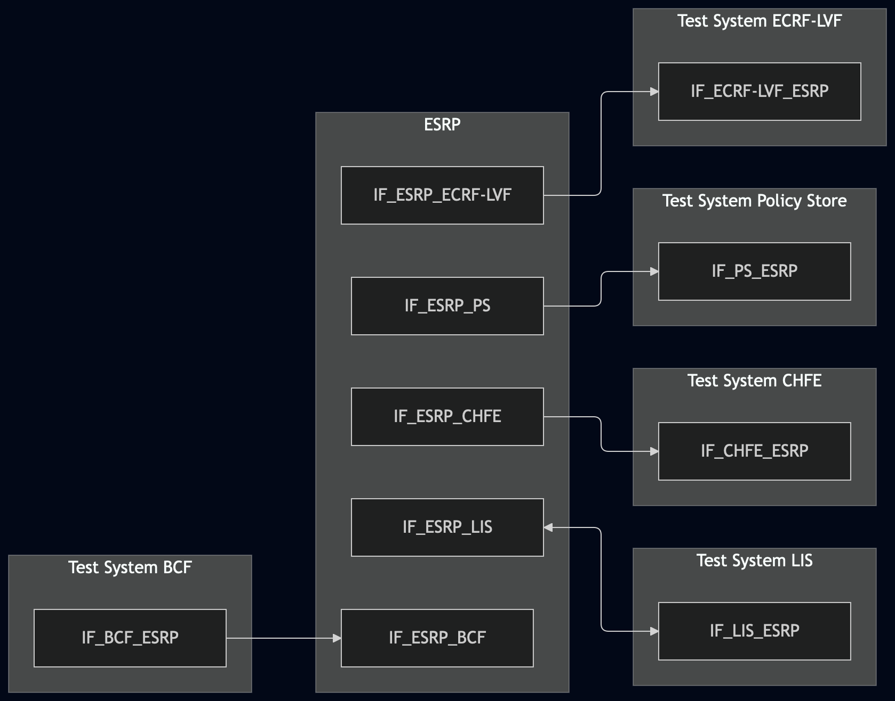
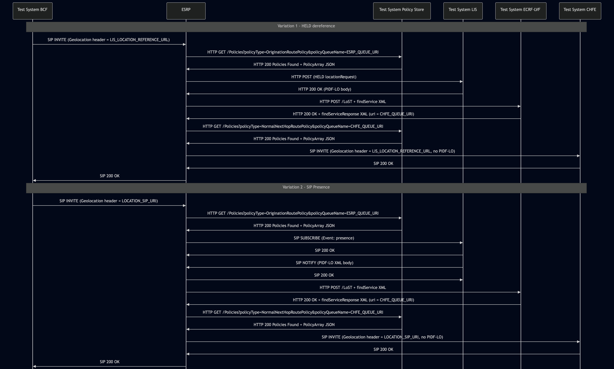

# Test Description: TD_ESRP_022
## Overview
### Summary
Preserving location reference

### Description
The test verifies that the outgoing INVITE preserves the original location reference and dereferenced location is not added to the message.


### HTTP and SIP transport types
Test can be performed with 2 different SIP and HTTP transport types. Steps describing actions for specific one are marked as following:
- (TLS transport) - should be used by default
- (TCP transport) - used in lab for testing purposes only if default TLS is not possible

### References
* Requirements : RQ_ESRP_201
* Test Case    : TC_ESRP_022

### Requirements
IXIT config file for ESRP

## Configuration
### Implementation Under Test Interface Connections
<!-- Identify each of the FEs that are part of the configuration and how they are connected -->
* Test System BCF
  * IF_BCF_ESRP - connected to IF_ESRP_BCF

* ESRP
  * IF_ESRP_BCF - connected to Test System BCF IF_BCF_ESRP
  * IF_ESRP_LIS - connected to Test System LIS IF_LIS_ESRP
  * IF_ESRP_CHFE - connected to Test System CHFE IF_CHFE_ESRP
  * IF_ESRP_PS - connected to Test System Policy Store IF_PS_ESRP
  * IF_ESRP_ECRF-LVF - connected to Test System ECRF-LVF IF_ECRF-LVF_ESRP

* Test System LIS
  * IF_LIS_ESRP - connected to IF_ESRP_LIS
  
* Test System CHFE
  * IF_CHFE_ESRP - connected to IF_ESRP_CHFE
  
* Test System Policy Store(PS)
  * IF_PS_ESRP - connected to IF_ESRP_PS
  
* Test System ECRF-LVF
  * IF_ECRF-LVF_ESRP - connected to IF_ESRP_ECRF-LVF

### Test System Interfaces
<!-- Identify each of the test system interfaces and whether it will be in active or monitor mode -->
* Test System BCF
  * IF_BCF_ESRP - Active

* Test System LIS
  * IF_LIS_ESRP - Active

* ESRP
  * IF_ESRP_BCF - Active
  * IF_ESRP_LIS - Active
  * IF_ESRP_CHFE - Active
  * IF_ESRP_PS - Active
  * IF_ESRP_ECRF-LVF - Active
  
* Test System CHFE
  * IF_CHFE_ESRP - Active

* Test System ECRF-LVF
  * IF_ECRF-LVF_ESRP - Active

* Test System Policy Store
  * IF_PS_ESRP - Active
 
 
### Connectivity Diagram
<!--
https://mermaid.live/edit#pako:eNp9U11vgjAU_SvNfQaDqIDNsoc5zUxcQmRPC4npoAIRWlNKpjP-97UgfuDmC7k995xzDzftASIeU8BgmmbIIs7WWYJDhpBMaUExionY6GPO-QajKCdlmUUhq9nrnH9HKRESLZaag9B8tnqZzFbTYOkrhvk8b2oNngk1sJgHTyeCKmvsljB5m01bC13_QfGDluBfOzTfsvpKBNmm6IOWEgX7UtICnWN0sjYgZXFHe-ldz-26nPPeo-rf7kE_-G_eddau9HZNj7V3YTobfKz2eZ5FexRILuiNi99JAAYkIosBS1FRAwoqCqKPcNCUEOorFAJWpaBxtTP1ZTIjnnMRQsiOSr8l7JPzorUQvEpSwGuSl-pUbWMi6WtGVMYLRQ2mYsIrJgHbbm0B-AA7wH171HOH7sCyB543djxnbMAesOf1-sPxSMG6aVvO0YCfeqjVcweO6_Qt2xuphtIbQCrJgz2L2nk0ztQi3ptHUr-VNti07pzSHn8Bh6_5Mw
-->




## Pre-Test Conditions

### Test System BCF, Test System CHFE
* Interfaces are connected to network
* Interfaces have IP addresses assigned by DHCP
* Device is active
* No active calls
* (TLS transport) Test System has its own certificate signed by PCA

### Test System LIS, Test system ECRF-LVF, Test System Policy Store
* Interfaces are connected to network
* Interfaces have IP addresses assigned by DHCP
* Device is active
* (TLS transport) Test System has its own certificate signed by PCA

### ESRP
* Interfaces are connected to network
* Interfaces have IP addresses assigned by DHCP
* Default configuration is loaded
* Device is initialized with steps from IXIT config file
* Device configured to use `Test System LIS` by default as LIS server
* Device configured to use `Test System ECRF-LVF` by default as ECRF-LVF server
* Device configured to use `Test System Policy Store` by default as Policy Store server
* `queue1@ESRP_FQDN` is configured as a default queue, where ESRP_FQDN is the FQDN of the ESRP
* Device has no static or default SIP next hop configured: the next hop for the call is determined only by the route policies
* Device is active
* Device is in normal operating state
* No active calls


## Test Sequence
### Test Preamble

#### Test System BCF
* Install SIPp by following steps from documentation[^1]
* Copy following XML scenario files to local storage:
  ```
  SIP_INVITE_geolocation_HELD.xml
  SIP_INVITE_geolocation_SIP.xml
  ```
* For SIP_INVITE_geolocation_HELD.xml replace LIS_LOCATION_REFERENCE_URL with URL to the Test System LIS, e.g.
  * (TLS)`<https://lis.ng911.dev.lab:4443/location>`
  * (TCP)`<http://lis.ng911.dev.lab:8080/location>`
* For SIP_INVITE_geolocation_SIP.xml replace LOCATION_SIP_URI with SIP URI to the Test System LIS, e.g. 
  * (TLS) `sip:location@lis.ng911.dev.lab:5060`  
  * (TCP) `sip:location@lis.ng911.dev.lab:5061`  
* Install Wireshark[^2]
* (TLS transport) Copy to local storage PCA-signed TLS certificate and private key files:
  ```
  PCA-cacert.pem
  PCA-cakey.pem
  ```
* (TLS transport) Copy to local storage TLS certificate and private key files used by ESRP:
  ```
  ESRP-cacert.pem
  ESRP-cakey.pem
  ```
* (TLS v1.2) Configure Wireshark to decode SIP over TLS, use tests system and IUT certificate keys [^3]
* (TLS v1.3) Configure logging of session keys and configure Wireshark to decode SIP over TLS [^4]
* Using Wireshark on Test System BCF start packet tracing on IF_BCF_ESRP interface - run following filter:
   * (TLS transport)
     > ip.addr == IF_BCF_ESRP_IP_ADDRESS and tls
   * (TCP transport)
     > ip.addr == IF_BCF_ESRP_IP_ADDRESS and sip

#### Test System Policy Store
* Install Wireshark[^2]
* (TLS v1.2) Configure Wireshark to decode HTTP over TLS, use test system and ESRP certificate keys[^3]
* (TLS v1.3) Configure logging of session keys and configure Wireshark to decode HTTP over TLS[^4]
* Copy following JSON files to local storage:
    ```
       Policy_object_RoutePolicy_NormalNextHop_v010.3f.5.0.0.json
       Policy_object_RoutePolicy_Origination_LostServiceURN.json
    ```
* Using Wireshark start packet tracing on IF_PS_ESRP interface - run following filter:
   * (TLS transport)
     > ip.addr == IF_PS_ESRP_IP_ADDRESS and tls
   * (TCP transport)
     > ip.addr == IF_PS_ESRP_IP_ADDRESS and http
* The Policy Store must be configured to accept and process HTTP GET requests.
  * Edit the file and replace following string values:
    * `Policy_object_RoutePolicy_Origination_LostServiceURN.json`:
      * `POLICY_QUEUE_NAME` - replace with ESRP's default queue on which the call arrives (`queue1@ESRP_FQDN`)
    * `Policy_object_RoutePolicy_NormalNextHop_v010.3f.5.0.0.json`:
      * `POLICY_QUEUE_NAME` - replace with the URI returned by Test System ECRF-LVF in findServiceResponse (`sip:chfe@CHFE_FQDN`)
      * `DOWNSTREAM_SIP_URI` - replace with sip uri of the Test System CHFE (`sip:chfe@CHFE_FQDN`)
  * Generate Policy Array JWS object for each policy file:
    ```
    python3 -m main generate_jws Policy_object_RoutePolicy_Origination_LostServiceURN.json \
    --cert test_system.crt \
    --key test_system.key \
    --output_file OriginationRoutePolicy.json \
    --policy_array
    
    python3 -m main generate_jws Policy_object_RoutePolicy_NormalNextHop_v010.3f.5.0.0.json \
    --cert test_system.crt \
    --key test_system.key \
    --output_file NormalNextHopRoutePolicy.json \
    --policy_array
    ```
  * Run server handling all policies requests. The server MUST keep running during the whole test, because the ESRP may request the policies during the call (NormalNextHopRoutePolicy - after it receives the URI from Test System ECRF-LVF):
    * (TLS):
      ```
         python3 http_entry.py \
         --ip IF_PS_ESRP \
         --port 443 \
         --role RECEIVER \
         --path '[\
         "/Policies?policyType=OriginationRoutePolicy", \
         "/Policies?policyType=NormalNextHopRoutePolicy" \
         ]' \
         --method '["GET", "GET"]' \
         --body '[\
         "file.OriginationRoutePolicy.json", \
         "file.NormalNextHopRoutePolicy.json" \
         ]' \
         --content_type application/jose+json \
         --response_code '[200, 200]' \
         --server_cert /tmp/cert.crt \
         --server_key /tmp/cert.key
      ```
    * (TCP):
      ```
         python3 http_entry.py \
         --ip IF_PS_ESRP \
         --port 80 \
         --role RECEIVER \
         --path '[\
         "/Policies?policyType=OriginationRoutePolicy", \
         "/Policies?policyType=NormalNextHopRoutePolicy" \
         ]' \
         --method '["GET", "GET"]' \
         --body '[\
         "file.OriginationRoutePolicy.json", \
         "file.NormalNextHopRoutePolicy.json" \
         ]' \
         --content_type application/jose+json \
         --response_code '[200, 200]'
      ```
     
#### Test System LIS
* Install SIPp by following steps from documentation[^1]
* Install Wireshark[^2]
* (TLS v1.2) Configure Wireshark to decode HTTP/SIP over TLS, use tests system and ESRP certificate keys [^3]
* (TLS v1.3) Configure logging of session keys and configure Wireshark to decode HTTP/SIP over TLS [^4]
* Copy following XML files to local storage:
  ```
  Location_response
  SIP_SUBSCRIBE_LIS.xml
  ```
* (TLS transport) Copy to local storage PCA-signed TLS certificate and private key files:
  ```
  PCA-cacert.pem
  PCA-cakey.pem
  ```
* (TLS transport) Copy to local storage TLS certificate and private key files used by ESRP:
  ```
  ESRP-cacert.pem
  ESRP-cakey.pem
  ```
* (TLS transport) Configure Wireshark to decode HTTP over TLS packets from Test System and ESRP as well[^3]
* Using Wireshark on 'Test System' start packet tracing on IF_LIS_ESRP interface - run following filter:
   * (TLS transport)
     > ip.addr == IF_LIS_ESRP_IP_ADDRESS and tls
   * (TCP transport)
     > ip.addr == IF_LIS_ESRP_IP_ADDRESS and sip||http

* Depending on current variation use one of following scenario files:
  * Variation 1 (HELD dereference)
    Start HTTP server responding to the ESRP's HTTP POST with the `Location_response` (PIDF-LO) body.
    `--path` MUST match the path component of `LIS_LOCATION_REFERENCE_URL` in `SIP_INVITE_geolocation_HELD.xml`
    Replace the example below with your configured value(e.g. if that URL is `<https://IF_LIS_ESRP_IP_ADDRESS:443/location>`, then `--path /location`):
    * (TLS):
    ```
    python3 http_entry.py \
    --ip IF_LIS_ESRP \
    --port 443 \
    --role RECEIVER \
    --path /location \
    --method POST \
    --body Location_response \
    --content_type application/held+xml \
    --response_code 200 \
    --server_cert PCA-cacert.pem \
    --server_key PCA-cakey.pem
    ``` 
    * (TCP):
    ```
    python3 http_entry.py \
    --ip IF_LIS_ESRP \
    --port 80 \
    --role RECEIVER \
    --path /location \
    --method POST \
    --body Location_response \
    --content_type application/held+xml \
    --response_code 200
    ```
  * Variation 2 (SIP Presence dereference)
    Prepare Test System to receive SIP SUBSCRIBE - run following SIPp command on Test System, example:
    * (TLS transport)
      > sudo sipp -t l1 -sf SIP_SUBSCRIBE_LIS.xml -tls_cert cacert.pem -tls_key cakey.pem -i IF_LIS_ESRP_IP_ADDRESS -p 5061
    * (TCP transport)
      > sudo sipp -t t1 -sf SIP_SUBSCRIBE_LIS.xml -i IF_LIS_ESRP_IP_ADDRESS -p 5060
      
#### Test System ECRF-LVF
* Install Wireshark[^2]
* (TLS v1.2) Configure Wireshark to decode HTTP over TLS, use tests system and ESRP certificate keys [^3]
* (TLS v1.3) Configure logging of session keys and configure Wireshark to decode HTTP over TLS [^4]
* Copy following XML scenario files to local storage:
  ```
  findServiceResponse.xml
  ```
* (TLS transport) Copy to local storage PCA-signed TLS certificate and private key files:
  ```
  PCA-cacert.pem
  PCA-cakey.pem
  ```
* (TLS transport) Copy to local storage TLS certificate and private key files used by ESRP:
  ```
  ESRP-cacert.pem
  ESRP-cakey.pem
  ```
* (TLS transport) Configure Wireshark to decode HTTP over TLS packets from Test System and ESRP as well[^3]
* Using Wireshark on 'Test System' start packet tracing on IF_ECRF-LVF_ESRP interface - run following filter:
   * (TLS transport)
     > ip.addr == IF_ECRF-LVF_ESRP_IP_ADDRESS and tls
   * (TCP transport)
     > ip.addr == IF_ECRF-LVF_ESRP_IP_ADDRESS and http
     
* start HTTP server on port 443 using command in the terminal (example for /lost entrypoint):
(TLS):
    ```
       python3 http_entry.py \
       --ip IF_ECRF-LVF_ESRP \
       --port 443 \
       --role RECEIVER \
       --path /lost \
       --method POST \
       --body findServiceResponse.xml \
       --server_cert PCA-cacert.pem \
       --server_key PCA-cakey.pem \
       --content_type application/lost+xml \
       --response_code 200
    ```
* start HTTP server on port 80 using command in the terminal (example for /lost entrypoint):
(TCP):
    ```
       python3 http_entry.py \
       --ip IF_ECRF-LVF_ESRP \
       --port 80 \
       --role RECEIVER \
       --path /lost \
       --method POST \
       --body findServiceResponse.xml \
       --content_type application/lost+xml \
       --response_code 200
    ```

#### Test System CHFE
* Install SIPp by following steps from documentation[^1]
* Install Wireshark[^2]
* (TLS v1.2) Configure Wireshark to decode SIP over TLS, use tests system and IUT certificate keys [^3]
* (TLS v1.3) Configure logging of session keys and configure Wireshark to decode SIP over TLS [^4]
* Copy following XML scenario files to local storage:
  ```
  SIP_INVITE_RECEIVE.xml
  ```
* (TLS transport) Copy to local storage SIP TLS certificate and private key files used to decrypt SIP packets within ESInet:
  > cacert.pem
  > cakey.pem
* Using Wireshark on 'Test System CHFE' start packet tracing on IF_CHFE_ESRP interface - run following filter:
   * (TLS transport)
     > ip.addr == IF_CHFE_ESRP_IP_ADDRESS and tls
   * (TCP transport)
     > ip.addr == IF_CHFE_ESRP_IP_ADDRESS and sip
* Prepare Test System to receive SIP INVITE - run following SIPp command on Test System, example:
    * (TLS transport)
      > sudo sipp -t l1 -sf SIP_INVITE_RECEIVE.xml -tls_cert cacert.pem -tls_key cakey.pem -i IF_CHFE_ESRP_IP_ADDRESS -p 5061
    * (TCP transport)
      > sudo sipp -t t1 -sf SIP_INVITE_RECEIVE.xml -i IF_CHFE_ESRP_IP_ADDRESS -p 5060

### Test Body
#### Variations
1. Variation 1 - Location dereference via HELD (Use: `SIP_INVITE_geolocation_HELD.xml` stimulus, `Location_response` used for Test System LIS response)
2. Variation 2 - Location dereference via SIP Presence SUBSCRIBE/NOTIFY (Use: `SIP_INVITE_geolocation_SIP.xml` stimulus,`SIP_SUBSCRIBE_LIS.xml` used for Test System LIS response)

#### Stimulus
For each variation send SIP packet to ESRP - run following SIPp command on Test System BCF, example:
    * (TCP transport)
       ```
       sudo sipp -t t1 -sf SIPP_XML_SCENARIO_FILE IF_ESRP_BCF_IP_ADDRESS:5060
       ```
    * (TLS transport)
       ```
       sudo sipp -t l1 -sf SIPP_XML_SCENARIO_FILE -tls_cert cacert.pem -tls_key cakey.pem IF_ESRP_BCF_IP_ADDRESS:5061
      ```

#### Response
Using traced packets on Wireshark verify if:
* SIP INVITE outgoing from the ESRP contains the same Geolocation reference as the incoming one (Geolocation header field remains unchanged)
* outgoing SIP INVITE does not contain PIDF-LO XML body received from Test System LIS:
  * (Variation 1) in 200 OK response for HTTP POST
  * (Variation 2) in SIP NOTIFY

VERDICT:
* ERROR - if the stimulus SIP INVITE was not sent from Test System BCF to ESRP 
* PASSED - all checks passed
* FAILED - any other cases.


### Test Postamble
#### Test System BCF, Test System CHFE, Test System LIS, Test System ECRF-LVF, Test System Policy Store
* stop all SIPp processes (if still running)
* stop all python HTTP server processes (if still running)
* archive all logs generated
* remove all XML scenarios (SIPp, HTTP)
* disconnect interfaces from ESRP
* stop Wireshark (if still running)
* (TLS transport) remove certificates

#### ESRP
* reconnect interfaces back to default
* no active calls

## Post-Test Conditions
### Test System BCF, Test System CHFE, Test System LIS, Test System ECRF-LVF, Test System Policy Store
* Test tools stopped
* interfaces disconnected from ESRP

### ESRP
* device connected back to default
* device in normal operating state

## Sequence Diagram
<!--
https://mermaid.live/edit#pako:eNrtVm1vmzAQ_isnf5gyFdqEvCO1U5uShS0lFEi1TUiRB05qNdiZgapZ1f8-m4S0pNOmttI-7QMhHM_dPff4Tsc9inhMkIl0XQ9ZxNmcLsyQAWTXJCEmxFjcqMcl5zcmREucpjRShoQKwcVplHGRmjDHy5SErAiSkh85YRE5p3ghcBKyFRYZjegKswzOBkPAKQQkzcBfpxlJlKmKsXzPVSB1r75x_X1nly9ptAZf0iBV7Nh-BpamvUwDb6iPr55RKu1V9GA0tPaRyhaykDk8I8BviVDlaMpqwhUWFGeUM2iADiNrfA4xEWQuLylPyCRSPzlRVZrg2y7YzpUdWFD7SPiSRxvPa4KlDxwr7rPxZHAa2BNn5llDy7OcgTWbeuP3IVMxZCjXN2EUBC58tAI4KqShJP2wKjQK1ityPBF0QVkR2uN5RjbyvdsgLnOSEwcn5FjFm11OralKYIfM9XdEi_hGvQ5leBjynMVwsD2KUyHwGj75E0fJsiUmyW893YkfQK3QoqzRU_2SZrIMCXueZ_IZaq59Ls9jAt95vH4stzylp6GPxlz-HsCcstgn4pZGBL5cjKXPFvzbBBW8R9IVl12s_KCWCyrVVwf6KMhLFHe4SPDSIXfZiK_-pHk1xas13xLbdOAbukoDxmGru6xXxas060a5XT7Zy1X730bCkCOh8K4g6WvGoSQtkS89kn87BE9HQJXlT8_8gWefycqsW8IyE1ZbCfYm4Kma-3ZnEtjDr4-DoVq1Ohy7fHsH9X9o3j40e733tlFBGloIGiMzEznRUEJk6eoR3as1G6JiEYfIlH8FifM7Xa1kPZK8RIhC9iD95Xb6xnlShhA8X1wjs9jJGspXMc7KZbyzyhUkixlIRTJkNhqGUURB5j26Q6bebB92ekar0281Wo1uv93X0BqZRv-w3el2m0avV2_06q2u8aChn0XixmGr327Xm51Oq97odI1mS0M4z7i_ZlFJi8RUbumLzedG8dVRkrOKN1tuD78AYHq5ZQ
-->




## Comments

Version:  010.3f.5.0.1

Date:     20261020

## Footnotes
[^1]: SIPp - tool for SIP packet simulations. Official documentation: https://sipp.sourceforge.net/doc/reference.html#Getting+SIPp

[^2]: Wireshark - tool for packet tracing and analysis. Official website: https://www.wireshark.org/download.html

[^3]: Wireshark configuration to decrypt TLS packets: https://www.zoiper.com/en/support/home/article/162/How%20to%20decode%20SIP%20over%20TLS%20with%20Wireshark%20and%20Decrypting%20SDES%20Protected%20SRTP%20Stream

[^4]: TLS v1.3 session keys logging + Wireshark configuration to decrypt traffic: https://my.f5.com/manage/s/article/K50557518
