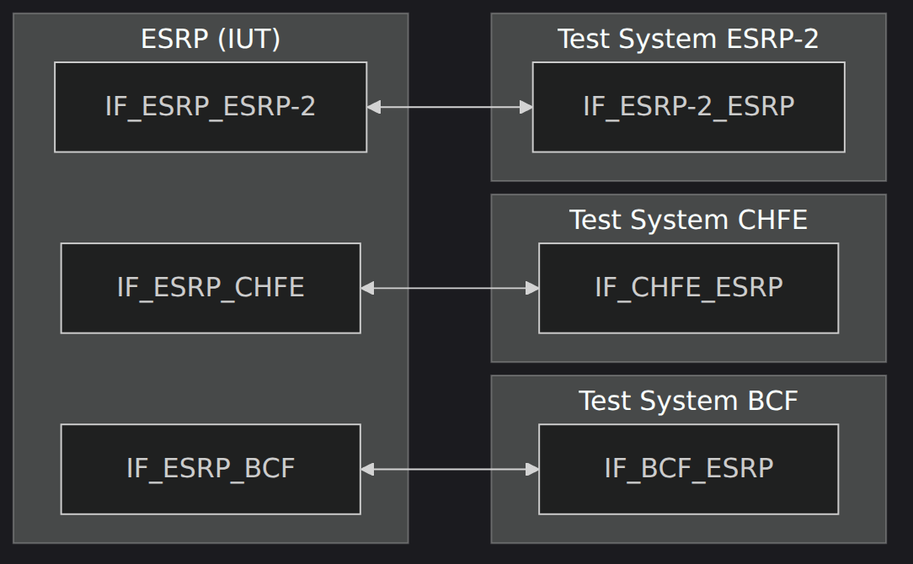
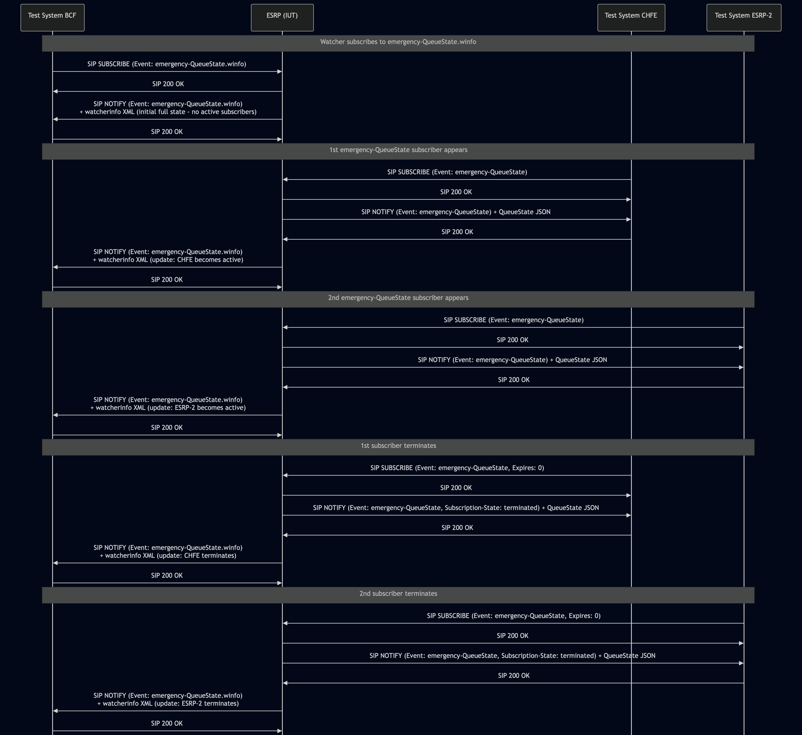

# Test Description: TD_ESRP_023

## Overview

### Summary

Watcher information RFC 3857

### Description

Verify that ESRP supports watcher information event template-package as per RFC 3857

### References

- Requirements: RQ_ESRP_208
- Test Case: TC_ESRP_023

### Requirements

IXIT config file for ESRP, including the queue SIP URI, Test System SIP identities and interface settings.

### SIP transport types

Test can be performed with 2 different SIP transport types. Steps describing actions for specific one are marked as following:

- (TLS transport) - used by default inside ESInet on production environment
- (TCP transport) - used in lab for testing purposes only if default TLS is not possible

## Configuration

### Implementation Under Test Interface Connections

* ESRP (IUT)
  * IF_ESRP_BCF - connected to Test System BCF IF_BCF_ESRP
  * IF_ESRP_CHFE - connected to Test System CHFE IF_CHFE_ESRP
  * IF_ESRP_ESRP-2 - connected to Test System ESRP-2 IF_ESRP-2_ESRP
* Test System BCF
  * IF_BCF_ESRP - connected to ESRP IF_ESRP_BCF
* Test System CHFE
  * IF_CHFE_ESRP - connected to ESRP IF_ESRP_CHFE
* Test System ESRP-2
  * IF_ESRP-2_ESRP - connected to ESRP IF_ESRP_ESRP-2

### Test System Interfaces

* ESRP (IUT)
  * IF_ESRP_BCF - Active
  * IF_ESRP_CHFE - Active
  * IF_ESRP_ESRP-2 - Active
* Test System BCF
  * IF_BCF_ESRP - Active
* Test System CHFE
  * IF_CHFE_ESRP - Active
* Test System ESRP-2
  * IF_ESRP-2_ESRP - Active

### Connectivity Diagram

<!--
https://mermaid.live/edit#pako:eNp1k1FLwzAUhf_KJU8KK2hxIkF82Nx0oCDrxAcrI0uzNqxNSpo6xth_N2m22JXuJeSefDk5uXD3iMqEIYyCIIgFlWLNUxwLAJ2xgmFIiNrYMpdyg4HmpKo4bQSyk7W2QKqYFda53NKMKN1cBxDGNyoJ5SLFcDt0oiJi48XhjRNprX7NUzkXjCgnbRUpSwN98URnGML7I1rVqxdzlC24ztk7USkXx-dMYlliuDtVK6m1LDA8xKL5mo8Hb3PHzKbLSTT_WI7GU3gMgicrmH0jnhPj1-nEI7boYZol9JQrj5zPntrsMPmOkT2Aq9nn4jpGP6fMZ5kM1Kp6KRulhdmyl3NhWqRdgtCzTCSdiCMDL1ilIdpVmhXQk-DUKmfrG3fZc9zx7Ivrm-tc_3t92Tbq2Hb-1u5D2LJ2WI85GqCCqYLwBOE9asbAjIedA3QYIFJrGe0ERVirmg1QXSZEs2dupoAUTjz8AQOk_6E
-->



## Pre-Test Conditions

### Test System BCF / Test System CHFE / Test System ESRP-2

* Interfaces are connected to network
* Interfaces have configured IP addresses
* Devices are active
* (TLS transport) Test Systems have valid PCA-signed certificates and matching private keys

### ESRP (IUT)

* Interfaces are connected to network
* Interfaces have configured IP addresses
* Default configuration is loaded
* IUT is initialized with steps from IXIT config file
* Device is in normal operating state
* The test queue has no emergency-QueueState subscribers
* Test System BCF is authorized to subscribe to emergency-QueueState.winfo and receive watcher information for both Test System CHFE and Test System ESRP-2 on the test queue
* Test System CHFE and Test System ESRP-2 are authorized to subscribe to emergency-QueueState on the test queue
* Subscriptions from the Test Systems are accepted without SIP authentication

## Test Sequence

### Test Preamble

#### Test System BCF

* Install SIPp[^1] and Wireshark[^2]
* Copy following XML scenario files to local storage:
  * `SIP_SUBSCRIBE_QueueState_watcher_info.xml`
* Edit the local XML scenario for each Test System:
  * Replace `[QUEUE_SIP_URI]` with SIP URI of the ESRP queue
* (TLS transport) Copy to local storage PCA-signed TLS certificate and private key files:
  ```text
  PCA-cacert.pem
  PCA-cakey.pem
  ```

* (TLS v1.2) Configure Wireshark to decode SIP over TLS, use tests system and IUT certificate keys [^3]
* (TLS v1.3) Configure logging of session keys and configure Wireshark to decode SIP over TLS [^4]
* Using Wireshark on Test System BCF start packet tracing on IF_BCF_ESRP interface:

  * (TLS transport)

    > ip.addr == IF_BCF_ESRP_IP_ADDRESS and tls

  * (TCP transport)

    > ip.addr == IF_BCF_ESRP_IP_ADDRESS and sip


#### Test System CHFE / Test System ESRP-2

* clone ng911 repository to local storage
* Install Wireshark[^2]
* Copy following XML scenario files to local storage:
  * `SIP_SUBSCRIBE_QueueState_terminate.xml`
* (TLS transport) Copy to local storage PCA-signed TLS certificate and private key files:
  ```text
  PCA-cacert.pem
  PCA-cakey.pem
  ```

* (TLS v1.2) Configure Wireshark to decode SIP over TLS, use tests system and IUT certificate keys [^3]
* (TLS v1.3) Configure logging of session keys and configure Wireshark to decode SIP over TLS [^4]
* Using Wireshark start packet tracing on local interface, e.g. for Test System CHFE:

  * (TLS transport)

    > ip.addr == IF_CHFE_ESRP_IP_ADDRESS and tls

  * (TCP transport)

    > ip.addr == IF_CHFE_ESRP_IP_ADDRESS and sip
    

### Test Body

#### Stimulus

1. Start watcher on Test System BCF. Run the following SIPp command, example:

* (TLS transport)

  ```text
  sipp -t l1 -sf SIP_SUBSCRIBE_QueueState_watcher_info.xml -i IF_BCF_ESRP_IP_ADDRESS -p 5061 -bind_local -aa -tls_cert PCA-cacert.pem -tls_key PCA-cakey.pem IF_ESRP_BCF_IP_ADDRESS:5061
  ```

* (TCP transport)

  ```text
  sipp -t t1 -sf SIP_SUBSCRIBE_QueueState_watcher_info.xml -i IF_BCF_ESRP_IP_ADDRESS -p 5061 -bind_local -aa IF_ESRP_BCF_IP_ADDRESS:5061
  ```

2. Start subscribers on Test System CHFE and Test System ESRP-2. Run the following SIP Service command, example for Test System CHFE:

  * (TLS transport)
    >   sudo python3 test_suite/services/stub_server/sip_service/sip_entry.py \
  --scenario test_suite/test_files/SIPp_scenarios/sip_service/SIP_SUBSCRIBE/SIP_SUBSCRIBE_QueueState_terminate.xml \
  --scenario-type auto --bind-ip {IF_CHFE_ESRP_IP} --bind-port 5061 \
  --remote-ip {IF_ESRP_CHFE_IP} --remote-port 5061 \
  --tls-cert {CHFE_CERT_FILE_PATH} --tls_key {CHFE_KEY_FILE_PATH} \
  --tls-ca {PCA_CERT_FILE_PATH} \
  --set QUEUE_SIP_URI {ESRP_QUEUE_SIP_URI} \
  --protocol TLS
  * (TCP transport)
    >   sudo python3 test_suite/services/stub_server/sip_service/sip_entry.py \
  --scenario test_suite/test_files/SIPp_scenarios/sip_service/SIP_SUBSCRIBE/SIP_SUBSCRIBE_QueueState_terminate.xml \
  --scenario-type auto --bind-ip {IF_CHFE_ESRP_IP} --bind-port 5060 \
  --remote-ip {IF_ESRP_CHFE_IP} --remote-port 5060 \
  --set QUEUE_SIP_URI {ESRP_QUEUE_SIP_URI} \
  --protocol TCP


#### Response

Using the traced packets in Wireshark, verify the following:

* ESRP responds to each SIP SUBSCRIBE with SIP 200 OK.
* ESRP sends SIP NOTIFY with `Event: emergency-QueueState` and QueueState JSON to Test System CHFE and Test System ESRP-2 when their subscriptions are established.
* each SIP NOTIFY with `Event: emergency-QueueState.winfo` sent by the ESRP to Test System BCF:
  * contains `Content-Type: application/watcherinfo+xml`
  * contains XML message body
  * XML message body contains `watcherinfo` tags
  * XML message body contains resource info with FQDN or IP address of the ESRP, e.g. `<watcher-list resource="sip:esrp@esrp.ng911.example"`
  * XML message body contains `package="emergency-QueueState"`
* ESRP sends full (`state="full"`) or partial (`state="partial"`) watcher info update to Test System BCF
  * showing no active subscribers (no `watcher` tags within `watcher-list`)
  * when Test System CHFE becomes a new subscriber (`status="active"`)
  * when Test System ESRP-2 becomes a new subscriber (`status="active"`)
  * when Test System CHFE terminates subscription (`status="terminated"`)
  * when Test System ESRP-2 terminates subscription (`status="terminated"`)
* When a subscription is terminated (by sending SIP SUBSCRIBE to ESRP with `Expires: 0`), ESRP sends a final NOTIFY with `Subscription-State: terminated`. Each Test System responds to received NOTIFY requests with SIP 200 OK.[^6]

VERDICT:

* PASSED - if ESRP responded as expected
* FAILED - any other cases

#### Examples

SIP NOTIFY received by Test System BCF with full watcher info showing no active subscribers
```
NOTIFY sip:esrp@esrp.ng911.example SIP/2.0
Via: SIP/2.0/TCP esrp.ng911.example;branch=z9hG4bK4ewq2
Max-Forwards: 70
To: <sip:bcf@bcf.ng911.example>;tag=1928323474
From: <sip:esrp@esrp.ng911.example>;tag=xfg9ew
Call-ID: test123@esrp.ng911.example
CSeq: 1 NOTIFY
Event: emergency-QueueState.winfo
Subscription-State: active;expires=3600
Contact: <sip:esrp@esrp.ng911.example>
Content-Type: application/watcherinfo+xml
Content-Length: 219

<?xml version="1.0"?>
<watcherinfo xmlns="urn:ietf:params:xml:ns:watcherinfo"
             version="0" state="full">
  <watcher-list resource="sip:esrp@esrp.ng911.example" package="emergency-QueueState"/>
</watcherinfo>
```

SIP NOTIFY received by Test System BCF with full watcher info showing 2x active subscribers
```
NOTIFY sip:esrp@esrp.ng911.example SIP/2.0
Via: SIP/2.0/TCP esrp.ng911.example;branch=z9hG4bK4ewq2
Max-Forwards: 70
To: <sip:bcf@bcf.ng911.example>;tag=1928323474
From: <sip:esrp@esrp.ng911.example>;tag=xfg9ew
Call-ID: test123@esrp.ng911.example
CSeq: 3 NOTIFY
Event: emergency-QueueState.winfo
Subscription-State: active;expires=3400
Contact: <sip:esrp@esrp.ng911.example>
Content-Type: application/watcherinfo+xml
Content-Length: 604

<?xml version="1.0"?>
<watcherinfo xmlns="urn:ietf:params:xml:ns:watcherinfo"
             version="1" state="full">
  <watcher-list resource="sip:esrp@esrp.ng911.example" package="emergency-QueueState"/>
    <watcher id="7768a22s" event="approved" status="active"
             duration-subscribed="1200" expiration="3600"
             display-name="CHFE">sip:chfe@chfe.ng911.example</watcher>
    <watcher id="8ajkfgda7s" event="subscribe" status="pending"
             duration-subscribed="0"
             display-name="ESRP-2">sip:esrp-2@esrp-2.ng911.example</watcher>
  </watcher-list>
</watcherinfo>
```

SIP NOTIFY received by Test System BCF with partial watcher info showing one of subscribers terminating
```
NOTIFY sip:esrp@esrp.ng911.example SIP/2.0
Via: SIP/2.0/TCP esrp.ng911.example;branch=z9hG4bK4ewq2
Max-Forwards: 70
To: <sip:bcf@bcf.ng911.example>;tag=1928323474
From: <sip:esrp@esrp.ng911.example>;tag=xfg9ew
Call-ID: test123@esrp.ng911.example
CSeq: 4 NOTIFY
Event: emergency-QueueState.winfo
Subscription-State: active;expires=3400
Contact: <sip:esrp@esrp.ng911.example>
Content-Type: application/watcherinfo+xml
Content-Length: 604

<?xml version="1.0"?>
<watcherinfo xmlns="urn:ietf:params:xml:ns:watcherinfo"
             version="1" state="partial">
  <watcher-list resource="sip:esrp@esrp.ng911.example" package="emergency-QueueState"/>
    <watcher id="7768a22s" event="approved" status="terminated"
             duration-subscribed="1200" expiration="3600"
             display-name="CHFE">sip:chfe@chfe.ng911.example</watcher>
  </watcher-list>
</watcherinfo>
```

### Test Postamble

#### Test System BCF / Test System CHFE / Test System ESRP-2

* After its configured pause, the BCF scenario terminates its watcher information subscription by sending an in-dialog SIP SUBSCRIBE with `Event: emergency-QueueState.winfo` and `Expires: 0`. It receives SIP 200 OK and the final NOTIFY with `Subscription-State: terminated`, and responds with SIP 200 OK.
* If execution was interrupted before cleanup, allow the remaining test subscriptions to expire before completing Test Postamble
* stop SIPp test processes (if still running)
* stop Wireshark (if still running)
* archive all logs generated
* disconnect interfaces from IUT
* (TLS transport) remove test certificates

#### ESRP (IUT)

* disconnect interfaces from Test Systems
* reconnect interfaces back to default
* restore previous configuration

## Post-Test Conditions

### Test System BCF / Test System CHFE / Test System ESRP-2

* Test tools stopped
* interfaces disconnected from IUT

### ESRP (IUT)

* device connected back to default
* device in normal operating state
* No test subscriptions remain active

## Sequence Diagram

<!--
https://mermaid.live/edit#pako:eNrNVm1P2zAQ_isnfwItqRKTFGpNSKMLWrfxMgzqNuWLm7jFWmJntgN0iP8-J6GjWgHxtpdvuctz5-eeOyd3iTKVc0SQ7_upzJScihlJJYA95SUnkDP9rTELpb4RyApmjMgah-Hfay4z3oIBSqG10m8yq7QhMGWF4alscy6AbwWbaVZ28IppKzJRMWlhHAIzcMyNBTo3lpewM9xdhSUNKqFHh7A2OjleXwXQlTzDd7vJLTj8O67J6uNUdth9ZTmoM64dM49iAmNms1NnmnpiMi0m3IBV4OTRM1fY3P9U85pTyyzvnQs5VV2acehvbycE6OgQ6MkOHR6NdhJYS864tOSe6OvKEhc9DrtwHARw8GHVv39wPNr98pCcryd6G17BeVdJ44LPex9hTUhhBStgWhcFmCYAfJAKWGbFGb-pWJv11aoWtO6QLXQC30ZpKSuwquJMmy4DfbRiS1rRO7SiD9dq3Sm0RPM9PdhfJfbnelFXuQORdmphwjNVukHrGvF48bHMHyk-fo74-A7x8QuIj_-m-N2n4NnyN7O_pLTluhTSHfDkSfcguaiE5u7jGrzs1HtAO6KVFUr6rY_cMM7_p1txo-PTbsR9LcEv1ZLn34Wnt-Rf3JUHNAV5aKZFjojVNfeQO7JkjYkum4gUtctGioh71DyvL_xm7fAzVSidolReuXj36_6qVLlIoVU9O0WkXTQ81DG63jB-eTWXOddDVUuLSBhFbRJELtGFM_tRbxDhoD_AAR5EcYA9NHfuzX5vK9qIB3EUDOKtGMdXHvrRnhv0tsKoH23GcbwRhzje3PAQq62ic5ktWPFcuAVor9uo2sVqwS1p31xTu_oJjX7yrw
-->



## Comments

Version:  010.3f.5.0.0

Date:     20261104

## Footnotes

[^1]: SIPp - tool for SIP packet simulations. Official documentation: https://sipp.readthedocs.io/. Command options: https://github.com/SIPp/sipp/blob/master/src/sipp.cpp. TLS key logging: https://github.com/SIPp/sipp/blob/master/README.md
[^2]: Wireshark - tool for packet tracing and analysis. Official website: https://www.wireshark.org/download.html
[^3]: Wireshark configuration to decrypt TLS packets: https://www.zoiper.com/en/support/home/article/162/How%20to%20decode%20SIP%20over%20TLS%20with%20Wireshark%20and%20Decrypting%20SDES%20Protected%20SRTP%20Stream
[^4]: TLS v1.3 session keys logging + Wireshark configuration to decrypt traffic: https://my.f5.com/manage/s/article/K50557518
[^4]: RFC 3857, Sections 4.3, 4.5, 4.7.1, 4.8 and 4.10: https://www.rfc-editor.org/rfc/rfc3857.html
[^5]: RFC 3858, Sections 3 and 4, defines the watcher information XML format and processing referenced by RFC 3857: https://www.rfc-editor.org/rfc/rfc3858.html
[^6]: RFC 6665, Section 4.2.1.4, subscription termination: https://www.rfc-editor.org/rfc/rfc6665.html#section-4.2.1.4
