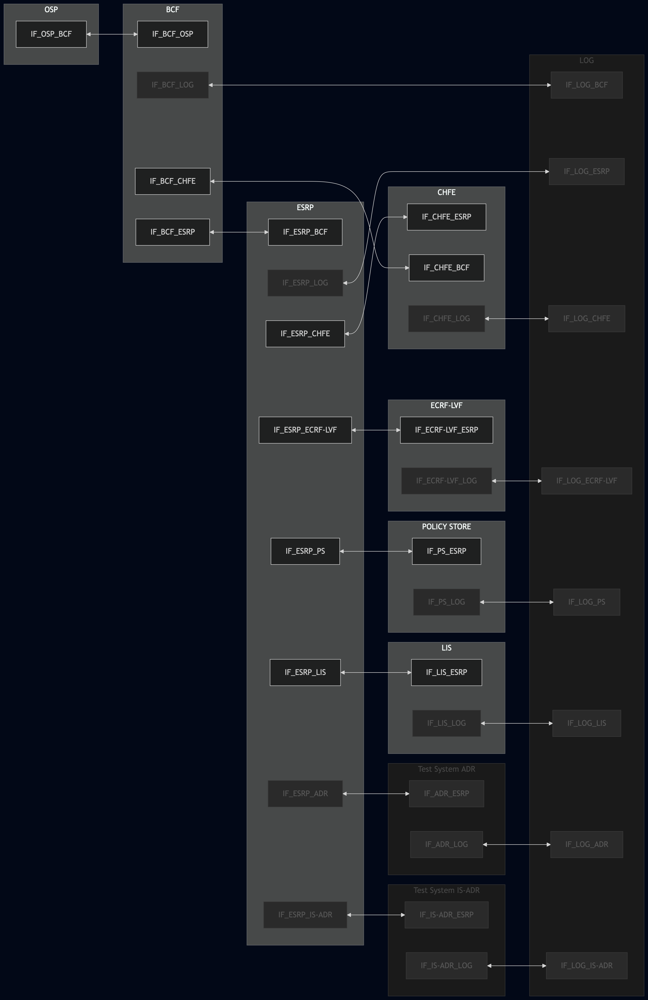
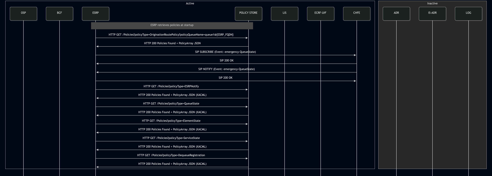
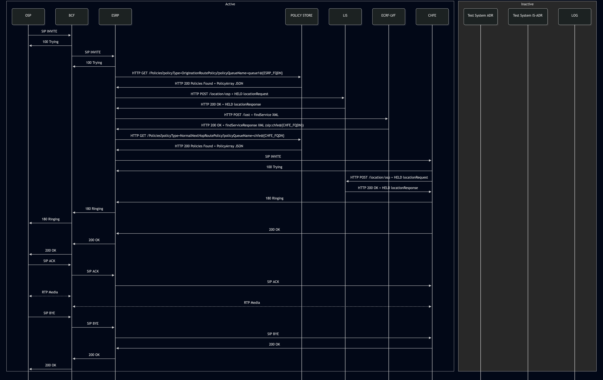

# Test Description: TD_INTEROP_001

## Overview
<!--
### Proof of Concept
Test procedure is a Proof of Concept and is limited to verify only basic requirements. 
Also test setup is limited to following functional elements:
- OSP
- BCF (Originating)
- ESRP (Originating)
- POLICY STORE
- LIS
- ECRF-LVF
- CHFE (all PSAP functions are merged to CHFE - PSAP infrastructure is out of scope for NG-911)
-->
### Summary
Cellular 9-1-1

### Description
Test covers 9-1-1 call from a cell phone

### References
* Requirements : Interop Criteria for Use Cases [v1.1 2024-12-06.v2] - LAST EDIT 2026-01-27 18:52 - 2.4 Cellular 9-1-1 
* Test Case    : 

### Requirements
IXIT config files for:
- OSP
- BCF
- ESRP
- CHFE
- LOG (disabled)
- ECRF-LVF
- POLICY STORE
- LIS
- ADR (disabled)
- IS-ADR (disabled)

### SIP transport types
Test can be performed with 2 different SIP transport types. Steps describing actions for specific one are marked as following:
- (TLS transport) - used by default inside ESInet on production environment
- (TCP transport) - used in lab for testing purposes only if default TLS is not possible

## Configuration
### Implementation Under Test Interface Connections
<!-- Identify each of the FEs that are part of the configuration and how they are connected -->
* OSP
  * IF_OSP_BCF - connected to IF_BCF_OSP
* BCF
  * IF_BCF_OSP - connected to IF_OSP_BCF
  * IF_BCF_ESRP - connected to IF_ESRP_BCF
  * IF_BCF_CHFE - connected to IF_CHFE_BCF
  * IF_BCF_LOG - (disabled)
* ESRP
  * IF_ESRP_BCF - connected to IF_BCF_ESRP
  * IF_ESRP_CHFE - connected to IF_CHFE_ESRP
  * IF_ESRP_PS - connected to IF_PS_ESRP
  * IF_ESRP_ECRF-LVF - connected to IF_ECRF-LVF_ESRP
  * IF_ESRP_LIS - connected to IF_LIS_ESRP
  * IF_ESRP_ADR - (disabled)
  * IF_ESRP_IS-ADR - (disabled)
  * IF_ESRP_LOG - (disabled)
* CHFE
  * IF_CHFE_ESRP - connected to IF_ESRP_CHFE
  * IF_CHFE_BCF - connected to IF_BCF_CHFE
  * IF_CHFE_LOG - (disabled)
* LOG (disabled)
  * IF_LOG_BCF - (disabled)
  * IF_LOG_ESRP - (disabled)
  * IF_LOG_CHFE - (disabled)
  * IF_LOG_ECRF-LVF - (disabled)
  * IF_LOG_PS - (disabled)
  * IF_LOG_LIS - (disabled)
  * IF_LOG_ADR - (disabled)
  * IF_LOG_IS-ADR - (disabled)
* ECRF-LVF (disabled)
  * IF_ECRF-LVF_ESRP - connected to IF_ESRP_ECRF-LVF
  * IF_ECRF-LVF_LOG - (disabled)
* POLICY STORE
  * IF_PS_ESRP - connected to IF_ESRP_PS
  * IF_PS_LOG - (disabled)
* LIS (disabled)
  * IF_LIS_ESRP - connected to IF_ESRP_LIS
  * IF_LIS_LOG - (disabled)
* ADR (disabled)
  * IF_ADR_ESRP - (disabled)
  * IF_ADR_LOG - (disabled)
* IS-ADR (disabled)
  * IF_IS-ADR_ESRP - (disabled)
  * IF_IS-ADR_LOG - (disabled)

### Test System Interfaces
<!-- Identify each of the test system interfaces and whether it will be in active or monitor mode -->
* OSP
  * IF_OSP_BCF - Active
* BCF
  * IF_BCF_OSP - Active
  * IF_BCF_ESRP - Active
  * IF_BCF_CHFE - Active
  * IF_BCF_LOG - (disabled)
* ESRP
  * IF_ESRP_BCF - Active
  * IF_ESRP_CHFE - Active
  * IF_ESRP_PS - Active
  * IF_ESRP_ECRF-LVF - Active
  * IF_ESRP_LIS - Active
  * IF_ESRP_ADR - (disabled)
  * IF_ESRP_IS-ADR - (disabled)
  * IF_ESRP_LOG - (disabled)
* CHFE
  * IF_CHFE_ESRP - Active
  * IF_CHFE_BCF - Active
  * IF_CHFE_LOG - (disabled)
* LOG (disabled)
  * IF_LOG_BCF - (disabled)
  * IF_LOG_ESRP - (disabled)
  * IF_LOG_CHFE - (disabled)
  * IF_LOG_ECRF-LVF - (disabled)
  * IF_LOG_PS - (disabled)
  * IF_LOG_LIS - (disabled)
  * IF_LOG_ADR - (disabled)
  * IF_LOG_IS-ADR - (disabled)
* ECRF-LVF
  * IF_ECRF-LVF_ESRP - Active
  * IF_ECRF-LVF_LOG - (disabled)
* POLICY STORE (disabled)
  * IF_PS_ESRP - Active
  * IF_PS_LOG - (disabled)
* LIS
  * IF_LIS_ESRP - Active
  * IF_LIS_LOG - (disabled)
* ADR (disabled)
  * IF_ADR_ESRP - (disabled)
  * IF_ADR_LOG - (disabled)
* IS-ADR (disabled)
  * IF_IS-ADR_ESRP - (disabled)
  * IF_IS-ADR_LOG - (disabled)

 
### Connectivity Diagram
<!--
https://mermaid.live/edit#pako:eNqdV2tr2zAU_StG_aqU2Hk5ZgzWNNkCGQlxGWzzKF6sPKgjF8dhy0r_-_R-OLL3sCH4SOdKx_ceSc4L2BQZAhHY5sWPzT4tK2-xTrBHrk2enk73aOvtSnRBmbc95Hl0E6T0hqeqLJ5QdNNL6Q03RV6U0c2AXQnmA5zO33dl-rz3lvHqawLIbwK-8S56ZYcSbapDgb2HO906nz0S4uPdZEZCNFCRCGdX43OyyWodnxAfuSQNrEjRPI3XBokiF2vyYTbVLIpcrMXyvSYR0Po-YuKrGRvfiDJ1yiSq62DtWq6CTt4qNlir2MmZTtazxSdzVtrSIU1O-mJujkmQk_Xufm2wCHKy5rHNm8edJqpKvUStuRf5ucpLY-4p07CKgnUtrEPVSCInSymWqFUxZ5usVr2EqGUIUFdBm_UrSeRiaTtJ5BzLNIpscPmE9knn8WcXQxlJABdH2UMAF8cwEYeWh5wrU72I8w2aFyiPM5Iq452ZlXRtXcn-kxlY8lbLxXzy2Ysfluu_NPEqNqQJUBdFmpUe_txuS1akenWabTk3JUh0VbW5IUKAVhW8wA_oVHnx5VSho1f3QqMiQjQUSVRXRNuVIgFaFUnTmZocu1ejLBZvCOOxTm2cqtQJZoNAfdZ6bzqdt8ZBqfrlMagI6qTB9SNGUfR-iGuHpk1ho9jjrGJFkZbEjuNHqzEWmc0kTlEsZS1cO3UUQ6UTX504iqOrYKgWZ7ueSuyuuHYcWQRrJrnhWwy2q-LrrcEehrcrHl-hFoVsptheR1Y3XarYdrXVTx2K686yGKxVGb665IgeTuLD0U_prT8c2SU_HPvsMgNpsv8rkNfpH0KNr12jaNAoDzQKAe18Q5VbqNMIdcagmRrxJV2b0KyokyBK6eyThXR2SotCo6JOonYztIoryTW69Ln7dYTJobG0oL2InHHK-rwXQLArDxmIqvKMIDii8phSCF5oXAKqPTqiBETkMUvLpwQk-JXEPKf4S1EcZVhZnHd7EG3T_ETQ-TlLK3R_SMlOfFStJdkEUTkpzrgCkd8LfTYKiF7ATxB1wuB2HAxGo_Fo7Hf74yCA4EKa-93hbTDu-oO-Hwx7YTgavkLwi83s3w57pLsbDsbDsOuPBiEE6bkq4gveSF0oO1RF-ZH_9WL_wKS6KesR4l5_A1W-3To
-->



### Entity types
Any pre-test conditions, preamble steps and test sequence itself for different entities depend on their type.
All entities in this document can be configured with one of the following types:
- IUT - Implementation Under Test which is a real functional element
- Test System - functional element is simulated to make IUTs working as normal

Some steps are obligatory only for one of the entity type, they are marked as `(IUT)` or `(Test System)`

## Pre-Test Conditions
### ALL (IUT) and (Test System)
* Interfaces are connected to network
* Interfaces have IP addresses assigned by DHCP
* Device is active
* Device is in normal operating state
* (TLS) Generated own PCA-signed certificate and private key files (ENTITY_NAME.crt, ENTITY_NAME.key)

### (IUT)
* IUT is initialized with steps from IXIT config file

### (Test System)
* ng911 repository cloned to local storage
* (TLS) Certificate and key used by all entities copied to local storage
* (TLS) PCA certificate copied to local storage

### (IUT) BCF
* IUT is provisioned with ESRP as a next hop

### (IUT) ESRP
* IUT is provisioned with CHFE as a next hop
* IUT is provisioned with default queue it manages (queue1@ESRP_FQDN)
* IUT is provisioned with default location

## Test Sequence

### Test Preamble

#### (Test System) OSP
* Install SIPp by following steps from documentation[^1]
* Install Wireshark[^2]
* (TLS v1.2) Configure Wireshark to decode HTTP over TLS, use tests system and PS certificate keys [^3]
* (TLS v1.3) Configure logging of session keys and configure Wireshark to decode HTTP over TLS [^4]
* Using Wireshark start packet tracing on all local interfaces
* Copy following XML scenario files to local storage:
  ```
  SIP_basic_911_call_from_OSP_with_RTP.xml
  g711ulaw_rtp_stream.pcap
  ```
* (TLS transport) Copy to local storage PCA-signed certificate and private key files:
  > OSP.crt
  > OSP.key


#### (Test System) BCF
* Install and configure NG911 Test Suite[^5]
* Install Wireshark[^2]
* (TLS v1.2) Configure Wireshark to decode HTTP over TLS, use tests system and PS certificate keys [^3]
* (TLS v1.3) Configure logging of session keys and configure Wireshark to decode HTTP over TLS [^4]
* Using Wireshark start packet tracing on all local interfaces
* Copy following XML scenario files to local storage:
  ```
  BCF_INTEROP_001.xml
  ```
* (TLS transport) Copy to local storage PCA-signed certificate and private key files:
  > BCF.crt
  > BCF.key
* Prepare Test System to operate as a normal FE, run SIP Service using following command:
   * (TLS transport)
     > python3 sip_entry.py --bind-ip IF_BCF_OSP_IP_ADDRESS --bind-port 5061 --remote-ip IF_ESRP_BCF_IP_ADDRESS --remote-port 5061 --protocol TLS --scenario BCF_INTEROP_001.xml --message-timeout 5000 --transaction-timeout 5000 --tls-cert BCF.crt --tls-key BCF.key --tls-ca PCA.crt
   * (TCP transport)
     > python3 sip_entry.py --bind-ip IF_BCF_OSP_IP_ADDRESS --bind-port 5060 --remote-ip IF_ESRP_BCF_IP_ADDRESS --remote-port 5060 --protocol TCP --scenario BCF_INTEROP_001.xml --message-timeout 5000 --transaction-timeout 5000


#### (Test System) ESRP
* Install and configure NG911 Test Suite[^5]
* Install Wireshark[^2]
* (TLS v1.2) Configure Wireshark to decode HTTP over TLS, use tests system and PS certificate keys [^3]
* (TLS v1.3) Configure logging of session keys and configure Wireshark to decode HTTP over TLS [^4]
* Using Wireshark start packet tracing on all local interfaces
* Copy following XML scenario files to local storage:
  ```
  ESRP_INTEROP_001.xml
  ```
* (TLS transport) Copy to local storage PCA-signed certificate and private key files:
  > ESRP.crt
  > ESRP.key
* Prepare Test System to operate as a normal FE, run SIP Service using following command:
   * (TLS transport)
     > python3 sip_entry.py --bind-ip IF_ESRP_BCF_IP_ADDRESS --bind-port 5061 --remote-ip IF_CHFE_ESRP_IP_ADDRESS --remote-port 5061 --protocol TLS --scenario ESRP_INTEROP_001.xml --message-timeout 5000 --transaction-timeout 5000 --tls-cert ESRP.crt --tls-key ESRP.key --tls-ca PCA.crt
   * (TCP transport)
     > python3 sip_entry.py --bind-ip IF_ESRP_BCF_IP_ADDRESS --bind-port 5060 --remote-ip IF_CHFE_ESRP_IP_ADDRESS --remote-port 5060 --protocol TCP --scenario ESRP_INTEROP_001.xml --message-timeout 5000 --transaction-timeout 5000


#### (Test System) CHFE
* Install and configure NG911 Test Suite[^5]
* Install Wireshark[^2]
* (TLS v1.2) Configure Wireshark to decode HTTP over TLS, use tests system and PS certificate keys [^3]
* (TLS v1.3) Configure logging of session keys and configure Wireshark to decode HTTP over TLS [^4]
* Using Wireshark start packet tracing on all local interfaces
* Copy following XML scenario files to local storage:
  ```
  CHFE_INTEROP_001.xml
  ```
* (TLS transport) Copy to local storage PCA-signed certificate and private key files:
  > CHFE.crt
  > CHFE.key
* Prepare Test System to operate as a normal FE, run SIP Service using following command:
   * (TLS transport)
     > python3 sip_entry.py --bind-ip IF_CHFE_ESRP_IP_ADDRESS --bind-port 5061 --remote-ip IF_ESRP_CHFE_IP_ADDRESS --remote-port 5061 --protocol TLS --scenario CHFE_INTEROP_001.xml --message-timeout 5000 --transaction-timeout 5000 --tls-cert CHFE.crt --tls-key CHFE.key --tls-ca PCA.crt
   * (TCP transport)
     > python3 sip_entry.py --bind-ip IF_CHFE_ESRP_IP_ADDRESS --bind-port 5060 --remote-ip IF_ESRP_CHFE_IP_ADDRESS --remote-port 5060 --protocol TCP --scenario CHFE_INTEROP_001.xml --message-timeout 5000 --transaction-timeout 5000

#### (Test System) LOG
disabled

#### (Test System) POLICY STORE
* Install and configure NG911 Test Suite[^5]
* Install Wireshark[^2]
* (TLS v1.2) Configure Wireshark to decode HTTP over TLS, use tests system and PS certificate keys [^3]
* (TLS v1.3) Configure logging of session keys and configure Wireshark to decode HTTP over TLS [^4]
* Using Wireshark start packet tracing on all local interfaces
* generate PolicyArray JWS objects for following XACML policies:
    ```
    XACML_DequeueRegistration.xml
    XACML_ElementState.xml
    XACML_ESRPNotify.xml
    XACML_QueueState.xml
    XACML_ServiceState.xml
    ```

  1. Edit each of the files and replace `ALLOWED_FQDN` with FQDN of the CHFE, `IUT_FQDN` and `IUT_PORT` with FQDN and port of the ESRP
  2. Run following command for each of the files to generate JWS body, e.g. for `XACML_DequeueRegistration.xml` generate `DequeueRegistration.json` to be used by http server on the Policy Store 
  
    ```
    python3 -m main generate_jws XACML_DequeueRegistration.xml --cert cert.pem --key key.pem --output_file DequeueRegistration.json --policy_array
    ```
* generate PolicyArray JWS object for OriginationRoutePolicy:
    ```
    Policy_object_OriginationRoutePolicy_LoSTServiceURN.json
    ```
  1. Edit file and replace `POLICY_QUEUE_NAME` with `queue1@{ESRP_FQDN}` where ESRP_FQDN is a FQDN of the ESRP. Replace also `DOWNSTREAM_SIP_URI` with `chfe@{CHFE_FQDN}`
  2. Run following command to generate JWS body:
    ```
    python3 -m main generate_jws Policy_object_OriginationRoutePolicy_LoSTServiceURN.json --cert cert.pem --key key.pem --output_file OriginationRoutePolicy.json --policy_array
    ```
* generate PolicyArray JWS object for NormalNextHopRoutePolicy:
    ```
    Policy_object_RoutePolicy_NormalNextHop_v010.3f.5.0.0.json
    ```
  1. Edit file and replace `POLICY_QUEUE_NAME` with `queue1@{ESRP_FQDN}` where ESRP_FQDN is a FQDN of the ESRP. Replace also `DOWNSTREAM_SIP_URI` with `chfe@{CHFE_FQDN}`
  2. Run following command to generate JWS body:
    ```
    python3 -m main generate_jws Policy_object_RoutePolicy_NormalNextHop_v010.3f.5.0.0.json --cert cert.pem --key key.pem --output_file NormalNextHopRoutePolicy.json --policy_array
    ```
* Run server handling all policies requests:
  ```
  python3 http_entry.py --ip IF_PS_ESRP --port 4443 --role RECEIVER \
  --path [\
  "/Policies?policyType=DequeueRegistration", \
  "/Policies?policyType=ElementState", \
  "/Policies?policyType=ESRPNotify", \
  "/Policies?policyType=QueueState", \
  "/Policies?policyType=ServiceState", \
  "/Policies?policyType=OriginationRoutePolicy?policyQueueName=queue1@{ESRP_FQDN}", \
  "/Policies?policyType=NormalNextHopRoutePolicy?policyQueueName=chfe@{CHFE_FQDN}"
  ]\
  --method ["GET", "GET", "GET", "GET", "GET", "GET", "GET"]
  --body [\
  "file.DequeueRegistration.json", \
  "file.ElementState.json", \
  "file.ESRPNotify.json", \
  "file.QueueState.json", \
  "file.ServiceState.json", \
  "file.OriginationRoutePolicy.json", \
  "file.NormalNextHopRoutePolicy.json", \
  ]\
   --content_type application/jose+json \
  --response_code [200, 200, 200, 200, 200, 200, 200]\
  --server_cert /tmp/cert.crt --server_key /tmp/cert.key
  ```

#### Test System ADR
disabled
#### Test System IS-ADR
disabled

#### (Test System) LIS
* Install and configure NG911 Test Suite[^5]
* Install Wireshark[^2]
* (TLS v1.2) Configure Wireshark to decode HTTP over TLS, use tests system and LIS certificate keys [^3]
* (TLS v1.3) Configure logging of session keys and configure Wireshark to decode HTTP over TLS [^4]
* Using Wireshark start packet tracing on all local interfaces
* Use following repository file for HELD location response XML:
```
Location_response
```
* run http server
```
python3 http_entry.py --ip IF_LIS_ESRP --port 4443 --role RECEIVER --path /location/osp --method POST \
--body Location_response --content_type application/held+xml --response_code 200 --server_cert cacert.pem --server_key cakey.pem
``` 

#### (Test System) ECRF-LVF
* Install and configure NG911 Test Suite[^5]
* Install Wireshark[^2]
* (TLS v1.2) Configure Wireshark to decode HTTP over TLS, use tests system and ECRF-LVF certificate keys [^3]
* (TLS v1.3) Configure logging of session keys and configure Wireshark to decode HTTP over TLS [^4]
* Using Wireshark start packet tracing on all local interfaces
* prepare findServiceResponse XML file, edit following file:
```
findServiceResponse.xml
```
Replace `sip:nypd@example.com` with `sip:chfe@{CHFE_FQDN}` where CHFE_FQDN is the FQDN used by the CHFE
* run http server:
```
python3 http_entry.py --ip IF_ECRF-LVF_ESRP --port 4443 --role RECEIVER --path /lost --method POST --body file.findServiceResponse.xml --content_type application/lost+xml --response_code 200 --server_cert cert.pem --server_key key.pem
```

### Test Body

#### Variations
- INTEROP_2.4_VAR_11: The Request-URI is a SIP URI with a 911 telephone number.

#### Pre-test sequence checks

| FEs | Requirement | Message sequence check |
| --- | --- | --- |
| ESRP | RQ_INTEROP_001 | ESRP analyzes the OriginationRoutePolicy rule sets for each queue that it manages and subscribes to the queue state of all downstream queues and the service state of all downstream services (e.g., ESRPs and PSAPs).  |
| ESRP | RQ_INTEROP_002 | ESRP retrieves its ESRPnotify Policy to determine which entities may subscribe to its ESRPnotify Event.  |
| ESRP | RQ_INTEROP_003 | ESRP retrieves the QueueState policy for each of the queues it manages to determine which entities may subscribe to the QueueState event for that queue.  |
| ESRP | RQ_INTEROP_005 | ESRP retrieves its ServiceState policy to determine which entities may subscribe to its ServiceState event.  |
| ESRP | RQ_INTEROP_006 | ESRP retrieves the DequeueRegistration policy for each of its queues to determine which entities may subscribe to the DequeueRegistration event of that queue.  |
| OSP | RQ_INTEROP_011 | Subscriber initiates 9-1-1 call using a cellular telephone.  |
|  | RQ_INTEROP_012 | (Communication between originating device and OSP network is out of scope)  |
| OSP | RQ_INTEROP_013 | OSP performs LoST query (or uses equivalent internal function) for “URN:Service:SOS” with location associated with the cell tower through which the caller is connected, or, in some variations, using its current best estimate of the location of the cellphone.  |

#### Stimulus

Send SIP packet to BCF - run following SIPp command on OSP, example:
* (TCP transport)
  ```
  sudo sipp -t t1 -sf SIP_basic_911_call_from_OSP_with_RTP_and_location_reference.xml -i IF_OSP_BCF IF_BCF_OSP:5060
  ```
* (TLS transport)
  ```
  sudo sipp -t l1 -tls_cert OSP.crt -tls_key OSP.key -sf SIP_basic_911_call_from_OSP_with_RTP_and_location_reference.xml -i IF_OSP_BCF IF_BCF_OSP:5061
  ```

#### Response

##### Message sequence checks

| FEs | Requirement | Message sequence check                                                                                                                                                                                                                                                                                                                                                                                                                                                  |
| --- | --- |-------------------------------------------------------------------------------------------------------------------------------------------------------------------------------------------------------------------------------------------------------------------------------------------------------------------------------------------------------------------------------------------------------------------------------------------------------------------------|
| OSP | RQ_INTEROP_014 | The OSP sends an INVITE to the SIP URI obtained in Pre-Test Sequence step 13; the INVITE contains location (typically by reference, but by value in some test variations). The INVITE also includes Call-Info header fields conveying the following Additional Data blocks by value (pointing to a body part) or by reference: “ProviderInfo” and “ServiceInfo”, and “SubscriberInfo” except in test variations where the originating device is non-service-initiated.  |
| BCF | RQ_INTEROP_015 | The ESInet BCF receives the INVITE.                                                                                                                                                                                                                                                                                                                                                                                                                                     |
| BCF | RQ_INTEROP_017 | The ESInet BCF sends a 100 Trying provisional response to the OSP.                                                                                                                                                                                                                                                                                                                                                                                                      |
| OSP | RQ_INTEROP_019 | The OSP receives the 100 Trying provisional response sent by the BCF.                                                                                                                                                                                                                                                                                                                                                                                                   |
| BCF | RQ_INTEROP_020 | The BCF scrubs the INVITE to remove inappropriate Resource-Priority and “verstat” values, so when a BCF is being tested, the INVITE sent by the OSP may be crafted to contain inappropriate values in order to test this behavior.                                                                                                                                                                                                                                      |
| BCF | RQ_INTEROP_021 | The BCF sends the INVITE to an ESRP (Originating ESRP).                                                                                                                                                                                                                                                                                                                                                                                                                 |
| ESRP | RQ_INTEROP_023 | The ESRP receives the INVITE from the BCF.                                                                                                                                                                                                                                                                                                                                                                                                                              |
| ESRP | RQ_INTEROP_025 | The ESRP sends a 100 Trying provisional response to the BCF.                                                                                                                                                                                                                                                                                                                                                                                                            |
| BCF | RQ_INTEROP_027 | The BCF receives the 100 Trying provisional response from the ESRP.                                                                                                                                                                                                                                                                                                                                                                                                     |
| ESRP | RQ_INTEROP_029 | The ESRP sends a request to its Policy Store to retrieve the OriginationRoutePolicy for the queue the call arrived on (the ESRP may do this at start-up, before call appearance).                                                                                                                                                                                                                                                                                       |
| POLICY STORE | RQ_INTEROP_031 | The Policy Store receives the request from the ESRP.                                                                                                                                                                                                                                                                                                                                                                                                                    |
| POLICY STORE | RQ_INTEROP_033 | The Policy Store identifies the query and verifies that the ESRP is permitted to access it.                                                                                                                                                                                                                                                                                                                                                                             |
| POLICY STORE | RQ_INTEROP_034 | The Policy Store sends a response to the ESRP containing the policy.                                                                                                                                                                                                                                                                                                                                                                                                    |
| ESRP | RQ_INTEROP_036 | The ESRP receives the Policy Store response.                                                                                                                                                                                                                                                                                                                                                                                                                            |
| ESRP | RQ_INTEROP_038 | The ESRP verifies the signature on the rule set (the ESRP may fetch and verify signatures of origination policies for each of its queues before call appearance, e.g., at startup and periodically as policies expire).                                                                                                                                                                                                                                                 |
| ESRP | RQ_INTEROP_039 | The ESRP executes the policy rule set.                                                                                                                                                                                                                                                                                                                                                                                                                                  |
| POLICY STORE | RQ_INTEROP_040 | The policy rule set contains a LoSTServiceURN condition that instructs the ESRP to perform an ECRF query using the location of the call (e.g., the top-most location in the INVITE) and a specified Service URN.                                                                                                                                                                                                                                                        |
| ESRP | RQ_INTEROP_041 | When this location is provided by HELD URI reference, the ESRP uses its LIS interface to dereference the location: The ESRP sends a HELD request per the HELD URI, specifying a “responseTime” value of “emergencyRouting”.                                                                                                                                                                                                                                             |
| LIS | RQ_INTEROP_043 | When this location is provided by HELD URI reference, the ESRP uses its LIS interface to dereference the location: The LIS receives the HELD request.                                                                                                                                                                                                                                                                                                                   |
| LIS | RQ_INTEROP_044 | When this location is provided by HELD URI reference, the ESRP uses its LIS interface to dereference the location: The LIS verifies that the ESRP is permitted to receive the location and sends a response containing the current location information.                                                                                                                                                                                                                |
| ESRP | RQ_INTEROP_045 | When this location is provided by HELD URI reference, the ESRP uses its LIS interface to dereference the location: The ESRP receives the response.                                                                                                                                                                                                                                                                                                                      |
| ESRP | RQ_INTEROP_061 | The ESRP sends an ECRF query per the LoSTServiceURN condition.                                                                                                                                                                                                                                                                                                                                                                                                          |
| ECRF-LVF | RQ_INTEROP_063 | The ECRF receives the query.                                                                                                                                                                                                                                                                                                                                                                                                                                            |
| ECRF-LVF | RQ_INTEROP_065 | The ECRF finds an appropriate mapping and sends a response.                                                                                                                                                                                                                                                                                                                                                                                                             |
| ESRP | RQ_INTEROP_067 | The ESRP receives the ECRF response and sets the Normal-NextHop variable to the SIP URI in the response.                                                                                                                                                                                                                                                                                                                                                                |
| ECRF-LVF | RQ_INTEROP_069 | For the variation where the ESInet has a 1-level/flat deployment architecture, the ECRF query containing the Service URN specified in the LoSTServiceURN condition and the location of the call results in an ECRF response containing a SIP URI that is handled by the ESRP (i.e., the ESRP is both the Originating and Terminating ESRP).                                                                                                                             |
| POLICY STORE | RQ_INTEROP_070 | The policy rule set contains an Invoke Policy Action using a PolicyType of NormalNexthopRoutePolicy.                                                                                                                                                                                                                                                                                                                                                                    |
| ESRP | RQ_INTEROP_071 | The ESRP sends a request to its Policy Store to retrieve the NormalNextHopRoutePolicy for the queue name that is in the Normal-NextHop variable (the ESRP may do this at start-up, before call appearance).                                                                                                                                                                                                                                                             |
| POLICY STORE | RQ_INTEROP_073 | The Policy Store receives the request from the ESRP.                                                                                                                                                                                                                                                                                                                                                                                                                    |
| POLICY STORE | RQ_INTEROP_075 | The Policy Store identifies the query and verifies that the ESRP is permitted to access it.                                                                                                                                                                                                                                                                                                                                                                             |
| POLICY STORE | RQ_INTEROP_076 | The Policy Store sends a response to the ESRP containing the policy.                                                                                                                                                                                                                                                                                                                                                                                                    |
| ESRP | RQ_INTEROP_078 | The ESRP receives the Policy Store response.                                                                                                                                                                                                                                                                                                                                                                                                                            |
| ESRP | RQ_INTEROP_080 | The ESRP verifies the signature on the rule set (the ESRP may fetch and verify signatures of origination policies for each of its queues before call appearance, e.g., at startup and periodically as policies expire).                                                                                                                                                                                                                                                 |
| ESRP | RQ_INTEROP_081 | The ESRP executes the policy rule set.                                                                                                                                                                                                                                                                                                                                                                                                                                  |
| ESRP | RQ_INTEROP_082 | If the rule set contains a LoSTServiceURN condition:  The ESRP prepares to perform an ECRF query using the location of the call (e.g., the top-most location in the INVITE) and the specified Service URN.                                                                                                                                                                                                                                                              |
| ESRP | RQ_INTEROP_094 | This rule set tests various states (e.g., that the normal destination queue is not full, that the normal target PSAP is operating normally, not under attack, etc.) and contains a RouteAction to send the call to the normal or an alternate destination.                                                                                                                                                                                                              |
| ESRP | RQ_INTEROP_095 | The ESRP sends the call to the SIP URI specified in the RouteAction.                                                                                                                                                                                                                                                                                                                                                                                                    |
| ESRP | RQ_INTEROP_105 | In some variations, the SIP URI is for a PSAP’s Call Handling Equipment without an ESRP; in such cases, the call is sent to the PSAP’s CHFE.                                                                                                                                                                                                                                                                                                                            |
| CHFE | RQ_INTEROP_112 | The PSAP’s CHFE receives the INVITE.                                                                                                                                                                                                                                                                                                                                                                                                                                    |
| CHFE | RQ_INTEROP_114 | The PSAP’s CHFE may send a 180 Ringing or other non-100 provisional response to the ESRP or BCF that sent it the INVITE. If so: The PSAP’s CHFE logs the non-100 provisional response it sent.                                                                                                                                                                                                                                                                          |
| CHFE | RQ_INTEROP_118 | The PSAP’s CHFE sends a 200 OK final response to the ESRP or BCF from which it received the call.                                                                                                                                                                                                                                                                                                                                                                       |
| ESRP | RQ_INTEROP_120 | The ESRP or BCF receives the 200 OK final response.                                                                                                                                                                                                                                                                                                                                                                                                                     |
| ESRP | RQ_INTEROP_122 | The ESRP or BCF sends the 200 OK to the ESRP or BCF from which it received the INVITE.                                                                                                                                                                                                                                                                                                                                                                                  |
| BCF | RQ_INTEROP_123 | The ESRP or BCF repeats steps 73-76, terminating when the Originating BCF sends the 200 OK final response to the OSP.                                                                                                                                                                                                                                                                                                                                                   |
| OSP | RQ_INTEROP_124 | The OSP receives the 200 OK sent by the Originating BCF.                                                                                                                                                                                                                                                                                                                                                                                                                |
| OSP | RQ_INTEROP_125 | The OSP sends an ACK to the Originating BCF.                                                                                                                                                                                                                                                                                                                                                                                                                            |
| BCF | RQ_INTEROP_126 | The BCF receives the ACK sent by the OSP.                                                                                                                                                                                                                                                                                                                                                                                                                               |
| BCF | RQ_INTEROP_128 | The BCF sends the ACK to the Originating ESRP.                                                                                                                                                                                                                                                                                                                                                                                                                          |
| ESRP | RQ_INTEROP_129 | The Originating ESRP receives the ACK from the BCF.                                                                                                                                                                                                                                                                                                                                                                                                                     |
| BCF | RQ_INTEROP_131 | The Originating BCF sends the ACK to the ESRP or BCF from which it received the 200 OK.                                                                                                                                                                                                                                                                                                                                                                                 |
| ESRP | RQ_INTEROP_132 | That ESRP or BCF repeats steps 82-85, stopping when the PSAP CHFE receives the ACK.                                                                                                                                                                                                                                                                                                                                                                                     |
| CHFE | RQ_INTEROP_133 | If the top-most location information in the INVITE is a location reference, the PSAP uses its LIS interface to dereference the location and logs the query and reply (if received), per the substeps in step 28 above.                                                                                                                                                                                                                                                  |
| OSP, BCF, CHFE | RQ_INTEROP_137 | The call taker answers the call; interactive media is established between caller and call taker (media is anchored at each call-anchoring point).                                                                                                                                                                                                                                                                                                                       |
| CHFE | RQ_INTEROP_138 | If the top-most location information in the INVITE is a location reference, then when requested manually by the call taker or automatically by PSAP CHFE (e.g., a set number of seconds into the call), the PSAP uses its LIS interface to dereference the location per the substeps in step 28, above and logs the query and reply or error.                                                                                                                           |


##### Message checks

- RQ_INTEROP_141: Verify that at each step in the Test Message Sequence the input and output messages contain correct content.
  - Verify if for SIP INVITE/SIP BYE messages at the output of the BCF:
    * "Route" header field was added on top of the "Route" headers section with FQDN/IP of the ESRP and `lr` parameter
    * "Via" header field was added on top of the "Via" headers section with FQDN/IP and port of the BCF
    * "Record-Route" header field was added on top of the "Record-Route" headers section with FQDN/IP and port of the BCF
    * All header fields and their values from the incoming message must remain unchanged in the outgoing message except:
      * "Route"
      * "Max-Forwards"
      * "CSeq"
      * "Content-Length"
      * "Content-Type"
      * "To" and Request URI - if in the input was different from `urn:service:sos`
      * "Contact"
      * "Resource-Priority" - if in the input was different from `esnet.X` where X=0-2
      * "From" - if in the input had incorrect "verstat" param value (different from “TN-Validation-Passed”, “TN-Validation-Failed” or “No-TN-Validation”)
  - Verify if for SIP INVITE at the output of the BCF:
    * Request URI and "To" header field must be changed to `urn:service:sos`
    *  Emergency Call Identifier included in "Call-Info" header field:
      * if header field contains "urn:emergency:uid:callid:"
        * if "urn:emergency:uid:callid:" is followed by 10 to 32 alphanumeric characters (String ID)
        * if String ID is followed by ":" and O-BCF domain name
        * if header field contains added param `purpose=CallId`
      * Incident Tracking Identifier included in "Call-Info" header field:
        * if header field contains "urn:emergency:uid:incidentid:"
        * if "urn:emergency:uid:incidentid:" is followed by 10 to 32 alphanumeric characters (String ID)
        * if String ID is followed by ":" and O-BCF domain name
        * if header field contains added param `purpose=IncidentId`
      * Resource-Priority header field, with one of following values:
        * `esnet.0`
        * `esnet.1` (default)
        * `esnet.2`
      * "Call-Info" was added with value pattern `ALPHANUMERIC_UNIQUE_ID@BCF_FQDN` with parameter `purpose=emergency-source`
      * Geolocation existing by value or by reference, one of following variants must be present: 
        * "Geolocation" header field containing URL 
        * "Geolocation" header field containing CID to content from the message body, example for value `<cid:default@example.com>` the same message must contain `Content-ID: <cid:default@example.com>` and in the message body there must be correct PIDF-LO XML
      * "Contact" header field must be changed to SIP URI with the BCF FQDN/IP
      * all message bodies from the incoming message remain unchanged in the outgoing message except SDP
      * SDP message body must be changed to anchor media through the BCF (FQDN/IP of the OSP cannot be present, only FQDN/IP of the BCF)
  - Verify for SIP INVITE/SIP BYE messages at the output of the ESRP:
     * "Route" header field was added on top of the "Route" headers section with FQDN/IP of the CHFE and `lr` parameter
     * "Via" header field was added on top of the "Via" headers section with FQDN/IP and port of the ESRP
     * "Record-Route" header field was added on top of the "Record-Route" headers section with FQDN/IP and port of the ESRP
     * All header fields and their values from the incoming message must remain unchanged in the outgoing message except:
       * "Route"
       * "Max-Forwards"
       * "CSeq"
       * "Content-Length"
       * "Content-Type"
       * "To" and Request URI - if in the input was different from `urn:service:sos`
       * "Resource-Priority" - if in the input was different from `esnet.X` where X=0-2
       * "From" - if in the input had incorrect "verstat" param value (different from “TN-Validation-Passed”, “TN-Validation-Failed” or “No-TN-Validation”)
   - Verify if for SIP INVITE at the output of the ESRP:
     * Request URI and "To" header field must remain `urn:service:sos` (if BCF failed to change, then ESRP must change with the same conditions)
     * Emergency Call Identifier (callid) added by the BCF must remain unchanged (if BCF failed to add, then ESRP must add with the same conditions)
     * Incident Tracking Identifier (incidentid) added by the BCF must remain unchanged (if BCF failed to add, then ESRP must add with the same conditions)
     * Resource-Priority header field added by the BCF must remain unchanged (if BCF failed to add/change, then ESRP must add/change with the same conditions)
     * Geolocation existing by value or by reference, one of following variants must be present: 
       * "Geolocation" header field containing URL 
       * "Geolocation" header field containing CID to content from the message body, example for value `<cid:default@example.com>` the same message must contain `Content-ID: <cid:default@example.com>` and in the message body there must be correct PIDF-LO XML
     * all message bodies from the incoming message remain unchanged in the outgoing message

- RQ_INTEROP_142: Verify that media streams are encrypted between the Originating BCF and the ESRP and downstream FEs (CHFE) both when encrypted and when not encrypted between the OSP and the Originating BCF.
- RQ_INTEROP_145: Verify that the INVITE sent by the OSP conveys location by value or by reference. - SIP INVITE must contain `Geolocation` header field with URL for location dereferencing
- RQ_INTEROP_151: Originating BCFs anchor media (the RTP media goes through the BCF)
- RQ_INTEROP_152: Encrypted media stream(s) successfully established between OSP and Originating BCF when SDP from OSP requested encrypted media: 
- RQ_INTEROP_153: Encrypted media stream(s) successfully established between PSAP CHFE and OSP when SDP from OSP requested encrypted media, and between PSAP CHFE and Originating BCF when SDP from OSP did not request encrypted media. 
- RQ_INTEROP_157: The call is successfully established with interactive media between OSP and CHFE: 
- RQ_INTEROP_161: An interactive emergency call with at minimum a voice channel is established between the caller and the call taker. - media is established between OSP and CHFE through the BCF

##### VERDICT:
* PASSED - all checks passed
* FAILED - any other cases

### Test Postamble
#### ALL (Test System)
* stop Wireshark (if still running)
* archive all logs generated
* disconnect interfaces from IUT
* (TLS) remove certificates

#### ALL (IUT)
* disconnect interfaces from Test System
* reconnect interfaces back to default

## Post-Test Conditions
### ALL (Test System)
* Test tools stopped
* interfaces disconnected from IUT

### ALL (IUT)
* device connected back to default
* device in normal operating state


## Sequence Diagram

1. Startup of all Functional Elements

<!--
https://mermaid.live/edit#pako:eNrFVX9v0zAQ_SqW_9pEMpL-XtAGXZtuga7J4oIYioS8xAsWrd05TrVQ9btjO-02RCsNgVhV6Zy7d--dL45vBVOeEehB27YTlnJ2S3MvYQDMqRBc9FPJReGBWzwriHbLb2ROPJBh8T1hJqcgdyVhKRlSnAs81yAAbvg9kAKzYoEFYRIoHrokb-qg_im_pCldYBUMUQRwoc3u-NlgpOPK7I77KDYE2u5GREjHo3AcDK4Bmoaxvxs3DgxQmT1Kg9iUoq09_rSnnsHFyNcobWsEYdljX0R-c9ByLPM_BAHDpjePVLtJ-8NYcyqzOx6gDSJA9l7QODw3-wvPn9RVLydcEsCXRJg2WqplXt1YQaSgZEkKsOAzRaQWWIJCKtpyUedqnH16qlMuptMInPtT8DraoN-atGpaLchJKGhOGZaUs5iXkhhMtUFclaQkEzwnJ3d65b5bad6vo6vhZF3rREipaOdGp-E4YCsDRrxkGXhVO6q-ELgC71E4-aVE_Uo8gIIIoI9naBAHZz448JfqiHpAHWyRq5Nc2aYSJLEkh3W2TnuQ1tlaOfywJzgJp8Ho-jm8v1X1lPfZXdVA9frobfUXbQIHn_uDy_HhH2o_bun_a_sz1VomX0gdEbGk6UvtfUjMRxKTnBbqotVf1D8pAlowFzSDnhQlsaA6unOsH-FK0yfQ3P8J9NRSkKy8t_UksFM-4yKBCVurfHXTfOF8vqUQvMy_Qc9MEAuWi0z1azMrHrxqRmREDFR1Enot1zEk0FvBe-jZrusetTtuy3V7nabb7XQsWEGv7R712q7TPe4dd5qNbqvZWlvwh9F1j9ye0204Dddxuu1mt9eyIC4lRxVLt1WRjKrJdlnPPjMCt7X5JrIpbf0TiW0yZQ
-->



2. Start of the test

<!--
https://mermaid.live/edit#pako:eNqtVn9v2jAQ_SqW_2pV0hIoJc3arpQfJSslKYmqdUKa3MTQaMROnaQiQ3z32Q7JIKTTphUh2bl39-7hu8NZQZd6GOpQUZQpcSmZ-XN9SgAIfMYo67gxZZEOZmgRYWGOX3CAdeAh9mNKZEyEXxNMXNzz0ZyhQDgB8EyXIGaIRCFimMSA8_hv-FMGig-3x77rh4iDpm0BFImlGr_pDgTOl2q8b08kgVirPSxb4JY5MrpPwHbMSb_ab2RIR768k6k7kVLEqowe39HTHQ76wkusmQcm3u9zYfPng9N6TX4PgUGQPJtqqk5vIpgcHMXATqMYB8JU7WvYFd6GrbwbMDJv5a81b7dUZlteC-Xqip-4DmzDAsb40XA2v4UbOcQddKDW68BhqU_m25Aow36YsOaU5bgNZtk6GDqOBW77Djix6IILxdHnUGxSJw3xpcn8uU9Q7FMyoUmMpU-68XhIcILHKMCXr2KnXq8E7_fBQ2-8zvJYdiFP5mlwHXkaMKAJ8cBRZkg7jKEUfLHN8Y5E3hmbWMu0ucgFdaWaExqFPHbYH_VAbpuIwYjiLJ4H7uc27_ZjopCSCO8kFd1WysoLfARmPvFszN58F4Ov96NNjGjN6kxb_nkeEQcOIj_U3ZcZvl6Jls1O7PAfSzOmLECLMV7GQxr-qTjlRB9VGsG433bCWjCX-24D_mdRs8R_XdRdRVodTLie8ihkY1IGt0evjO3QZjr2GbftW2Tb5tLkd7p31bNdAHvHXyCc6uJCydkm_Hzuseejgi8Ds8ASWlJx89SvVlEAeyoK5CMOBtbgnPke1GOW4BoMMO918QhXImQK5a04hTrfMuwlS0Xcj4pLF5RN4ZSseTz_x_1GaZBTMJrMX6Au79UaTEIPxfkNWlj5zelh1uXNH0NdbaqSBOoruBSPx6dNrXWunp1p7aZ63j6twRTqDfVYa6l1ra22tIba0NT2ugZ_yrzqMe-ZdqPe4FPQbjXbGo9ASUztlLi5Kl4Aft_fZ28E8sUg19aXyEba-hfrFWu3
-->





## Comments

Version:  010.3f.6.1.9

Date:     20261010

## Footnotes
[^1]: SIPp - tool for SIP packet simulations. Official documentation: https://sipp.sourceforge.net/doc/reference.html#Getting+SIPp

[^2]: Wireshark - tool for packet tracing and anaylisis. Official website: https://www.wireshark.org/download.html

[^3]: Wireshark configuration to decrypt SIP over TLS packets: https://www.zoiper.com/en/support/home/article/162/How%20to%20decode%20SIP%20over%20TLS%20with%20Wireshark%20and%20Decrypting%20SDES%20Protected%20SRTP%20Stream

[^4]: TLS v1.3 session keys logging + Wireshark configuration to decrypt traffic: https://my.f5.com/manage/s/article/K50557518

[^5]: NG9-1-1 Conformance and Interoperability Program Wiki: https://github.com/tamu-edu/ng911-dev/wiki
