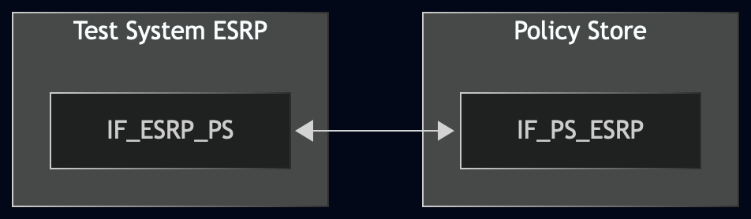
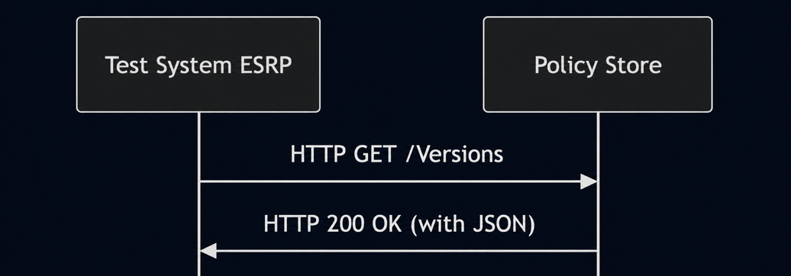

# Test Description: TD_PS_003


## Overview
### Summary
Handling of /Versions entrypoint

### Description
Verify that the Policy Store implements the /Versions entry point and returns the required version information and JWS algorithm list in response to a HTTP GET request.

### References
* Requirements : RQ_PS_013, RQ_PS_014, RQ_PS_097, RQ_PS_134
* Test Case    : TC_PS_003

### Requirements
IXIT config file for Policy Store

### HTTP transport types
Test can be performed with 2 different HTTP transport types. Steps describing actions for specific one are marked as following:
- (TLS) - used by default inside ESInet on production environment
- (TCP) - used if default TLS is not possible

## Configuration
### Implementation Under Test Interface Connections
* Policy Store (PS)
  * IF_PS_ESRP - connected to Test System ESRP IF_ESRP_PS
* Test System ESRP
  * IF_ESRP_PS - connected to Policy Store IF_PS_ESRP

### Interface Modes
* Policy Store (PS)
  * IF_PS_ESRP - Active
* Test System ESRP
  * IF_ESRP_PS - Active
 
### Connectivity Diagram
<!--
https://mermaid.live/edit#pako:eNpdUdFKwzAU_ZVwn5uxpO3aBfFFJwgKZfVJAhKbrC22yUhTXB37d9PMKfMt55x77j039wiVkQoYYIy5rozetTXjGiHXqF4xJIX94DqIu858Vo2wDj1t5wqEHh_eNuW2eCvKG4xvPSrKQJzVYXyvrdg36EUNDpXT4FSP_uTrBmdOafnPW5iurSZUOmPVle9qlPdBBLVtJTBnRxVBr2wvZgjHuYRD2IcD80-r5HjA82a4Mp2xHLg-ef9e6Fdj-ksLa8a6AbYT3eDRuJfCqftW-Fz9L2v9ZGXvzKgdMJKsQxNgRzh4SOMFWcWUrNNslZOcJhFMniZ0kaeU0DRJCFmv0vgUwVeYu1xkeU7TfJmlGfEiiSMQozPlpKtLKiVb_xfP56OF212ybYLyE-30DfC2kao
-->




## Pre-Test Conditions
### Test System ESRP
* Interfaces are connected to network
* Interfaces have configured IP addresses
* ng911 repository cloned to local storage
* A valid PCA-signed Test System certificate and matching private key (test_system.crt, test_system.key), together with the PCA CA certificate (PCA.crt), are available in the working directory used to run curl

### Policy Store (PS)
* Interfaces are connected to network
* Interfaces have configured IP addresses
* Default configuration is loaded
* IUT is initialized with steps from IXIT config file
* Device is in normal operating state

## Test Sequence

### Test Preamble

#### Test System ESRP
* Install Wireshark[^1]
* (TLS v1.2) Configure Wireshark to decode HTTP over TLS, use tests system and PS certificate keys [^2]
* (TLS v1.3) Configure logging of session keys and configure Wireshark to decode HTTP over TLS [^3]
* Using Wireshark on 'Test System ESRP' start packet tracing on IF_ESRP_PS interface - run following filter:
   * (TLS)
     > ip.addr == IF_ESRP_PS_IP_ADDRESS and tls
   * (TCP)
     > ip.addr == IF_ESRP_PS_IP_ADDRESS and http
     
### Test Body

#### Stimulus
Send HTTP GET to /Versions entrypoint of Policy Store:

- (TLSv1.2):
  
  `curl --cert test_system.crt --key test_system.key --cacert PCA.crt --tlsv1.2 -X GET https://IF_PS_ESRP_IP_ADDRESS:PORT/Versions`

- (TLSv1.3):
  
  `curl --cert test_system.crt --key test_system.key --cacert PCA.crt --tlsv1.3 -X GET https://IF_PS_ESRP_IP_ADDRESS:PORT/Versions`

- (TCP):
  
  `curl -X GET http://IF_PS_TS_IP_ADDRESS:PORT/Versions`

#### Response
Policy Store should respond with HTTP 200 OK with JSON body containing:
1. A mandatory 'fingerprint' member with a string value.
2. A mandatory 'versions' member containing a non-empty array of version objects (one for each version supported by the Policy Store).
3. Each version object MUST contain integer 'major' and 'minor' members.
4. Each version object MUST contain a 'serviceInfo' JSON object with a 'requiredAlgorithms' array of strings listing JWS signing algorithms acceptable to the Policy Store.
5. The 'vendor' member is optional; if present, it shall be a string.

Example:

```
{
    "fingerprint": "Woof-FurrySuite-v8-8c439e",
    "versions": [
    {
        "major": 6, "minor": 3,
        "vendor": "burby-magic",
        "serviceInfo": {
            "requiredAlgorithms": [ "EdDSA" ]
        }
    }
    ]
}
```

VERDICT:
* PASSED - if response has correct JSON body
* FAILED - any other cases


### Test Postamble
#### Test System ESRP
* stop Wireshark (if still running)
* archive all logs generated
* disconnect interfaces from IUT
* (TLS) remove certificates

#### Policy Store
* disconnect interfaces from Test System ESRP
* reconnect interfaces back to default

## Post-Test Conditions
### Test System ESRP
* Test tools stopped
* interfaces disconnected from IUT

### Policy Store
* device connected back to default
* device in normal operating state

## Sequence Diagram
<!--
https://mermaid.live/edit#pako:eNplkUFP4zAQhf_KaE6slJQ6bZrgA9Jqt2K1KyAiFQeUi-UMrUViF9vRUqr-dxyXcOHmefN55unNEaVpCTmmadpoafSz2vJGA_gd9cShFfZlLDtjXjjITjin5Cg4eh1IS4owQK-sNfan9MY6Ds-ic9ToOHMCfyuxtaI_43thvZJqL7SHdf1QgXCwIeehPjhPfdS-k1U9cpXplDxAHVbRmRnp9Pq6qjn82WwquFlv4PKRrFNGuzNS1QEYuU8km8_h_h9c_Fd-B3_r-7sfjcYEt1a1yL0dKMGebC_GEo_jjAZjJA3y8LTUDm-pNJ2xDTb6FL4Gh0_G9NNva4btDnlMIsFh3wo_RfClWtIt2V9m0B45K-IM5Ed8C1W2mLHVImNXebEqWZktEzwEmWWzMs9Yli-XjF2t8sUpwfe4dj4ryjLLy3mRFyw02SJBMXhTH7ScTFGrQmq354vHw0_W1rHz6ez0AQWpqOE
-->




## Comments

Version:  010.3f.5.0.7

Date:     20261022

## Footnotes
[^1]: Wireshark - tool for packet tracing and analysis. Official website: https://www.wireshark.org/download.html
[^2]: Wireshark configuration to decrypt TLS packets: https://www.zoiper.com/en/support/home/article/162/How%20to%20decode%20SIP%20over%20TLS%20with%20Wireshark%20and%20Decrypting%20SDES%20Protected%20SRTP%20Stream
[^3]: TLS v1.3 session keys logging + Wireshark configuration to decrypt traffic: https://my.f5.com/manage/s/article/K50557518
