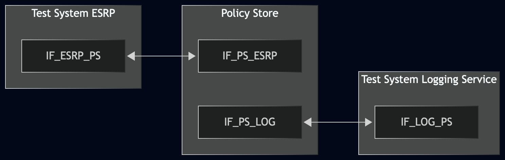
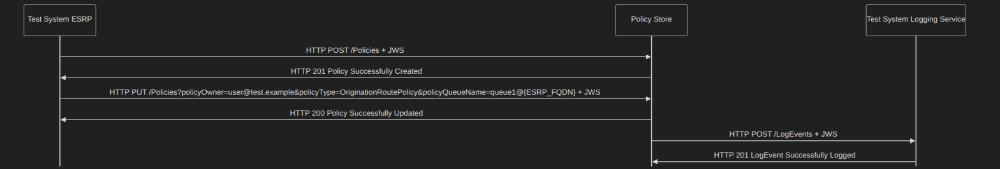

# Test Description: TD_PS_012
## Overview
### Summary
Validation of the LogEvents POST request properties sent by the Policy Store.

### Description
This test verifies that when the Policy Store sends a LogEvent to the Logging Service, it sends an HTTP POST request to the configured `.../LogEvents` entry point without request parameters and with a request body containing a JSON Web Signature (JWS) of a LogEvent.


### References
* Requirements : RQ_PS_121
* Test Case    : TC_PS_012

### Requirements
IXIT config file for Policy Store

## Configuration
### Implementation Under Test Interface Connections
<!-- Identify each of the FEs that are part of the configuration and how they are connected -->
* Policy Store (PS)
  * IF_PS_ESRP - connected to Test System ESRP IF_ESRP_PS
  * IF_PS_LOG - connected to Test System Logging Service IF_LOG_PS
* Test System ESRP
  * IF_ESRP_PS - connected to Policy Store IF_PS_ESRP
* Test System Logging Service
  * IF_LOG_PS - connected to Policy Store IF_PS_LOG

### Test System Interfaces
<!-- Identify each of the test system interfaces and whether it will be in active or monitor mode -->
* Test System ESRP
  * IF_ESRP_PS - Active
* Test System Logging Service
  * IF_LOG_PS - Active
* Policy Store (PS)
  * IF_PS_ESRP - Active
  * IF_PS_LOG - Active

### Connectivity Diagram
<!--
https://mermaid.live/edit#pako:eNqNUlFPgzAQ_ivNPcMCDGE0xgd1GpMZl7EnrVkqdNAI7dIV3Vz23y2wwTTGrE_33X139931dpDIlAEG27aJSKRY8gwTgZDOWckwSql6J6IJLgv5meRUaTSZ1QyE1tVbpugqR-N4Nn0hMGdrjeLtWrOycRF4bYn1S7liieZSoPl17324W9TMxTQ2-T3oMplIifjVreFOZcGTLYq1VOy8PtN4cdDZgx-ZrXvydN9RjP2vkpZ7OvZEZhkXGYqZ-uDJmcpMmW4Brf1X13476NK2r05G6uKt5C58qCXAgkzxFLBWFbOgZKqkNYRdnUmg-WsC2JiKpdXGrn_dTmQhFQEi9iZ_RcWzlOWxhJJVlgNe0mJtULVKqWa3nJqtlJ1XGe1M3chKaMCu7zdFAO9gY6A7GLphGLqOcxE5TuiFFmwBR_4gCEbuMAqcke86nr-34Ktp6wyiyAk8Pwp8bxh67tACWmkZb0Vy1MRSbo7hsT3n5qqPysZN5CBs_w22aOSw
-->




## Pre-Test Conditions

### Test System ESRP / Test System Logging Service
* Interfaces are connected to network
* Interfaces have IP addresses assigned by DHCP
* Device is active
* Test System has its own certificate signed by PCA
* ng911 repository cloned to local storage

### Policy Store (PS)
* Interfaces are connected to network
* Interfaces have IP addresses assigned by DHCP
* Default configuration is loaded
* IUT is initialized with steps from IXIT config file
* Device is active
* Device is in normal operating state

## Test Sequence

### Test Preamble

#### Test System ESRP
* Install Wireshark[^1]
* (TLS v1.2) Configure Wireshark to decode HTTP over TLS, use tests system and PS certificate keys [^2]
* (TLS v1.3) Configure logging of session keys and configure Wireshark to decode HTTP over TLS [^3]
* Copy to local storage PCA-signed certificate and private key files:
  ```
  ESRP-cacert.pem
  ESRP-cakey.pem
  ```
* Copy the PCA certificate to local storage:
  ```
  PCA.crt
  ```
* Using Wireshark on 'Test System' start packet tracing on IF_ESRP_PS interface - run following filter:
   * (TLS)
     > ip.addr == IF_ESRP_PS_IP_ADDRESS and tls
   * (TCP)
     > ip.addr == IF_ESRP_PS_IP_ADDRESS and http
* Prepare first policy JWS object for the initial HTTP POST
  * copy to local storage and edit file `Policy_object_OriginationRoutePolicy_LostServiceUrnCondition.json`
    * change `POLICY_QUEUE_NAME` to `queue1@{ESRP_FQDN}` where {ESRP_FQDN} is the right FQDN of Test System ESRP
    * change `sip:DOWNSTREAM_SIP_URI` to e.g. `sip:test@ng911.test:5060`
    * save file as e.g. `policy1.json`
  * generate JWS object and save to file jws_initial.json, e.g.
    ```
    python3 -m main generate_jws policy1.json --cert ESRP-cacert.pem --key ESRP-cakey.pem --output_file jws_initial.json
    ```
* Prepare second policy JWS object for the initial policy update to be sent in HTTP PUT request
  * copy to local storage and edit file `Policy_object_OriginationRoutePolicy_LostServiceUrnCondition.json`
    * change `POLICY_QUEUE_NAME` to `queue1@{ESRP_FQDN}` where {ESRP_FQDN} is the right FQDN of Test System ESRP
    * change `sip:DOWNSTREAM_SIP_URI` to e.g. `sip:test_update@ng911.test:5060`
    * save file as e.g. `policy2.json`
  * generate JWS object and save to file jws_update.json, e.g.
    ```
    python3 -m main generate_jws policy2.json --cert ESRP-cacert.pem --key ESRP-cakey.pem --output_file jws_update.json
    ```

#### Test System Logging Service
* Install Wireshark[^1]
* Using Wireshark on 'Test System' start packet tracing on IF_LOG_PS interface - run following filter:
   * (TCP)
     > ip.addr == IF_LOG_PS_IP_ADDRESS and http
* Ensure the project repository is available on Test System Logging Service. Run the repository-relative commands below from the repository root.
* Prepare a valid LogEvents response body:

  ```
  mkdir -p /tmp/ps_012
  ID="$(python3 -c 'import uuid; print(uuid.uuid4().hex)')"
  printf '{"logEventId":"urn:emergency:uid:logid:%s:test.example"}\n' "$ID" > /tmp/ps_012/logeventid.json
  ```

* Start the Logging Service receiver:

  ```
  python3 test_suite/services/stub_server/http/http_entry.py \
    --ip IF_LOG_PS_IP_ADDRESS \
    --port 8080 \
    --role RECEIVER \
    --path '["/LogEvents","/Versions"]' \
    --method '["POST","GET"]' \
    --response_code '["201","200"]' \
    --body '["file./tmp/ps_012/logeventid.json","file.test_suite/test_files/JSON/versions/Logging_Service_Versions_object_example_v010.3f.5.0.0.json"]' \
    --content_type application/json
  ```

* `GET /Versions` is provided only as Logging Service version-discovery support for the Policy Store.

### Test Body

#### Stimulus

1. Send initial policy - from Test System ESRP send HTTP POST to Policy Store with generated inital JWS object jws_initial.json:

HTTP POST:
- (TLSv1.2):
  
  `curl --cert ESRP-cacert.pem --key ESRP-cakey.pem --cacert PCA.crt --tlsv1.2 -X POST https://IF_PS_ESRP_IP_ADDRESS:PORT/Policies -H "Content-Type: application/json" -d jws_initial.json`

- (TLSv1.3):
  
  `curl --cert ESRP-cacert.pem --key ESRP-cakey.pem --cacert PCA.crt --tlsv1.3 -X POST https://IF_PS_ESRP_IP_ADDRESS:PORT/Policies -H "Content-Type: application/json" -d jws_initial.json`
- (TCP):
  
  `curl -X POST https://IF_PS_ESRP_IP_ADDRESS:PORT/Policies -H "Content-Type: application/json" -d jws_initial.json`

2. Update the existing policy which triggers logging of PolicyChangeLogEvent - from Test System ESRP send HTTP PUT to Policy Store with generated updated JWS object jws_updated.json:

HTTP PUT:
- (TLSv1.2):
  
  `curl --cert ESRP-cacert.pem --key ESRP-cakey.pem --cacert PCA.crt --tlsv1.2 -X PUT https://IF_PS_ESRP_IP_ADDRESS:PORT/Policies?policyOwner=agency.test.example&policyType=OriginationRoutePolicy&policyQueueName=queue1@{ESRP_FQDN} -H "Content-Type: application/json" -d jws_update.json`

- (TLSv1.3):
  
  `curl --cert ESRP-cacert.pem --key ESRP-cakey.pem --cacert PCA.crt --tlsv1.3 -X PUT https://IF_PS_ESRP_IP_ADDRESS:PORT/Policies?policyOwner=agency.test.example&policyType=OriginationRoutePolicy&policyQueueName=queue1@{ESRP_FQDN} -H "Content-Type: application/json" -d jws_update.json`
- (TCP):
  
  `curl -X PUT https://IF_PS_ESRP_IP_ADDRESS:PORT/Policies?policyOwner=agency.test.example&policyType=OriginationRoutePolicy&policyQueueName=queue1@{ESRP_FQDN} -H "Content-Type: application/json" -d jws_update.json`

#### Response

Using Wireshark, verify the LogEvent request messages sent by the Policy Store to the IF_LOG_PS:

* the HTTP method is `POST`;
* the request URI contains the configured `.../LogEvents` entry point;
* the request target URI contains no request parameters or query component. Example of a failing URI:
  ```
  IF_LOG_PS:8080/api/LogEvents?param=test
  ```
* the request contains a valid JWS JSON body containing the following members:
  * `"protected"` or `"header"` - with a Base64Url-encoded value;
  * `"payload"` - with a Base64Url-encoded value;
  * `"signature"` - with a Base64Url-encoded value or an empty string for an unsigned JWS.

VERDICT:

* ERROR - if Test System ESRP failed to send successfully HTTP POST or HTTP PUT to the Policy Store
* PASSED - All checks passed
* FAILED - any other cases

### Test Postamble

#### Test System ESRP
* Stop Wireshark if it is still running
* Archive the packet capture
* Remove copied certificate and private key files
* Disconnect IF_ESRP_PS from the Policy Store

#### Test System Logging Service
* Stop the http_service process if it is still running
* Stop Wireshark if it is still running
* Archive the packet capture
* Remove copied certificate and private key files
* Disconnect IF_LOG_PS from the Policy Store

#### Policy Store
* Disconnect IF_PS_ESRP from Test System ESRP
* Disconnect IF_PS_LOG from Test System Logging Service
* Reconnect IF_PS_ESRP and IF_PS_LOG to the default network configuration

## Post-Test Conditions

### Test System ESRP
* Test tools are stopped
* IF_ESRP_PS is disconnected from the Policy Store
* The packet capture is archived

### Test System Logging Service
* Test tools are stopped
* IF_LOG_PS is disconnected from the Policy Store
* The packet capture is archived

### Policy Store
* IF_PS_ESRP and IF_PS_LOG are reconnected to the default network configuration
* Device is in normal operating state

## Sequence Diagram
<!--
https://mermaid.live/edit#pako:eNp9U1tv0zAU_iuWH3hZUpK0NE2kjqGtgNBYs6UTEoqELOc0s0jszLFHQ9X_Pttpp5YBb758t3N8vMVUlIBT7Pt-wanga1alBUeoYVIK-YEqIbsUrUndgT1WD9BAikoifxbccTp41MApXDFSSdJYEEItkYpR1hKu0CK_yxDp0Ao6hfK-U9C4s9fILLe4TNSM9ig3zvAac7389KfYtagqxiuUg3xi1HAGlvXwz8-zPEWfV6sMZct8hd46dQYdOkNfvuUDMssNzsL3yCgIX1JoSqHr1rque3QpgSgo_yF_f6T-vnX05S8Ocq47kBfKBB7BhjRtDW-G21XfwnwpmQlPFBP8TmgFg-8ecatBww1pYP5oV-HF1rr--Hh7dbP7fwHBXwu4b8uhgCOaaehJg0w3F0_A1UmHDOi4VtugA-7Uwb7FYIA9XElW4lRJDR5uQDbEbvHWShbYTVKBU7OUUOqNb2fKp6IWssAF3xm-efDvQjQHCSl09YBTN4se1q6W_dS9nErgJchLobnCaRjGM6eC0y3e2P1oHMZxHAbBuyQI4ij2cI_TZDKaTmfhOJkGs0kYRJOdh38732CUJME0miTTSTSOo3AcephoJfKe00MqKJmZ1K_DL3Kf6ZBt4W720XbPaEQbWQ
-->




## Comments

Version:  010.3f.5.0.3

Date:     20261028

## Footnotes
[^1]: Wireshark - tool for packet tracing and analysis. Official website: https://www.wireshark.org/download.html
[^2]: Wireshark configuration to decrypt TLS packets: https://www.zoiper.com/en/support/home/article/162/How%20to%20decode%20SIP%20over%20TLS%20with%20Wireshark%20and%20Decrypting%20SDES%20Protected%20SRTP%20Stream
[^3]: TLS v1.3 session keys logging + Wireshark configuration to decrypt traffic: https://my.f5.com/manage/s/article/K50557518
