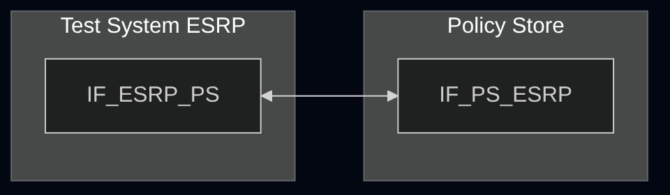
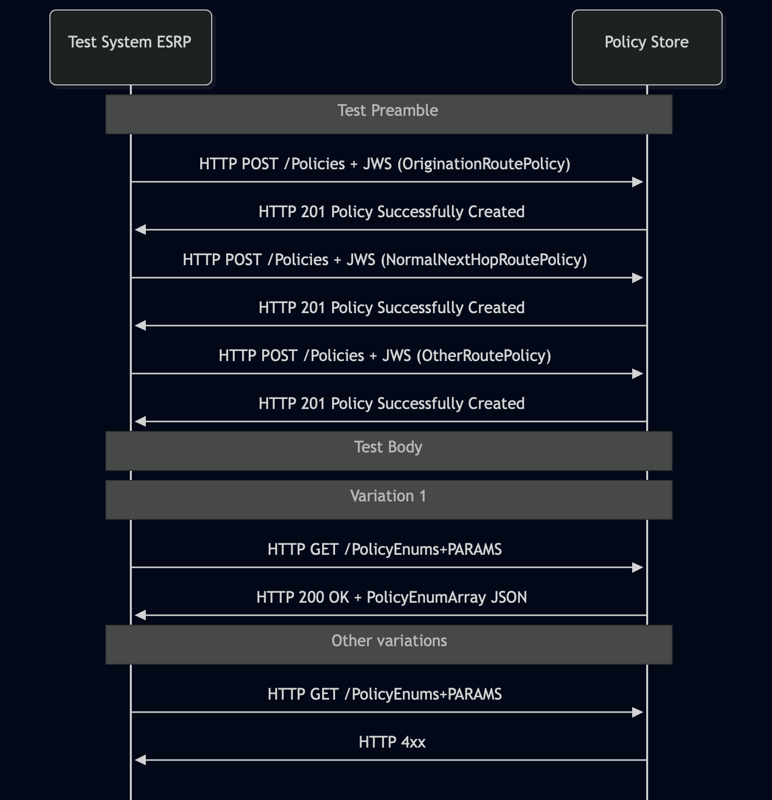

# Test Description: TD_PS_013
## Overview
### Summary
Handling of parameters in HTTP GET to /PolicyEnums entrypoint.


### Description
This test verifies that the Policy Store handles HTTP GET requests with parameters to the `.../PolicyEnums` entry point correctly.

The first variation (V1) expecting 200 OK response sends a correct request with all filtering parameters (`policyOwner`, `policyType`, `policyQueueName`, `start`, `limit`).

All the remaining variations (V2 - V14) expecting 4xx error responses send different incorrect requests

### References
* Requirements : RQ_PS_023
* Test Case    : TC_PS_013

### Requirements
IXIT config file for Policy Store

## Configuration
### Implementation Under Test Interface Connections
<!-- Identify each of the FEs that are part of the configuration and how they are connected -->
* Policy Store (PS)
  * IF_PS_ESRP - connected to Test System ESRP IF_ESRP_PS
* Test System ESRP
  * IF_ESRP_PS - connected to Policy Store IF_PS_ESRP

### Test System Interfaces
<!-- Identify each of the test system interfaces and whether it will be in active or monitor mode -->
* Test System ESRP
  * IF_ESRP_PS - Active
* Policy Store (PS)
  * IF_PS_ESRP - Active

### Connectivity Diagram
<!--
https://mermaid.live/edit#pako:eNplkMGKwjAQhl9lmLN5gbJ4coUFD8V4c5YSk9GWNYmkKVKk726SLXZx5_b_-eafmTxQe8NYAQohyGnvzt2lIgcQW7ZcgVHhh1x5PF_9XbcqRNjtMwHQD6dLULcWPuW-PhIeuI8gxz6yLRbh9y-Y62vbZK-pZSIX8WLYmbfUQtb-2ukRZPSB3_Nq2cyTF_E_b5kFH0Ks_zSSwxWg5WBVZ_InPAjL3ZQEYbkdp8yoIXo5Op38GAZOznAzKvKmU2lXO9vTE-opZ1A
-->




## Pre-Test Conditions

### Test System ESRP
* Interfaces are connected to network
* Interfaces have IP addresses assigned by DHCP
* Device is active
* Test System has its own certificate signed by PCA
* ng911 repository cloned to local storage

### Policy Store (PS)
* Interfaces are connected to network
* Interfaces have IP addresses assigned by DHCP
* Default configuration is loaded
* IUT is initialized with steps from IXIT config file
* Device is active
* Device is in normal operating state
* Policy Store contains no policies owned by the policy owner used in this test

## Test Sequence

### Test Preamble

#### Test System ESRP
* Install Wireshark[^1]
* (TLS v1.2) Configure Wireshark to decode HTTP over TLS, use tests system and PS certificate keys [^2]
* (TLS v1.3) Configure logging of session keys and configure Wireshark to decode HTTP over TLS [^3]
* Copy to local storage PCA-signed certificate and private key files:
  ```
  ESRP-cacert.pem
  ESRP-cakey.pem
  ```
* Copy the PCA certificate to local storage:
  ```
  PCA.crt
  ```
* Using Wireshark on 'Test System' start packet tracing on IF_ESRP_PS interface - run following filter:
   * (TLS)
     > ip.addr == IF_ESRP_PS_IP_ADDRESS and tls
   * (TCP)
     > ip.addr == IF_ESRP_PS_IP_ADDRESS and http
* Prepare policy JWS object #1 - OriginationRoutePolicy
  * copy to local storage and edit file `test_suite/test_files/JSON/policy_object/Policy_object_RoutePolicy_Origination_v010.3f.5.0.0.json`
    * change `POLICY_QUEUE_NAME` to the SIP URI `sip:queue1@{ESRP_FQDN}` where {ESRP_FQDN} is the right FQDN of Test System ESRP
    * change `sip:DOWNSTREAM_SIP_URI` to e.g. `sip:chfe@ng911.example:5060`
    * save file as e.g. `policy_orig.json`
  * generate JWS object and save to file jws_orig.json, e.g.
    ```
    python3 -m main generate_jws policy_orig.json --cert ESRP-cacert.pem --key ESRP-cakey.pem --output_file jws_orig.json
    ```
* Prepare policy JWS object #2 - NormalNextHopRoutePolicy
  * copy to local storage and edit file `test_suite/test_files/JSON/policy_object/Policy_object_RoutePolicy_NormalNextHop_v010.3f.5.0.0.json`
    * change `POLICY_QUEUE_NAME` to the SIP URI `sip:queue1@{ESRP_FQDN}`
    * change `sip:DOWNSTREAM_SIP_URI` to e.g. `sip:chfe@ng911.example:5060`
    * save file as e.g. `policy_nnh.json`
  * generate JWS object and save to file jws_nnh.json, e.g.
    ```
    python3 -m main generate_jws policy_nnh.json --cert ESRP-cacert.pem --key ESRP-cakey.pem --output_file jws_nnh.json
    ```
* Prepare policy JWS object #3 - OtherRoutePolicy
  * copy to local storage and edit file `test_suite/test_files/JSON/policy_object/Policy_object_RoutePolicy_Other_v010.3f.5.0.0.json`
    * keep `policyId` value `OtherRoutePolicy_policyId`
    * change `sip:DOWNSTREAM_SIP_URI` to e.g. `sip:chfe@ng911.example:5060`
    * save file as e.g. `policy_other.json`
  * generate JWS object and save to file jws_other.json, e.g.
    ```
    python3 -m main generate_jws policy_other.json --cert ESRP-cacert.pem --key ESRP-cakey.pem --output_file jws_other.json
    ```
* Store policies #1, #2 and #3 in the Policy Store - send HTTP POST for each JWS object (`jws_orig.json`, `jws_nnh.json`, `jws_other.json`), e.g. (TLSv1.2):

  `curl --cert ESRP-cacert.pem --key ESRP-cakey.pem --cacert PCA.crt --tlsv1.2 -X POST https://IF_PS_ESRP_IP_ADDRESS:PORT/Policies -H "Content-Type: application/json" -d @jws_orig.json`

  (for TLSv1.3 use `--tlsv1.3`; for TCP use `http://` and omit the certificate and TLS options)
* Each HTTP POST MUST be answered with a 2xx status code

### Test Body

#### Variations
1. Valid request with all filtering parameters, URL:

```
POLICY_STORE_FQDN_OR_IP:PORT/PolicyEnums?policyOwner=agency.test.example&policyType=OriginationRoutePolicy&policyQueueName=sip%3Aqueue1@{ESRP_FQDN}&start=1&limit=50&policiesUpdatedSince=2020-03-10T10%3A00%3A00-05%3A00
```

2. No query parameters at all, URL:

```
POLICY_STORE_FQDN_OR_IP:PORT/PolicyEnums
```

3. Incorrect "limit" parameter (send string), URL:

```
POLICY_STORE_FQDN_OR_IP:PORT/PolicyEnums?limit=test&start=1&policyType=OriginationRoutePolicy&policyQueueName=sip%3Aqueue1@{ESRP_FQDN}&policiesUpdatedSince=2020-03-10T10%3A00%3A00-05%3A00
```

4. Incorrect "limit" parameter (send empty), URL:

```
POLICY_STORE_FQDN_OR_IP:PORT/PolicyEnums?limit=&start=1&policyType=OriginationRoutePolicy&policyQueueName=sip%3Aqueue1@{ESRP_FQDN}&policiesUpdatedSince=2020-03-10T10%3A00%3A00-05%3A00
```

5. Incorrect "limit" parameter (send space), URL:

```
POLICY_STORE_FQDN_OR_IP:PORT/PolicyEnums?limit=%20&start=1&policyType=OriginationRoutePolicy&policyQueueName=sip%3Aqueue1@{ESRP_FQDN}&policiesUpdatedSince=2020-03-10T10%3A00%3A00-05%3A00
```

6. Incorrect "limit" parameter (send value exceeding 64bit unsigned int), URL:

```
POLICY_STORE_FQDN_OR_IP:PORT/PolicyEnums?limit=18446744073709551616&start=1&policyType=OriginationRoutePolicy&policyQueueName=sip%3Aqueue1@{ESRP_FQDN}&policiesUpdatedSince=2020-03-10T10%3A00%3A00-05%3A00
```

7. Incorrect "limit" parameter (send negative value exceeding 64bit int), URL:

```
POLICY_STORE_FQDN_OR_IP:PORT/PolicyEnums?limit=-9223372036854775809&start=1&policyType=OriginationRoutePolicy&policyQueueName=sip%3Aqueue1@{ESRP_FQDN}&policiesUpdatedSince=2020-03-10T10%3A00%3A00-05%3A00
```

8. Incorrect "start" parameter (send string), URL:

```
POLICY_STORE_FQDN_OR_IP:PORT/PolicyEnums?limit=10&start=test&policyType=OriginationRoutePolicy&policyQueueName=sip%3Aqueue1@{ESRP_FQDN}&policiesUpdatedSince=2020-03-10T10%3A00%3A00-05%3A00
```

9. Incorrect "start" parameter (send empty), URL:

```
POLICY_STORE_FQDN_OR_IP:PORT/PolicyEnums?limit=10&start=&policyType=OriginationRoutePolicy&policyQueueName=sip%3Aqueue1@{ESRP_FQDN}&policiesUpdatedSince=2020-03-10T10%3A00%3A00-05%3A00
```

10. Incorrect "start" parameter (send space), URL:

```
POLICY_STORE_FQDN_OR_IP:PORT/PolicyEnums?limit=10&start=%20&policyType=OriginationRoutePolicy&policyQueueName=sip%3Aqueue1@{ESRP_FQDN}&policiesUpdatedSince=2020-03-10T10%3A00%3A00-05%3A00
```

11. Incorrect "start" parameter (send value exceeding 64bit unsigned int), URL:

```
POLICY_STORE_FQDN_OR_IP:PORT/PolicyEnums?limit=10&start=18446744073709551616&policyType=OriginationRoutePolicy&policyQueueName=sip%3Aqueue1@{ESRP_FQDN}&policiesUpdatedSince=2020-03-10T10%3A00%3A00-05%3A00
```

12. Incorrect "start" parameter (send value less than 1), URL:

```
POLICY_STORE_FQDN_OR_IP:PORT/PolicyEnums?limit=10&start=0&policyType=OriginationRoutePolicy&policyQueueName=sip%3Aqueue1@{ESRP_FQDN}&policiesUpdatedSince=2020-03-10T10%3A00%3A00-05%3A00
```

13. Incorrect 'policyOwner' parameter (special characters not allowed in FQDN), URL:

```
POLICY_STORE_FQDN_OR_IP:PORT/PolicyEnums?policyOwner=te$t.failed&limit=10&start=1&policyType=OriginationRoutePolicy&policyQueueName=sip%3Aqueue1@{ESRP_FQDN}&policiesUpdatedSince=2020-03-10T10%3A00%3A00-05%3A00
```

14. Incorrect 'policyOwner' parameter (leading period), URL:

```
POLICY_STORE_FQDN_OR_IP:PORT/PolicyEnums?policyOwner=.test.example&limit=10&start=1&policyType=OriginationRoutePolicy&policyQueueName=sip%3Aqueue1@{ESRP_FQDN}&policiesUpdatedSince=2020-03-10T10%3A00%3A00-05%3A00
```

15. Incorrect 'policyOwner' parameter (FQDN length exceeded), URL:

```
POLICY_STORE_FQDN_OR_IP:PORT/PolicyEnums?policyOwner=agency.test.examplecomcomcomcomcomcomcomcomcomcomcomcomcomcomcomcomcomcomcomcomcomcomcomcomcomcomcomcomcomcomcomcomcomcomcomcomcomcomcomcomcomcomcomcomcomcomcomcomcomcomcomcomcomcomcomcomcomcomcomcomcomcomcomcomcomcomcomcomcomcomcomcomcomcomcomcomcomcomcomcom&limit=10&start=1&policyType=OriginationRoutePolicy&policyQueueName=sip%3Aqueue1@{ESRP_FQDN}&policiesUpdatedSince=2020-03-10T10%3A00%3A00-05%3A00&policiesUpdatedSince=2020-03-10T10%3A00%3A00-05%3A00
```

16. Incorrect 'policyType' parameter, URL:

```
POLICY_STORE_FQDN_OR_IP:PORT/PolicyEnums?policyOwner=agency.test.example&policyType=OriginationRoutePolicyy&policyQueueName=sip%3Aqueue1@{ESRP_FQDN}&start=1&limit=50&policiesUpdatedSince=2020-03-10T10%3A00%3A00-05%3A00
```

17. Incorrect "policyQueueName" (send without username), URL:

```
POLICY_STORE_FQDN_OR_IP:PORT/PolicyEnums?policyOwner=agency.test.example&policyType=OriginationRoutePolicy&policyQueueName={ESRP_FQDN}&start=1&limit=50&policiesUpdatedSince=2020-03-10T10%3A00%3A00-05%3A00
```

18. Incorrect "policyQueueName" (send without domain), URL:

```
POLICY_STORE_FQDN_OR_IP:PORT/PolicyEnums?policyOwner=agency.test.example&policyType=OriginationRoutePolicy&policyQueueName=sip%3Aqueue1&start=1&limit=50&policiesUpdatedSince=2020-03-10T10%3A00%3A00-05%3A00
```

19. Incorrect "policyQueueName" (send with not allowed characters), URL:

```
POLICY_STORE_FQDN_OR_IP:PORT/PolicyEnums?policyOwner=agency.test.example&policyType=OriginationRoutePolicy&policyQueueName=sip%3Aqueue1@${ESRP_FQDN}&start=1&limit=50&policiesUpdatedSince=2020-03-10T10%3A00%3A00-05%3A00
```

20. Incorrect "policyQueueName" (send invalid port), URL:

```
POLICY_STORE_FQDN_OR_IP:PORT/PolicyEnums?policyOwner=agency.test.example&policyType=OriginationRoutePolicy&policyQueueName=sip%3Aqueue1@{ESRP_FQDN}%3A65536&start=1&limit=50&policiesUpdatedSince=2020-03-10T10%3A00%3A00-05%3A00
```

21. Incorrect "policyQueueName" (send invalid scheme), URL:

```
POLICY_STORE_FQDN_OR_IP:PORT/PolicyEnums?policyOwner=agency.test.example&policyType=OriginationRoutePolicy&policyQueueName=zip%3Aqueue1@{ESRP_FQDN}&start=1&limit=50&policiesUpdatedSince=2020-03-10T10%3A00%3A00-05%3A00
```

22. Incorrect "policyId" parameter (send empty), URL:

```
POLICY_STORE_FQDN_OR_IP:PORT/PolicyEnums?policyOwner=agency.test.example&policyType=OtherRoutePolicy&policyId=&start=1&limit=50&policiesUpdatedSince=2020-03-10T10%3A00%3A00-05%3A00
```

23. Incorrect "policyId" parameter (send space), URL:

```
POLICY_STORE_FQDN_OR_IP:PORT/PolicyEnums?policyOwner=agency.test.example&policyType=OtherRoutePolicy&policyId=%20&start=1&limit=50&policiesUpdatedSince=2020-03-10T10%3A00%3A00-05%3A00
```

24. Incorrect "policiesUpdatedSince" parameter (incorrect year), URL:

```
POLICY_STORE_FQDN_OR_IP:PORT/PolicyEnums?policyOwner=agency.test.example&policyType=OriginationRoutePolicy&policyQueueName=sip%3Aqueue1@{ESRP_FQDN}&start=1&limit=50&policiesUpdatedSince=21155-08-21T12%3A58%3A03.01-05%3A00
```

25. Incorrect "policiesUpdatedSince" parameter (incorrect month), URL:

```
POLICY_STORE_FQDN_OR_IP:PORT/PolicyEnums?policyOwner=agency.test.example&policyType=OriginationRoutePolicy&policyQueueName=sip%3Aqueue1@{ESRP_FQDN}&start=1&limit=50&policiesUpdatedSince=2115-13-21T12%3A58%3A03.01-05%3A00
```

26. Incorrect "policiesUpdatedSince" parameter (incorrect day), URL:

```
POLICY_STORE_FQDN_OR_IP:PORT/PolicyEnums?policyOwner=agency.test.example&policyType=OriginationRoutePolicy&policyQueueName=sip%3Aqueue1@{ESRP_FQDN}&start=1&limit=50&policiesUpdatedSince=2115-12-32T12%3A58%3A03.01-05%3A00
```

27. Incorrect "policiesUpdatedSince" parameter (incorrect hour), URL:

```
POLICY_STORE_FQDN_OR_IP:PORT/PolicyEnums?policyOwner=agency.test.example&policyType=OriginationRoutePolicy&policyQueueName=sip%3Aqueue1@{ESRP_FQDN}&start=1&limit=50&policiesUpdatedSince=2115-12-21T24%3A58%3A03.01-05%3A00
```

28. Incorrect "policiesUpdatedSince" parameter (incorrect minute), URL:

```
POLICY_STORE_FQDN_OR_IP:PORT/PolicyEnums?policyOwner=agency.test.example&policyType=OriginationRoutePolicy&policyQueueName=sip%3Aqueue1@{ESRP_FQDN}&start=1&limit=50&policiesUpdatedSince=2115-12-21T12%3A60%3A03.01-05%3A00
```

29. Incorrect "policiesUpdatedSince" parameter (incorrect second), URL:

```
POLICY_STORE_FQDN_OR_IP:PORT/PolicyEnums?policyOwner=agency.test.example&policyType=OriginationRoutePolicy&policyQueueName=sip%3Aqueue1@{ESRP_FQDN}&start=1&limit=50&policiesUpdatedSince=2115-12-21T12%3A58%3A61.01-05%3A00
```

30. Incorrect "policiesUpdatedSince" parameter (incorrect time offset), URL:

```
POLICY_STORE_FQDN_OR_IP:PORT/PolicyEnums?policyOwner=agency.test.example&policyType=OriginationRoutePolicy&policyQueueName=sip%3Aqueue1@{ESRP_FQDN}&start=1&limit=50&policiesUpdatedSince=2115-12-21T12%3A58%3A03.01-24%3A60
```

31. Incorrect "policiesUpdatedSince" parameter (incorrect day in February), URL:

```
POLICY_STORE_FQDN_OR_IP:PORT/PolicyEnums?policyOwner=agency.test.example&policyType=OriginationRoutePolicy&policyQueueName=sip%3Aqueue1@{ESRP_FQDN}&start=1&limit=50&policiesUpdatedSince=2115-02-30T12%3A58%3A03.01-05%3A00
```

#### Stimulus

For each variation in the table, from Test System ESRP send HTTP GET to the Policy Store, e.g. for V1:

HTTP GET:
- (TLSv1.2):

  `curl --cert ESRP-cacert.pem --key ESRP-cakey.pem --cacert PCA.crt --tlsv1.2 -X GET "https://POLICY_STORE_FQDN_OR_IP:PORT/PolicyEnums?policyOwner=agency.test.example&policyType=OriginationRoutePolicy&policyQueueName=sip%3Aqueue1@{ESRP_FQDN}&start=1&limit=50&policiesUpdatedSince=2020-03-10T10%3A00%3A00-05%3A00"`

- (TLSv1.3):

  `curl --cert ESRP-cacert.pem --key ESRP-cakey.pem --cacert PCA.crt --tlsv1.3 -X GET "https://POLICY_STORE_FQDN_OR_IP:PORT/PolicyEnums?policyOwner=agency.test.example&policyType=OriginationRoutePolicy&policyQueueName=sip%3Aqueue1@{ESRP_FQDN}&start=1&limit=50&policiesUpdatedSince=2020-03-10T10%3A00%3A00-05%3A00"`

- (TCP):

  `curl -X GET "http://POLICY_STORE_FQDN_OR_IP:PORT/PolicyEnums?policyOwner=agency.test.example&policyType=OriginationRoutePolicy&policyQueueName=sip%3Aqueue1@{ESRP_FQDN}&start=1&limit=50&policiesUpdatedSince=2020-03-10T10%3A00%3A00-05%3A00"`

#### Response

Using Wireshark, verify the responses sent by the Policy Store on IF_PS_ESRP.

Variation 1:

* the HTTP status code is `200`;
* the body is a JSON `PolicyEnumArray` object containing the mandatory members:
  * `"count"` - integer, equal to the number of `PolicyEnum` objects in `"policyEnums"`
  * `"totalCount"` - integer, greater than or equal to `"count"`
  * `"policyEnums"` - array of `PolicyEnum` JSON objects;
  * each `"PolicyEnum"` object consists of:
    * `"policyType"` - member that is a string consisting of the contents of the "Type" field of one entry in the Policy Types registry (NENA-STA-010.3, Section 10.33)
    * `"policyOwner"` - with string value containing FQDN or URI with FQDN, e.g. `agency.test.example`
    * (optional) `"policyId"` - with string value, MUST be provided when `"policyType"` is `"OtherRoutePolicy"`
    * (optional) `"policyQueueName"` - with string value consisting of a queue name (a SIP URI), MUST be provided when `"policyType"` is `"NormalNextHopRoutePolicy"`
    * `"policyExpirationTime"` - string with correct date-time format (f.e. 2020-03-10T11:00:01-05:00)
    * `"policyLastModificationTime"` - string with correct date-time format (f.e. 2020-03-10T11:00:01-05:00)

    * Example of a valid response body (V1):
```
{
  "count": 1,
  "totalCount": 1,
  "policyEnums": [
    {
      "policyType": "OriginationRoutePolicy",
      "policyOwner": "agency.test.example",
      "policyQueueName": "sip:queue1@esrp.ng911.example",
      "policyExpirationTime": "2027-10-21T00:00:00Z",
      "policyLastModificationTime": "2026-10-21T10:00:00Z"
    }
  ]
}
```

Other variations:

* HTTP 4XX error response


VERDICT:

* ERROR - if Test System ESRP failed to store the policies in the Policy Store in the Test Preamble
* PASSED - if IUT responded as expected
* FAILED - all other cases

### Test Postamble

#### Test System ESRP
* Delete the policies stored in the Test Preamble from the Policy Store, e.g. for OriginationRoutePolicy:
- (TLSv1.2):

  `curl --cert ESRP-cacert.pem --key ESRP-cakey.pem --cacert PCA.crt --tlsv1.2 -X DELETE "https://POLICY_STORE_FQDN_OR_IP:PORT/Policies?policyOwner=agency.test.example&policyType=OriginationRoutePolicy&policyQueueName=sip%3Aqueue1@{ESRP_FQDN}"`

- (TLSv1.3):

  `curl --cert ESRP-cacert.pem --key ESRP-cakey.pem --cacert PCA.crt --tlsv1.3 -X DELETE "https://POLICY_STORE_FQDN_OR_IP:PORT/Policies?policyOwner=agency.test.example&policyType=OriginationRoutePolicy&policyQueueName=sip%3Aqueue1@{ESRP_FQDN}"`

- (TCP):

  `curl -X DELETE "http://POLICY_STORE_FQDN_OR_IP:PORT/Policies?policyOwner=agency.test.example&policyType=OriginationRoutePolicy&policyQueueName=sip%3Aqueue1@{ESRP_FQDN}"`

* Stop Wireshark if it is still running
* Archive the packet capture
* Remove copied certificate and private key files
* Disconnect IF_ESRP_PS from the Policy Store

#### Policy Store
* Disconnect IF_PS_ESRP from Test System ESRP
* Reconnect IF_PS_ESRP to the default network configuration

## Post-Test Conditions

### Test System ESRP
* Test tools are stopped
* IF_ESRP_PS is disconnected from the Policy Store
* The packet capture is archived

### Policy Store
* Policies stored during the test are removed
* IF_PS_ESRP is reconnected to the default network configuration
* Device is in normal operating state

## Sequence Diagram
<!--
https://mermaid.live/edit#pako:eNq9VMtu2zAQ_BWCpxaRXL0cWTwEcFOjQYrYgmk0QKELK60dohLpklRg1fC_l6Ks9ND4UCDojeTOzgx3uTziUlaACfZ9vxClFFu-I4VAyDxBAwRVTP3otxp-tiBKcDGEGq6UVPPSSKUJ2rJaQyEcxQj8xNlOsWaA75kyvOR7Jgxa0HWOmEYb0AbRThto3NnfyJz2uFzWvOwQtVIwYJbSAJLPoFyel1MykOUKWPO9PqP6mH9z00fvNpsc5Su6QR8cGweNrtD9I0XvVorvuGCGS7GWrYFB7f1AkVNL0POcKaIgfLHTliVovW3rukO3VthA9S-6S6kaVi_hYO7k_r8qr2xn1RspXurER1l1FxFfmeKu4Ch83ffnxWi7W4i20Vf5fD1_oJd8Bmj1xV7uT8JcKdahe7paXvTgioCeRyf6DYwkhwP28E7xChOjWvBwA7bH_RYf-5QCu5kqMLFLBVV78Pvp8ktZS1XgQpxsvn3436RsRgol290TJm7APNzuK1v782S9nCoQFahb2QqDSZQGjgSTIz5gEieTWZjEaRYFWRRls-nUwx0m4fV0Mg2jJEuzJIjTOEhPHv7ldINJGs-yOJhFYRLO0uso8jBrjaSdKEdXUHE7jQ_Dx-H-j9HbwkXO1k6_AfU2Xps
-->




## Comments

Version:  010.3f.5.0.1

Date:     20261027

## Footnotes
[^1]: Wireshark - tool for packet tracing and analysis. Official website: https://www.wireshark.org/download.html
[^2]: Wireshark configuration to decrypt TLS packets: https://www.zoiper.com/en/support/home/article/162/How%20to%20decode%20SIP%20over%20TLS%20with%20Wireshark%20and%20Decrypting%20SDES%20Protected%20SRTP%20Stream
[^3]: TLS v1.3 session keys logging + Wireshark configuration to decrypt traffic: https://my.f5.com/manage/s/article/K50557518
