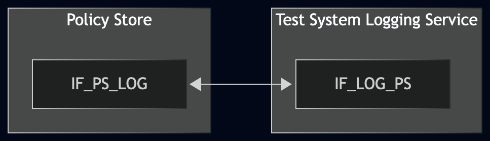
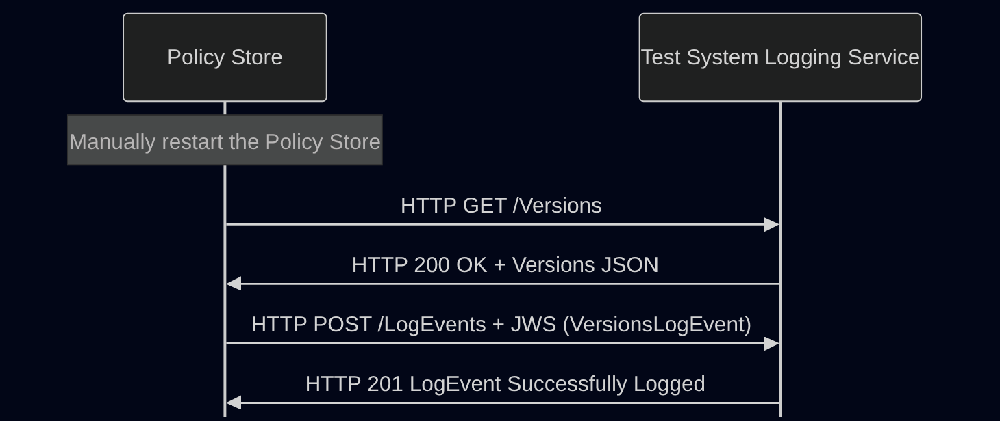

# Test Description: TD_PS_014
## Overview
### Summary
Logging of VersionsLogEvent

### Description
This test verifies VersionsLogEvent sent to Logging Service on each sent HTTP GET /Versions.

### References
* Requirements : RQ_PS_123
* Test Case    : TC_PS_014

### Requirements
IXIT config file for Policy Store

## Configuration
### Implementation Under Test Interface Connections
<!-- Identify each of the FEs that are part of the configuration and how they are connected -->
* Policy Store (PS)
  * IF_PS_LOG - connected to Test System Logging Service IF_LOG_PS
* Test System Logging Service
  * IF_LOG_PS - connected to Policy Store IF_PS_LOG

### Test System Interfaces
<!-- Identify each of the test system interfaces and whether it will be in active or monitor mode -->
* Policy Store (PS)
  * IF_PS_LOG - Active
* Test System Logging Service
  * IF_LOG_PS - Active


### Connectivity Diagram
<!--
https://mermaid.live/edit#pako:eNqNUslOwzAQ_RVrzknVLI0bC3FgFVIRFekJjCrjuIlFYleOA4Sq_46T0lRCHPBptjfvzXh2wHUugIDv-1RxrTayIFQhZEtRC4JyZt6oGpKbSn_wkhmLFo99BUJN-1oYti3RMnumsNSV5B3KrDaCwsuhpH-5NIJbqRVaXZyidzfrZbZePNw66GiPOKFyqn6xHGpXorEo6xorarTQRSFVgTJh3iX_J6trsx4Ej_ZfrKMkdOb75yccVeBBYWQOxJpWeFALU7PehV2PpDBsjgJxphF5--n3O_S5rrShQNXe4bdMPWldH1sY3RYlkA2rGue125xZcSWZm7oeo8ZpE-ZSt8oCCfHQA8gOPoEEwXQSY5ykYRjheRzPQw86IFE4mc6CIE1wMHPhJN578DWwTicYh3GSJlGK8TyIsAOw1uqsU_yoSeTSfeT94TiGGzkqux4yP8L23_qZsZ8
-->




## Pre-Test Conditions

### Test System Logging Service
* Interfaces are connected to network
* Interfaces have IP addresses assigned by DHCP
* Device is active
* Test System has its own certificate signed by PCA
* ng911 repository cloned to local storage

### Policy Store (PS)
* Interfaces are connected to network
* Interfaces have IP addresses assigned by DHCP
* Default configuration is loaded
* IUT is initialized with steps from IXIT config file
* IUT is configured to send LogEvents to Test System Logging Service (IF_LOG_PS)
* Device is active
* Device is in normal operating state

## Test Sequence

### Test Preamble

#### Test System Logging Service
* Install Wireshark[^1]
* (TLS v1.2) Configure Wireshark to decode HTTP over TLS, use tests system and PS certificate keys [^2]
* (TLS v1.3) Configure logging of session keys and configure Wireshark to decode HTTP over TLS [^3]
* (TLS) Copy to local storage PCA-signed certificate and private key files:
  ```
  LOG-cacert.pem
  LOG-cakey.pem
  ```
* Using Wireshark on 'Test System' start packet tracing on IF_LOG_PS interface - run following filter:
   * (TLS)
     > ip.addr == IF_LOG_PS_IP_ADDRESS and tls
   * (TCP)
     > ip.addr == IF_LOG_PS_IP_ADDRESS and http
* Ensure the project repository is available on Test System Logging Service. Run the repository-relative commands below from the repository root.
* Prepare a valid LogEvents response body:

  ```
  mkdir -p /tmp/ps_014
  ID="$(python3 -c 'import uuid; print(uuid.uuid4().hex)')"
  printf '{"logEventId":"urn:emergency:uid:logid:%s:test.example"}\n' "$ID" > /tmp/ps_014/logeventid.json
  ```

* Start the Logging Service receiver:

  * (TLS):

  ```
  python3 test_suite/services/stub_server/http/http_entry.py \
    --ip IF_LOG_PS_IP_ADDRESS \
    --port 443 \
    --role RECEIVER \
    --path '["/LogEvents","/Versions"]' \
    --method '["POST","GET"]' \
    --response_code '["201","200"]' \
    --body '["file./tmp/ps_014/logeventid.json","file.test_suite/test_files/JSON/versions/Logging_Service_Versions_object_example_v010.3f.5.0.0.json"]' \
    --content_type application/json \
    --server_cert LOG-cacert.pem \
    --server_key LOG-cakey.pem
  ```

  * (TCP):

  ```
  python3 test_suite/services/stub_server/http/http_entry.py \
    --ip IF_LOG_PS_IP_ADDRESS \
    --port 8080 \
    --role RECEIVER \
    --path '["/LogEvents","/Versions"]' \
    --method '["POST","GET"]' \
    --response_code '["201","200"]' \
    --body '["file./tmp/ps_014/logeventid.json","file.test_suite/test_files/JSON/versions/Logging_Service_Versions_object_example_v010.3f.5.0.0.json"]' \
    --content_type application/json
  ```

### Test Body

#### Stimulus

Restart Policy Store manually to trigger sending of HTTP GET /Versions to Test System Logging Service

#### Response

Using traced packets on Wireshark verify if Policy Store sends HTTP POST to Test System Logging Service /LogEvents entrypoint with JWS body containing:
  * "logEventType": "VersionsLogEvent"
  * "timestamp" with correct date-time format (e.g. 2020-03-10T11:00:01-05:00)
  * "elementId" which has value with FQDN of Policy Store
  * "agencyId" which has value with FQDN of an agency
  * "source" - string containing the URL used by the Policy Store to send HTTP GET /Versions to Test System Logging Service
  * "response" - string with the Versions JSON response received from Test System Logging Service
  * (optional) "clientAssignedIdentifier" field with string value
  * (optional) "agencyAgentId" field with string value
  * (optional) "agencyPositionId" field with string value
  * (optional) field "ipAddressPort" with string value representing normalized IP address and port number, or FQDN of 
   another element that participated in the transaction that triggered this LogEvent element 
  * (optional) "extension" field should contain a JSON object

Example of the decoded JWS payload:
```json
{
  "logEventType": "VersionsLogEvent",
  "timestamp": "2026-10-20T12:00:00.05Z",
  "elementId": "ps.ng911.example",
  "agencyId": "ng911.test",
  "source": "https://log.ng911.example:8080/Versions",
  "response": "{\"fingerprint\": \"ng911_test_suite_fingerprint\", \"versions\": [{\"major\": 0, \"minor\": 1, \"vendor\": \"ng911_test_suite\", \"serviceInfo\": {\"requiredAlgorithms\": [\"EdDSA\"]}}]}"
}
```

VERDICT:
* PASSED - all checks passed
* FAILED - any other cases

### Test Postamble

#### Test System Logging Service
* Stop the http_service process if it is still running
* Stop Wireshark if it is still running
* Archive the packet capture
* Remove `/tmp/ps_014`
* (TLS) Remove copied certificate and private key files
* Disconnect IF_LOG_PS from the Policy Store

#### Policy Store
* Disconnect IF_PS_ESRP from Test System ESRP
* Disconnect IF_PS_LOG from Test System Logging Service
* Reconnect IF_PS_ESRP and IF_PS_LOG to the default network configuration

## Post-Test Conditions

### Test System Logging Service
* Test tools are stopped
* IF_LOG_PS is disconnected from the Policy Store
* The packet capture is archived

### Policy Store
* IF_PS_ESRP and IF_PS_LOG are reconnected to the default network configuration
* Device is in normal operating state

## Sequence Diagram
<!--
https://mermaid.live/edit#pako:eNp1kc1OwzAQhF9l5BMIIgrHHCohURWV0kRyBBdfLGcbLBK7-KdSVPXdsVNyAo4efzO7qzkxZVtiJVhRFMIoa_a6K4UBBu2cdY8qWOdL7GXvKcvhgwYq0Ur3Kczk8fQVySh60rJzcsgQcJAuaKUP0gTUHNKjtr1WI3jKo9_MtlpnqCEfwEcfaMDWdp02HTi5o1bJc3HtbCDYI7mUW-JVmij7foRLzpSX9_tjVM2L5TLNKPHcNDXWqwZ3b-S8tsZfiPSZkBw5EQ-LBaoX3GCmsOHV7s-wuuIpLW27OpIJPnk27xxXs3H-uP5nzj1mAjwqRd7vYz4on0-tMOwWbCA3SN3mmk6CTRWI9BBsqoGdMyNjsHw0KunBRUpKPLQyzLX8yOdvVNuhKg
-->




## Comments

Version:  010.3f.5.0.0

Date:     20261030

## Footnotes
[^1]: Wireshark - tool for packet tracing and analysis. Official website: https://www.wireshark.org/download.html
[^2]: Wireshark configuration to decrypt TLS packets: https://www.zoiper.com/en/support/home/article/162/How%20to%20decode%20SIP%20over%20TLS%20with%20Wireshark%20and%20Decrypting%20SDES%20Protected%20SRTP%20Stream
[^3]: TLS v1.3 session keys logging + Wireshark configuration to decrypt traffic: https://my.f5.com/manage/s/article/K50557518
