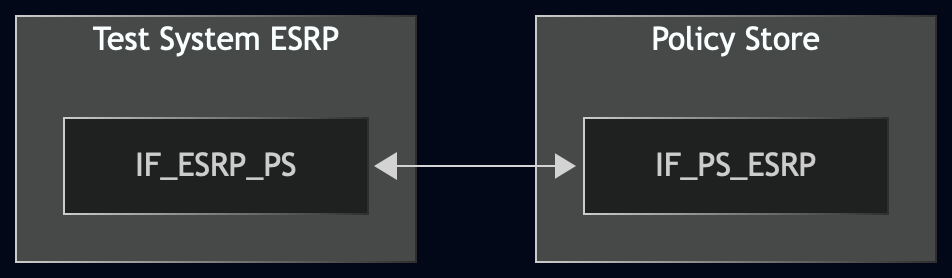
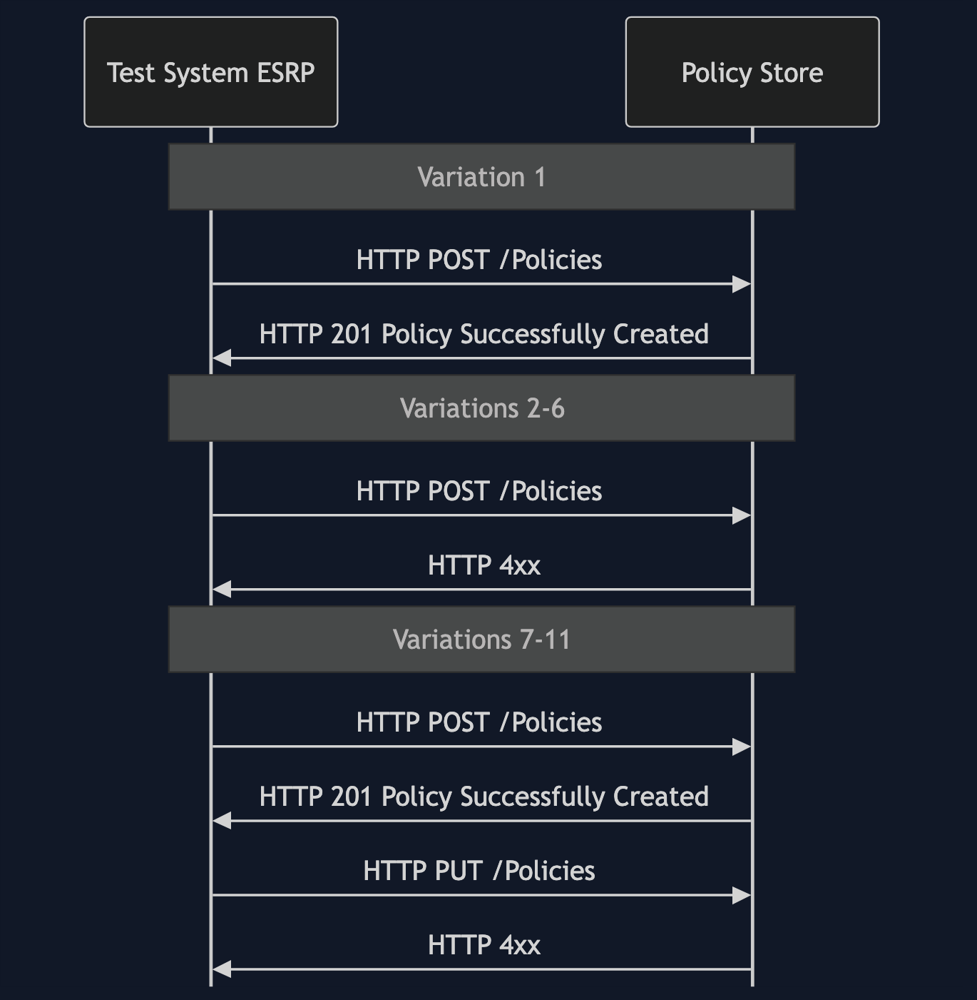

# Test Description: TD_PS_015

## Overview

### Summary
TimePeriodCondition `timeStart` / `timeEnd` validation.

### Description
Verify that the Policy Store rejects a Route Policy creation request when a single `timeStart` or `timeEnd` member contains multiple values, or when `timeEnd` is not greater than `timeStart`.

### References
- Requirements: `RQ_PS_093`, `RQ_PS_095`.
- Test Case: `TC_PS_015`.

### Requirements
IXIT config file for Policy Store

### HTTP transport types
Test can be performed with 2 different HTTP transport types. Steps describing actions for specific one are marked as following:
- (TLS) - used by default inside ESInet on production environment
- (TCP) - used if default TLS is not possible


## Configuration
### Implementation Under Test Interface Connections
* Policy Store (PS)
  * IF_PS_ESRP - connected to Test System ESRP IF_ESRP_PS
* Test System ESRP
  * IF_ESRP_PS - connected to Policy Store IF_PS_ESRP

### Interface Modes
* Policy Store (PS)
  * IF_PS_ESRP - Active
* Test System ESRP
  * IF_ESRP_PS - Active

### Connectivity Diagram

<!--
https://mermaid.live/edit#pako:eNplkc1u2zAQhF9lsacGkFz9WLbFQ4AgMRIkaCNURg-FLgS1sYlIpENSSFzD716KinLpjbv8ODucPaPQLSHDOI4bJbR6kXvWKAB3oJ4YtNy8jmWn9SsD0XFrpRgblt4GUoICDNBLY7S5EU4by-CFd5YaFTRn8E7yveH9hB-5cVLII1cOtvWvCriFHVkH9ck66kPvf7KqR67SnRQnqP0ompiRjq-vq5rBw27nqfvtDr7_JmOlVnZiqtoTIzgxkCUJPD_Bt3fpDvBYP_-8ahRGuDeyRebMQBH2ZHo-lngeNRoMmTTI_NFQO3zEYzqx0J02DTbq4t97n3-07mcJo4f9AVnII8Lh2HI3B_HVNaRaMrd6UA7ZsggayM74gWyTLNJVnmVplmTrrMjSCE_I0jRfbHyxXK3Xpf_HZnmJ8G-YmizKYlWU6zIvyiLNV1keIR-crk9KzJ6olT66H9Paw_ZnZ9tw82ns8g-jyarW
-->



## Pre-Test Conditions
### Test System ESRP
* Interfaces are connected to network
* Interfaces have configured IP addresses
* ng911 repository cloned to local storage
* A valid PCA-signed Test System certificate and matching private key (test_system.crt, test_system.key), together with the PCA CA certificate (PCA.crt), are available in the working directory used to run curl

### Policy Store (PS)
* Interfaces are connected to network
* Interfaces have configured IP addresses
* Default configuration is loaded
* IUT is initialized with steps from IXIT config file
* Device is in normal operating state

## Test Sequence

### Test Preamble
#### Test System ESRP
* Install Wireshark[^1]
* (TLS v1.2) Configure Wireshark to decode HTTP over TLS, use tests system and PS certificate keys [^2]
* (TLS v1.3) Configure logging of session keys and configure Wireshark to decode HTTP over TLS [^3]
* Using Wireshark on 'Test System ESRP' start packet tracing on IF_ESRP_PS interface - run following filter:
   * (TLS)
     > ip.addr == IF_ESRP_PS_IP_ADDRESS and tls
   * (TCP)
     > ip.addr == IF_ESRP_PS_IP_ADDRESS and http
* Make two temporary working copies of `Policy_object_OriginationRoutePolicy_TimePeriodCondition.json`, named e.g. `policy1.json` and `policy2.json`.
* Edit both policy files `policy1.json` and `policy2.json`:
  * change `POLICY_QUEUE_NAME` to e.g. `queue1@ng911.test`
  * change `DOWNSTREAM_SIP_URI` to e.g. `chfe@ng911.test`
* Generate a temporary signed JWS file `jws1.json` from `policy1.json`, example command:
  ```
  python3 -m main generate_jws policy1.json --cert test_system.crt --key test_system.key --output_file jws1.json
  ```
* (Variations 7-11) Store the initial policy. Send HTTP POST to /Policies entrypoint of Policy Store:

   - (TLSv1.2):

   `curl --cert test_system.crt --key test_system.key --cacert PCA.crt --tlsv1.2 -X POST https://IF_PS_ESRP:PORT/Policies -H "Content-Type: application/json" -d @jws1.json`
    
   - (TLSv1.3):

   `curl --cert test_system.crt --key test_system.key --cacert PCA.crt --tlsv1.3 -X POST https://IF_PS_ESRP:PORT/Policies -H "Content-Type: application/json" -d @jws1.json`
    
   - (TCP):

   `curl -X POST https://IF_PS_ESRP:PORT/Policies -H "Content-Type: application/json" -d @jws1.json`
* (Variations 7-11) For each variation, create a separate valid policy using HTTP POST and verify HTTP 201 Policy Successfully Created. Only then send that variation's invalid HTTP PUT using the same `policyOwner`, `policyType` and `policyQueueName`. If the POST does not return HTTP 201, stop the variation.
* Edit another JSON members within `policy2.json` depending on the current variation:
```
  "policyRules_0_conditions_0_timeStart": "01:00:00",
```
or
```
  "policyRules_0_conditions_0_timeEnd": "23:30:20",
```
* Generate a temporary signed JWS file `jws2.json` from `policy2.json`, example command:
  ```
  python3 -m main generate_jws policy2.json --cert test_system.crt --key test_system.key --output_file jws2.json
  ```

### Test Body

#### Variations

1. HTTP POST with correct policy. Use file `jws1.json` containing correct policy

2. HTTP POST with multiple `timeStart` values.
Use value:
```
 "policyRules_0_conditions_0_timeStart": ["01:00:00", "12:00:10"],
```
3. HTTP POST with multiple `timeEnd` values. 
Use value: 
```
"policyRules_0_conditions_0_timeEnd": ["23:20:20", "23:25:20"],
```

4. HTTP POST with equal `timeStart` and `timeEnd` time values. 
Use values:
```
  "policyRules_0_conditions_0_timeStart": "01:00:00",
  "policyRules_0_conditions_0_timeEnd": "01:00:00",
```

5. HTTP POST with `timeStart` with greater value than `timeEnd`
Use values:
```
  "policyRules_0_conditions_0_timeStart": "23:40:20",
  "policyRules_0_conditions_0_timeEnd": "23:30:20",
```
6. HTTP POST with `timeEnd` equal `00:00:00` when `timeStart` is empty 
Use values:
```
  "policyRules_0_conditions_0_timeStart": "",
  "policyRules_0_conditions_0_timeEnd": "00:00:00",
```
7. HTTP PUT with multiple `timeStart` values.
Use value:
```
 "policyRules_0_conditions_0_timeStart": ["01:00:00", "12:00:10"],
```
8. HTTP PUT with multiple `timeEnd` values. 
Use value: 
```
"policyRules_0_conditions_0_timeEnd": ["23:20:20", "23:25:20"],
```

9. HTTP PUT with equal `timeStart` and `timeEnd` time values. 
Use values:
```
  "policyRules_0_conditions_0_timeStart": "01:00:00",
  "policyRules_0_conditions_0_timeEnd": "01:00:00",
```

10. HTTP PUT with `timeStart` with greater value than `timeEnd`
Use values:
```
  "policyRules_0_conditions_0_timeStart": "23:40:20",
  "policyRules_0_conditions_0_timeEnd": "23:30:20",
```
11. HTTP PUT with `timeEnd` equal `00:00:00` when `timeStart` is empty 
Use values:
```
  "policyRules_0_conditions_0_timeStart": "",
  "policyRules_0_conditions_0_timeEnd": "00:00:00",
```

#### Stimulus

Send HTTP request to /Policies entrypoint of Policy Store. Use appropriate method, request parameters and generated file depending on variation:

For Variations 7-11, the PUT updates the policy successfully created by the prerequisite POST (HTTP 201). The expected response to the invalid PUT is HTTP 4xx.
* (Variation 1) {METHOD} = "POST", {FILE} = "@jws1.json", {REQUEST_PARAMS} = ""
* (Variations 2-6) {METHOD} = "POST", {FILE} = "@jws2.json", {REQUEST_PARAMS} = ""
* (Variations 7-11) {METHOD} = "PUT", {FILE} = "@jws2.json", {REQUEST_PARAMS} = "?policyOwner=user@test.example&policyType=OriginationRoutePolicy&policyQueueName=queue1@ng911.test"

   - (TLSv1.2):

   `curl --cert test_system.crt --key test_system.key --cacert PCA.crt --tlsv1.2 -X {METHOD} https://IF_PS_ESRP:PORT/Policies{REQUEST_PARAMS} -H "Content-Type: application/json" -d {FILE}`
    
   - (TLSv1.3):

   `curl --cert test_system.crt --key test_system.key --cacert PCA.crt --tlsv1.3 -X {METHOD} https://IF_PS_ESRP:PORT/Policies{REQUEST_PARAMS} -H "Content-Type: application/json" -d {FILE}`
    
   - (TCP):

   `curl -X {METHOD} https://IF_PS_ESRP:PORT/Policies{REQUEST_PARAMS} -H "Content-Type: application/json" -d {FILE}`


#### Response
* (Variation 1) Policy Store responds with HTTP 201 Policy Successfully Created
* (Variations 2-11) Policy Store responds with HTTP 4xx error message

VERDICT:
* PASSED - if Policy Store responded as expected
* FAILED - any other cases

### Test Postamble
#### Test System ESRP
* remove created policy by sending HTTP DELETE to the Policy Store:
   - (TLSv1.2):

   `curl --cert test_system.crt --key test_system.key --cacert PCA.crt --tlsv1.2 -X DELETE https://IF_PS_ESRP:PORT/Policies?policyOwner=user@test.example&policyType=OriginationRoutePolicy&policyQueueName=queue1@ng911.test`
    
   - (TLSv1.3):

   `curl --cert test_system.crt --key test_system.key --cacert PCA.crt --tlsv1.3 -X DELETE https://IF_PS_ESRP:PORT/Policies?policyOwner=user@test.example&policyType=OriginationRoutePolicy&policyQueueName=queue1@ng911.test`
    
   - (TCP):

   `curl -X DELETE https://IF_PS_ESRP:PORT/Policies?policyOwner=user@test.example&policyType=OriginationRoutePolicy&policyQueueName=queue1@ng911.test`
* stop Wireshark (if still running)
* archive all logs generated
* disconnect interfaces from IUT
* (TLS) remove certificates

#### Policy Store
* disconnect interfaces from Test System ESRP
* reconnect interfaces back to default

## Post-Test Conditions
### Test System ESRP
* Test tools stopped
* interfaces disconnected from IUT

### Policy Store
* device connected back to default
* device in normal operating state
* No test-created policies remain in the Policy Store

## Sequence Diagram

<!--
https://mermaid.live/edit#pako:eNq1kzFv2zAQhf_K4WbJlWhZsjkEKNIAXdIKlZsh0EJQZ4eIRDokVVg1_N8rUXaWLEaADhRI3nf3noDHE0rTEHKM47jW0uid2vNaA_gX6ohDI-zrdGyNeeUgW-GcktOFo7eetKQAA3TKWmO_Sm-s47ATraNah5lX8JsSeyu6GT8I65VUB6E9PFS_ShAOtuQ8VIPz1IW7j2RZTVxpWiUHqEYpmpn5-8N4AvOHbOiOyorDk7BKeGU0pDMzVeK7u6n2fbstofxZbeFLmKjIzUxZjcQEXhiWpO-avZTk3K5v2wHuLQlPza0WHLA4_7yL7His9S0qRZz-75_9MPj3LfYxwr1VDXJve4qwI9uJ6YinqaXGkLga-bi11PTHWJrW2BprfR5bxwA8G9Ndu63p9y_IQ9Ai7A_N6O6SsHeEdEP23vTaI0-TMAL5CY_I12yR5kuWZEme5WnOVhEOyGNWLNKsWC_XeZGm48pX5wj_BtVksVnlq02xYRlbsmzNNhGK3ptq0PIqSI0aM_k4v6fwrK7OHkLlYvf8D1gXEi4
-->



## Comments

Version:  010.3f.5.0.1

Date:     20261022

## Footnotes
[^1]: Wireshark - tool for packet tracing and analysis. Official website: https://www.wireshark.org/download.html
[^2]: Wireshark configuration to decrypt TLS packets: https://www.zoiper.com/en/support/home/article/162/How%20to%20decode%20SIP%20over%20TLS%20with%20Wireshark%20and%20Decrypting%20SDES%20Protected%20SRTP%20Stream
[^3]: TLS v1.3 session keys logging + Wireshark configuration to decrypt traffic: https://my.f5.com/manage/s/article/K50557518
