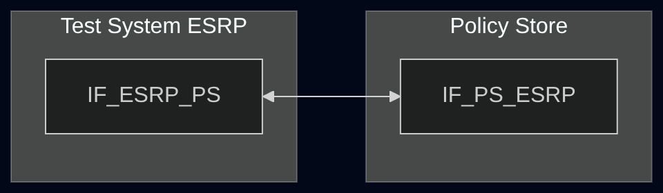
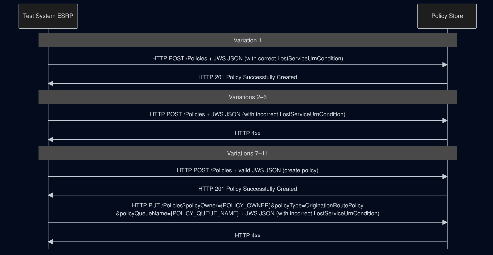

# Test Description: TD_PS_016

## Overview

### Summary
LostServiceUrnCondition condition members validation.

### Description
Verify that the Policy Store validates the required members of `LostServiceUrnCondition` when storing or updating a Route Policy.

### References
- Requirements: RQ_PS_060
- Test Case: TC_PS_016

### Requirements
IXIT config file for Policy Store

### HTTP transport types
Use the HTTP transport configured for the Policy Store in IXIT. Steps for the supported types are marked as following:

- (TLS) - HTTPS, used by default inside ESInet
- (TCP) - plain HTTP only if supported and permitted by the IUT configuration

## Configuration

### Implementation Under Test Interface Connections
* Policy Store (PS)
  * IF_PS_ESRP - connected to Test System ESRP IF_ESRP_PS
* Test System ESRP
  * IF_ESRP_PS - connected to Policy Store IF_PS_ESRP

### Interface Modes
* Policy Store (PS)
  * IF_PS_ESRP - Active
* Test System ESRP
  * IF_ESRP_PS - Active

### Connectivity Diagram

<!--
https://mermaid.live/edit#pako:eNqFklFLwzAUhf9KuM8tOB-DCKIbDhTK4pNGRkxv27A0GUmq1rH_bpLaiXsxD4V7z8m5tx85gLQ1AoWyLLmR1jSqpdwQEjrskZJauF0qtbU7SqQW3iuZGo01YSV6pUdKONw4JXRB7lG_Y1BSFMQL40uPTjUcuMnpjbYfshMukIdNiiDED2-tE_uOLNmmeuHwhD4QNvqAfW5xeJ2M6axXi2hZr7ZJ2VbsJKKpz-IqFp2V1UqOhAXr8Czocgqq2PbPlFNQHEWuyvI6WbmBAlqnaqCN0B4L6NH1ItVwSHYOmRWHBCLzgmLqJ2hTewY3K7_0Jv0_fse4w16YZ2t7oMENcQtnh7Y77TTsaxHwTokI4NcSfwjdrR1MAHqRE4Ae4DMXY_weC_jKkYsCxBAsG42cL2OtIrnH6XXkRzJPWWblZ_TxG56SuQg
-->



## Pre-Test Conditions

### Test System ESRP
* Interfaces are connected to network
* Interfaces have configured IP addresses
* ng911 repository cloned to local storage
* A valid PCA-signed Test System certificate and matching private key (`test_system.crt`, `test_system.key`), together with the PCA CA certificate (`PCA.crt`), are available in the working directory used to run curl

### Policy Store (PS)
* Interfaces are connected to network
* Interfaces have configured IP addresses
* Default configuration is loaded
* IUT is initialized with steps from IXIT config file
* Device is in normal operating state

## Test Sequence

### Test Preamble
#### Test System ESRP
* Install Wireshark[^1]
* (TLS v1.2) Configure Wireshark to decode HTTP over TLS where the negotiated session permits it[^2]
* (TLS v1.3) Configure session-key logging and Wireshark TLS decryption[^3]
* Using Wireshark on Test System ESRP, start packet tracing on IF_ESRP_PS:
  * (TLS)
    > ip.addr == IF_ESRP_PS_IP_ADDRESS and tls
  * (TCP)
    > ip.addr == IF_ESRP_PS_IP_ADDRESS and http
* Prepare `OriginationRoutePolicy` JSON using the file `Policy_object_OriginationRoutePolicy_LostServiceUrnCondition.json`
  * Set `policyOwner` to an authorized FQDN or URI containing a FQDN e.g. `agency.test.example`. Chosen value will be used later in this procedure in placed marked with `{POLICY_OWNER}`
  * Set `policyQueueName` SIP URI e.g. `sip:queue1@esrp.test.example`. Chosen value will be used later in this procedure in placed marked with `{POLICY_QUEUE_NAME}`
  * Set `policyRules_0_actions_0_recipientUri` SIP URI e.g. `sip:chfe@psap.test.example`
  * save the valid baseline as a temporary working file `policy1.json`.
* (Variations 2-11) Make copy of `policy1.json` save as e.g. `policy2.json`
* (Variations 2-11) Edit JSON members and values within `policy2.json` depending on the current variation (check Variations section)
* Generate JWS files `jws1.json` from `policy1.json`, and `jws2.json` from `policy2.json` e.g.:

  ```
  python3 -m main generate_jws policy1.json --cert test_system.crt --key test_system.key --output_file jws1.json
  ```

* Check the signed JWS for the intended condition values. Use a test policy identity that is not already stored. For each of Variations 7–11, use a separate unused identity and keep it the same in the valid and invalid JWS files and in the PUT request parameters.

### Test Body

#### Variations

1. HTTP POST with a correct `LostServiceUrnCondition`. Use values:

```
"policyRules_0_conditions_0_conditionType": "LostServiceUrnCondition",
"policyRules_0_conditions_0_urn": "urn:service:sos",
```

2. HTTP POST with `LostServiceUrnCondition` missing `urn`. Remove the `urn` member; keep:

```
"policyRules_0_conditions_0_conditionType": "LostServiceUrnCondition",
```

3. HTTP POST with `LostServiceUrnCondition` containing `urn` with integer value. Use values:

```
"policyRules_0_conditions_0_conditionType": "LostServiceUrnCondition",
"policyRules_0_conditions_0_urn": 1,
```

4. HTTP POST with `urn` set to a string that is not a correct Service URN (`urn:servicee:sos`). Use values:

```
"policyRules_0_conditions_0_conditionType": "LostServiceUrnCondition",
"policyRules_0_conditions_0_urn": "urn:servicee:sos",
```

5. HTTP POST with `urn` set to a string that is not a correct Service URN (`urn:emergencyy:service:sos`). Use values:

```
"policyRules_0_conditions_0_conditionType": "LostServiceUrnCondition",
"policyRules_0_conditions_0_urn": "urn:emergencyy:service:sos",
```

6. HTTP POST with two `LostServiceUrnCondition` objects; the second is missing `urn`. Remove the second `urn` member; use:

```
"policyRules_0_conditions_0_conditionType": "LostServiceUrnCondition",
"policyRules_0_conditions_0_urn": "urn:service:sos",
"policyRules_0_conditions_1_conditionType": "LostServiceUrnCondition",
```

7. HTTP PUT with `LostServiceUrnCondition` missing `urn`. Remove the `urn` member; keep:

```
"policyRules_0_conditions_0_conditionType": "LostServiceUrnCondition",
```

8. HTTP PUT with `LostServiceUrnCondition` containing `urn` with integer value. Use values:

```
"policyRules_0_conditions_0_conditionType": "LostServiceUrnCondition",
"policyRules_0_conditions_0_urn": 1,
```

9. HTTP PUT with `urn` set to a string that is not a correct Service URN (`urn:servicee:sos`). Use values:

```
"policyRules_0_conditions_0_conditionType": "LostServiceUrnCondition",
"policyRules_0_conditions_0_urn": "urn:servicee:sos",
```

10. HTTP PUT with `urn` set to a string that is not a correct Service URN (`urn:emergencyy:service:sos`). Use values:

```
"policyRules_0_conditions_0_conditionType": "LostServiceUrnCondition",
"policyRules_0_conditions_0_urn": "urn:emergencyy:service:sos",
```

11. HTTP PUT with two `LostServiceUrnCondition` objects; the second is missing `urn`. Remove the second `urn` member; use:

```
"policyRules_0_conditions_0_conditionType": "LostServiceUrnCondition",
"policyRules_0_conditions_0_urn": "urn:service:sos",
"policyRules_0_conditions_1_conditionType": "LostServiceUrnCondition",
```

#### Stimulus
Send HTTP request to the Policy Store `/Policies` entry point. Select the method, file and parameters for the variation:

* (Variation 1) {METHOD} = "POST", {FILE} = "@jws1.json", {REQUEST_PARAMS} = ""
* (Variations 2–6) {METHOD} = "POST", {FILE} = "@jws2.json", {REQUEST_PARAMS} = ""
* (Variations 7–11) Perform the following actions in order for each variation:
  1. Create the policy with a valid POST: {METHOD} = "POST", {FILE} = "@jws1.json", {REQUEST_PARAMS} = "". HTTP 201 is required to establish the policy before evaluating the PUT result.
  2. Send the invalid PUT: {METHOD} = "PUT", {FILE} = "@jws2.json", {REQUEST_PARAMS} = "?policyOwner={POLICY_OWNER}&policyType=OriginationRoutePolicy&policyQueueName={POLICY_QUEUE_NAME}"

For PUT, URL-encode the identity of the policy created by the successful POST, using the same `policyOwner`, `policyType` and `policyQueueName` in both requests.

* (TLSv1.2):

  `curl --cert test_system.crt --key test_system.key --cacert PCA.crt --tlsv1.2 --tls-max 1.2 -X {METHOD} "https://IF_PS_ESRP:PORT/Policies{REQUEST_PARAMS}" -H "Content-Type: application/json" --data-binary {FILE}`

* (TLSv1.3):

  `curl --cert test_system.crt --key test_system.key --cacert PCA.crt --tlsv1.3 -X {METHOD} "https://IF_PS_ESRP:PORT/Policies{REQUEST_PARAMS}" -H "Content-Type: application/json" --data-binary {FILE}`

* (TCP, only if permitted by IXIT):

  `curl -X {METHOD} "http://IF_PS_ESRP:PORT/Policies{REQUEST_PARAMS}" -H "Content-Type: application/json" --data-binary {FILE}`

#### Response
* (Variation 1) Policy Store responds with HTTP 201 Policy Successfully Created.
* (Variations 2–6) Policy Store rejects the invalid POST condition with HTTP 4xx; unrelated errors do not count.
* (Variations 7–11) After the valid POST returns HTTP 201, Policy Store rejects the invalid PUT condition with HTTP 4xx; unrelated errors do not count.

VERDICT:
* PASSED - if Policy Store responded as expected
* FAILED - any other cases

### Test Postamble
#### Test System ESRP
* Remove policies created by this test using HTTP DELETE. Use each policy's URL-encoded `policyOwner` and `policyQueueName`:
  * (TLSv1.2):

    `curl --cert test_system.crt --key test_system.key --cacert PCA.crt --tlsv1.2 --tls-max 1.2 -X DELETE "https://IF_PS_ESRP:PORT/Policies?policyOwner={POLICY_OWNER}&policyType=OriginationRoutePolicy&policyQueueName={POLICY_QUEUE_NAME}"`

  * (TLSv1.3):

    `curl --cert test_system.crt --key test_system.key --cacert PCA.crt --tlsv1.3 -X DELETE "https://IF_PS_ESRP:PORT/Policies?policyOwner={POLICY_OWNER}&policyType=OriginationRoutePolicy&policyQueueName={POLICY_QUEUE_NAME}"`

  * (TCP, only if permitted by IXIT):

    `curl -X DELETE "http://IF_PS_ESRP:PORT/Policies?policyOwner={POLICY_OWNER}&policyType=OriginationRoutePolicy&policyQueueName={POLICY_QUEUE_NAME}"`

* Stop Wireshark, archive the logs and disconnect test interfaces.

#### Policy Store
* Restore normal network connections and operating state.

## Post-Test Conditions
### Test System ESRP
* Test tools stopped
* Interfaces returned to their normal state

### Policy Store
* Device in normal operating state
* No test-created policies remain in the Policy Store; report any unverified cleanup separately

## Sequence Diagram

<!--
https://mermaid.live/edit#pako:eNqtVV1v2jAU_StXfpg2LWEkfBSitVPFqLqqhbSBVZsiVZ5zoVYTm9kOhSH---IEWLdOE1R7tO895x6f2CcrwmSCJCCu68aCSTHh0yAWAOYeMwwgoerBLlMpHwJgKdWaM7sxkcKc0YynywBicqo4TR04x3SOhjPqgKZCuxoVn8TE9mv8nqNgWJIDZFwpqU6ZkUoHMKGpxqpA7dbZgeQAQho8HJWh1nR6ILB0anucj5xOFc0quhlVBYDPqDDQj25CoBpGqA1ES20wK_eed4aR7QtlytkSouL0hRNV16A4FMg5qhLphFEAn2mhznApwKt6bMU9ObG189EohHAYjeBdycZRw1u4uI3gIhoO4PUjN_fApFLIDFxKbSJUc85wrERPioRb2jcVaxgVnJZ6w-rXvZ3CnLHCtkmepkvoKaQGk30Ea_Dd9ss0c_Ey1c3FYj9lR663r51zmvLkiUBWOgCz0pyXuvfXyeMngz9U_MNHgep4FQ4vP_W-3A1vB_2b9auqNFrO8Hio-JSL8lA3MjdYDd10XOeY44BmuCO4HvfH_bvB6VV__f6bOvmfvhOHTBVPSFA-bYdkqDJq12RlMTEp8yUm9sEpTPKFa5PGZTKVKiZO1WNDp2rZBs-28it9qvq_3-wGtH2zFrKqlMfkaRDZQqV3W_0jjfYeZrG_R9JB0Ge5tA_agtexWBfWF7nyVcqMBEblhflK5tP73afIZ0lx6zbBtdtVKBJUPZkLQ4KG1ylJSLAiCxK4Tb_W8Pxu1_c7fqPVanZbDlmSwOvU2m2_2fA9r33UbLaaa4f8KOfWa12_0-rW_Uan3i0augUfzY2MloJtVWFxh6S6qn4_5V9oq61fVjbS1j8B8MoqPw
-->



## Comments

Version: 010.3f.5.0.0

Date: 20261028

## Footnotes

[^1]: Wireshark - tool for packet tracing and analysis. Official website: https://www.wireshark.org/download.html
[^2]: Wireshark TLS decryption documentation: https://wiki.wireshark.org/TLS/
[^3]: TLS session-key logging and Wireshark configuration: https://wiki.wireshark.org/TLS/
