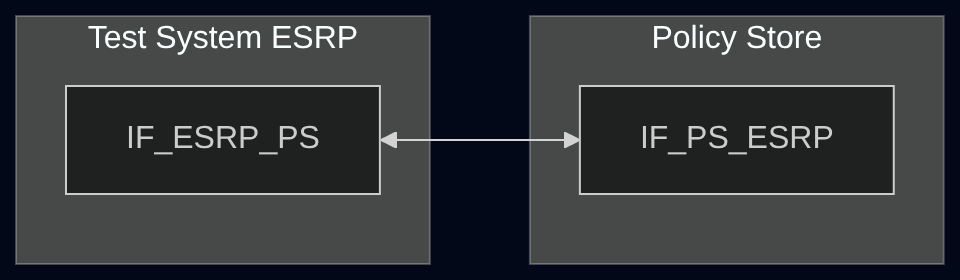
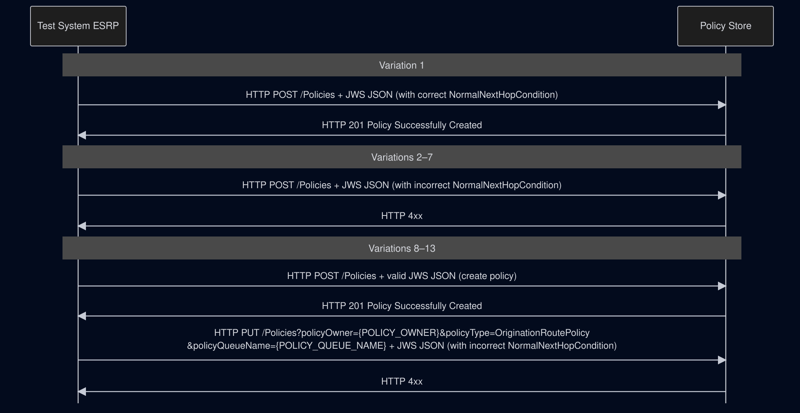

# Test Description: TD_PS_017

## Overview

### Summary
NormalNextHopCondition members validation.

### Description
Verify that the Policy Store validates the required members of `NormalNextHopCondition` when storing or updating a Route Policy.

### References
- Requirements: RQ_PS_070
- Test Case: TC_PS_017

### Requirements
IXIT config file for Policy Store

### HTTP transport types
Use the HTTP transport configured for the Policy Store in IXIT. Steps for the supported types are marked as following:

- (TLS) - HTTPS, used by default inside ESInet
- (TCP) - plain HTTP only if supported and permitted by the IUT configuration

## Configuration

### Implementation Under Test Interface Connections
* Policy Store (PS)
  * IF_PS_ESRP - connected to Test System ESRP IF_ESRP_PS
* Test System ESRP
  * IF_ESRP_PS - connected to Policy Store IF_PS_ESRP

### Interface Modes
* Policy Store (PS)
  * IF_PS_ESRP - Active
* Test System ESRP
  * IF_ESRP_PS - Active

### Connectivity Diagram

<!--
https://mermaid.live/edit#pako:eNqFklFLwzAUhf9KuM8tOB-DCKIbDhTK4pNGRkxv27A0GUmq1rH_bpLaiXsxD4V7z8m5tx85gLQ1AoWyLLmR1jSqpdwQEjrskZJauF0qtbU7SqQW3iuZGo01YSV6pUdKONw4JXRB7lG_Y1BSFMQL40uPTjUcuMnpjbYfshMukIdNiiDED2-tE_uOLNmmeuHwhD4QNvqAfW5xeJ2M6axXi2hZr7ZJ2VbsJKKpz-IqFp2V1UqOhAXr8Czocgqq2PbPlFNQHEWuyvI6WbmBAlqnaqCN0B4L6NH1ItVwSHYOmRWHBCLzgmLqJ2hTewY3K7_0Jv0_fse4w16YZ2t7oMENcQtnh7Y77TTsaxHwTokI4NcSfwjdrR1MAHqRE4Ae4DMXY_weC_jKkYsCxBAsG42cL2OtIrnH6XXkRzJPWWblZ_TxG56SuQg
-->



## Pre-Test Conditions

### Test System ESRP
* Interfaces are connected to network
* Interfaces have configured IP addresses
* ng911 repository cloned to local storage
* A valid PCA-signed Test System certificate and matching private key (`test_system.crt`, `test_system.key`), together with the PCA CA certificate (`PCA.crt`), are available in the working directory used to run curl

### Policy Store (PS)
* Interfaces are connected to network
* Interfaces have configured IP addresses
* Default configuration is loaded
* IUT is initialized with steps from IXIT config file
* Device is in normal operating state

## Test Sequence

### Test Preamble
#### Test System ESRP
* Install Wireshark[^1]
* (TLS v1.2) Configure Wireshark to decode HTTP over TLS where the negotiated session permits it[^2]
* (TLS v1.3) Configure session-key logging and Wireshark TLS decryption[^3]
* Using Wireshark on Test System ESRP, start packet tracing on IF_ESRP_PS:
  * (TLS)
    > ip.addr == IF_ESRP_PS_IP_ADDRESS and tls
  * (TCP)
    > ip.addr == IF_ESRP_PS_IP_ADDRESS and http
* Prepare `OriginationRoutePolicy` JSON using the file `Policy_object_OriginationRoutePolicy_NormalNextHopCondition.json`
  * Set `policyOwner` to an authorized FQDN or URI containing a FQDN e.g. `agency.test.example`. Chosen value will be used later in this procedure in placed marked with `{POLICY_OWNER}`
  * Set `policyQueueName` SIP URI e.g. `sip:queue1@esrp.test.example`. Chosen value will be used later in this procedure in placed marked with `{POLICY_QUEUE_NAME}`
  * Set `policyRules_0_actions_0_recipientUri` SIP URI e.g. `sip:chfe@psap.test.example`
  * save the valid baseline as a temporary working file `policy1.json`.
* (Variations 2-13) Make copy of `policy1.json` save as e.g. `policy2.json`
* (Variations 2-13) Edit JSON members and values within `policy2.json` depending on the current variation (check Variations section)
* Generate JWS files `jws1.json` from `policy1.json`, and `jws2.json` from `policy2.json` e.g.:

  ```
  python3 -m main generate_jws policy1.json --cert test_system.crt --key test_system.key --output_file jws1.json
  ```

* Check the signed JWS for the intended condition values. Use a test policy identity that is not already stored. For each of Variations 8–13, use a separate unused identity and keep it the same in the valid and invalid JWS files and in the PUT request parameters.


### Test Body

#### Variations

1. HTTP POST with a correct `NormalNextHopCondition`. Use values:

```
"policyRules_0_conditions_0_conditionType": "NormalNextHopCondition",
"policyRules_0_conditions_0_operator": "EQ",
"policyRules_0_conditions_0_content": "sip:chfe@ng911.test",
```

2. HTTP POST with `NormalNextHopCondition` missing `operator`. Remove `operator`; use:

```
"policyRules_0_conditions_0_conditionType": "NormalNextHopCondition",
"policyRules_0_conditions_0_content": "sip:chfe@ng911.test",
```

3. HTTP POST with `NormalNextHopCondition` containing `operator` with integer value. Use values:

```
"policyRules_0_conditions_0_conditionType": "NormalNextHopCondition",
"policyRules_0_conditions_0_operator": 1,
"policyRules_0_conditions_0_content": "sip:chfe@ng911.test",
```

4. HTTP POST with unsupported `operator`. Use values:

```
"policyRules_0_conditions_0_conditionType": "NormalNextHopCondition",
"policyRules_0_conditions_0_operator": "EQQ",
"policyRules_0_conditions_0_content": "sip:chfe@ng911.test",
```

5. HTTP POST with `NormalNextHopCondition` missing `content`. Remove `content`; use:

```
"policyRules_0_conditions_0_conditionType": "NormalNextHopCondition",
"policyRules_0_conditions_0_operator": "EQ",
```

6. HTTP POST with `NormalNextHopCondition` containing `content` with integer value. Use values:

```
"policyRules_0_conditions_0_conditionType": "NormalNextHopCondition",
"policyRules_0_conditions_0_operator": "EQ",
"policyRules_0_conditions_0_content": 1,
```

7. HTTP POST with two `NormalNextHopCondition` objects; the second is missing `content`. Remove the second `content` member; use values:

```
"policyRules_0_conditions_0_conditionType": "NormalNextHopCondition",
"policyRules_0_conditions_0_operator": "EQ",
"policyRules_0_conditions_0_content": "sip:chfe@ng911.test",
"policyRules_0_conditions_1_conditionType": "NormalNextHopCondition",
"policyRules_0_conditions_1_operator": "EQ",
```

8. HTTP PUT with `NormalNextHopCondition` missing `operator`. Remove `operator`; use:

```
"policyRules_0_conditions_0_conditionType": "NormalNextHopCondition",
"policyRules_0_conditions_0_content": "sip:chfe@ng911.test",
```

9. HTTP PUT with `NormalNextHopCondition` containing `operator` with integer value. Use values:

```
"policyRules_0_conditions_0_conditionType": "NormalNextHopCondition",
"policyRules_0_conditions_0_operator": 1,
"policyRules_0_conditions_0_content": "sip:chfe@ng911.test",
```

10. HTTP PUT with unsupported `operator`. Use values:

```
"policyRules_0_conditions_0_conditionType": "NormalNextHopCondition",
"policyRules_0_conditions_0_operator": "EQQ",
"policyRules_0_conditions_0_content": "sip:chfe@ng911.test",
```

11. HTTP PUT with `NormalNextHopCondition` missing `content`. Remove `content`; use:

```
"policyRules_0_conditions_0_conditionType": "NormalNextHopCondition",
"policyRules_0_conditions_0_operator": "EQ",
```

12. HTTP PUT with `NormalNextHopCondition` containing `content` with integer value. Use values:

```
"policyRules_0_conditions_0_conditionType": "NormalNextHopCondition",
"policyRules_0_conditions_0_operator": "EQ",
"policyRules_0_conditions_0_content": 1,
```

13. HTTP PUT with two `NormalNextHopCondition` objects; the second is missing `content`. Remove the second `content` member; use values:

```
"policyRules_0_conditions_0_conditionType": "NormalNextHopCondition",
"policyRules_0_conditions_0_operator": "EQ",
"policyRules_0_conditions_0_content": "sip:chfe@ng911.test",
"policyRules_0_conditions_1_conditionType": "NormalNextHopCondition",
"policyRules_0_conditions_1_operator": "EQ",
```


#### Stimulus
Send HTTP request to the Policy Store `/Policies` entry point. Select the method, file and parameters for the variation:

* (Variation 1) {METHOD} = "POST", {FILE} = "@jws1.json", {REQUEST_PARAMS} = ""
* (Variations 2–7) {METHOD} = "POST", {FILE} = "@jws2.json", {REQUEST_PARAMS} = ""
* (Variations 8–13) Perform the following actions in order for each variation:
  1. Create the policy with a valid POST: {METHOD} = "POST", {FILE} = "@jws1.json", {REQUEST_PARAMS} = "". HTTP 201 is required to establish the policy before evaluating the PUT result.
  2. Send the invalid PUT: {METHOD} = "PUT", {FILE} = "@jws2.json", {REQUEST_PARAMS} = "?policyOwner={POLICY_OWNER}&policyType=OriginationRoutePolicy&policyQueueName={POLICY_QUEUE_NAME}"

For PUT, URL-encode the identity of the policy created by the successful POST, using the same `policyOwner`, `policyType` and `policyQueueName` in both requests.

* (TLSv1.2):

  `curl --cert test_system.crt --key test_system.key --cacert PCA.crt --tlsv1.2 --tls-max 1.2 -X {METHOD} "https://IF_PS_ESRP:PORT/Policies{REQUEST_PARAMS}" -H "Content-Type: application/json" --data-binary {FILE}`

* (TLSv1.3):

  `curl --cert test_system.crt --key test_system.key --cacert PCA.crt --tlsv1.3 -X {METHOD} "https://IF_PS_ESRP:PORT/Policies{REQUEST_PARAMS}" -H "Content-Type: application/json" --data-binary {FILE}`

* (TCP, only if permitted by IXIT):

  `curl -X {METHOD} "http://IF_PS_ESRP:PORT/Policies{REQUEST_PARAMS}" -H "Content-Type: application/json" --data-binary {FILE}`

#### Response
* (Variation 1) Policy Store responds with HTTP 201 Policy Successfully Created.
* (Variations 2–7) Policy Store rejects the invalid POST condition with HTTP 4xx; unrelated errors do not count.
* (Variations 8–13) After the valid POST returns HTTP 201, Policy Store rejects the invalid PUT condition with HTTP 4xx; unrelated errors do not count.

VERDICT:
* PASSED - if Policy Store responded as expected
* FAILED - any other cases

### Test Postamble
#### Test System ESRP
* Remove policies created by this test using HTTP DELETE. Use each policy's URL-encoded `policyOwner` and `policyQueueName`:
  * (TLSv1.2):

    `curl --cert test_system.crt --key test_system.key --cacert PCA.crt --tlsv1.2 --tls-max 1.2 -X DELETE "https://IF_PS_ESRP:PORT/Policies?policyOwner={POLICY_OWNER}&policyType=OriginationRoutePolicy&policyQueueName={POLICY_QUEUE_NAME}"`

  * (TLSv1.3):

    `curl --cert test_system.crt --key test_system.key --cacert PCA.crt --tlsv1.3 -X DELETE "https://IF_PS_ESRP:PORT/Policies?policyOwner={POLICY_OWNER}&policyType=OriginationRoutePolicy&policyQueueName={POLICY_QUEUE_NAME}"`

  * (TCP, only if permitted by IXIT):

    `curl -X DELETE "http://IF_PS_ESRP:PORT/Policies?policyOwner={POLICY_OWNER}&policyType=OriginationRoutePolicy&policyQueueName={POLICY_QUEUE_NAME}"`

* Stop Wireshark, archive the logs and disconnect test interfaces.

#### Policy Store
* Restore normal network connections and operating state.

## Post-Test Conditions
### Test System ESRP
* Test tools stopped
* Interfaces returned to their normal state

### Policy Store
* Device in normal operating state
* No test-created policies remain in the Policy Store; report any unverified cleanup separately

## Sequence Diagram

<!--
https://mermaid.live/edit#pako:eNqtVWFv0zAU_CtP_oBAJKNJ062N2NA0isbE2mzpmECRJuO8dtYSu9jO1lL1v2MnbRkMoXbio33v7p1f7MuCMJkjiYnv-5lgUoz5JM4EgLnFEmPIqbpzy0LKuxhYQbXmzG2MpTAfaMmLeQwZOVacFh6cYnGPhjPqgaZC-xoVH2fE1Wv8XqFgWIsDlFwpqY6ZkUrHMKaFxgagbuvDjuIAQhrcnVWi1nSyI7Ge1Po47zmdKFo2clOqLIFPqTDQTy8ToBpGqA2kc22wrPeeViapq0tkwdkcUnt6O4mmamAPBfIeVc30kjSGz9S6M1wKCJoah_hHRw47HY0SSIbpCN7Uahw1vIaz6xTO0uEAXj5wcwtMKoXMWG1V0mKAM3MqpydS5NypvmpEk9RKOuWVaNgKNgYrxuzUxlVRzOFEITWYb-NXQ-gfPM8yF88yHc1m2xnr-kF7S2f3tOD5I3-sHgBM69k8d3h_7Xz1qPG7Rn_4IFAdLpLhp48nX26G14P-5fJFA43mUzwcKj7hoj7UpawMNk1XFRcVVjigJW4ELq76V_2bwfF5f_n2mzr6j2MnHpkonpO4ftceKdHy3ZosHCcjdbhkxL02hXk1813M-EwWUmXEa2pc4jQl69RZI7-ip8H__WBXpPWDdZRF4zwjj1PIAY3fNfpHFG3dzHF_z6OdqE9CaRu2Iy8zsbSjt6HyVcqSxEZVdvhKVpPbzaeoprm9dKvU2uwqFDmqE1kJQ-Io6NQiJF6QGYn9KNxrB2GvF4bdsN3pRD0Lz0kcdPf298OoHQbB_kEUdaKlR37UfVt7vbDb6bXCdrfVswW9rkdoZWQ6F2ztCu0dkuq8-ffUv6C1t36NrKwtfwLXeijW
-->



## Comments

Version: 010.3f.5.0.0

Date: 20261018

## Footnotes

[^1]: Wireshark - tool for packet tracing and analysis. Official website: https://www.wireshark.org/download.html

[^2]: Wireshark TLS decryption documentation: https://wiki.wireshark.org/TLS/

[^3]: TLS session-key logging and Wireshark configuration: https://wiki.wireshark.org/TLS/
